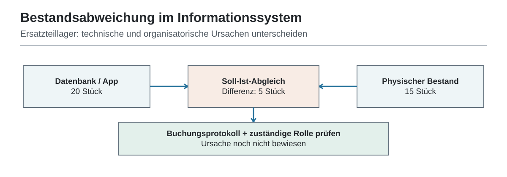

# M1-L1 – Soziotechnische Informationssysteme {#L1}

**Kursbereich:** M1 – Informationssysteme

**Niveau:** Bachelor · Kern/Grundlagen

**Vorwissen:** Schulmathematik und Computergrundlagen.

**Lernziel:** Bestandsabweichungen im Zusammenspiel von Menschen, Regeln, Daten und Technik analysieren.

## Einstieg und Grundbegriffe {#S1}

Ein Informationssystem besteht nicht nur aus Software. Personen, Rollen, Regeln, Daten und technische Komponenten bilden gemeinsam ein System, das Aufgaben einer Organisation unterstützt. Die Systemgrenze legt fest, welche Elemente analysiert werden und welche Umweltbedingungen als gegeben gelten. Eine technische Funktion ist nur dann nützlich, wenn sie in den realen Arbeitsablauf passt. Anforderungen müssen deshalb sowohl die sachliche Aufgabe als auch die Verantwortlichkeiten beschreiben.

## Begriffszusammenhang {#S2}

*Abbildung: Bestands-App meldet 20 Stück, physische Zählung ergibt 15. Fünf Stück Differenz müssen vor einer Korrektur anhand der Buchungen untersucht werden.*

## Beispiel und Anwendung {#S3}

Ein Ersatzteillager führt eine Bestands-App ein. Die App zeigt 20 Stück, tatsächlich sind 15 vorhanden. Die Ursache kann eine nicht erfasste Entnahme sein, nicht ein Rechenfehler. Eine Abhilfe verbindet Buchungsregel, Scanvorgang und Bestandsabgleich.

Der Abgleich weist zunächst nur eine Differenz von fünf Stück aus. Die Erfassung muss für beide Bestände auf denselben Stichtag und dieselbe Artikelkennung bezogen werden. Erst dann können etwa verspätete Buchungen oder Zählfehler untersucht werden.

## Selbstkontrolle {#S4}

### Aufgabe

Welche Systemelemente müssen bei der Fehlersuche berücksichtigt werden?

::: {.lc-solutions data-lc-section="S4"}
Physischer Bestand, Buchungsvorgang, zuständige Rolle und Datenbank; zusätzlich die Zeitpunkte der Erfassung. Eine reine App-Korrektur genügt nicht.
:::

## Weiterführung {#S5}

[M1-L2](M1-L2.md)

## Quellen und Vertiefung {#S6}

- [Universität Münster – Aufbau des Wirtschaftsinformatikstudiums (B.Sc.)](https://www.wi.uni-muenster.de/de/studieninteressierte/unsere-studiengaenge/bachelor-science-wirtschaftsinformatik/aufbau-des) · Studienprofil; curricularer Kontext, kein Einzelnachweis der Fachdetails · Zuletzt abgerufen: 2026-11-25
- [OpenStax – Foundations of Information Systems, 1.1 Introduction to Information Systems](https://openstax.org/books/foundations-information-systems/pages/1-1-introduction-to-information-systems) · Komponenten, Rollen, Verfahren und Typen von Informationssystemen · Zuletzt abgerufen: 2026-11-25
