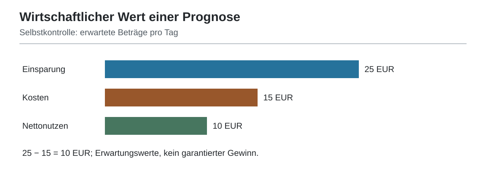

# M1-L2 – Information, Entscheidung und Wert {#L2}

**Kursbereich:** M1 – Informationssysteme

**Niveau:** Bachelor · Kern/Grundlagen

**Vorwissen:** [M1-L1](M1-L1.md)

**Lernziel:** Den erwarteten Nettonutzen einer Prognose berechnen und ihre Entscheidungsrelevanz beurteilen.

## Einstieg und Grundbegriffe {#S1}

Daten sind aufgezeichnete Werte; Information entsteht durch ihre Interpretation in einem Kontext. Eine Entscheidung setzt Handlungsalternativen und ein Ziel voraus. Der Wert einer Information hängt davon ab, ob sie die Wahl zwischen Alternativen verbessert, und nicht bloß von ihrer Genauigkeit. Transaktionssysteme erfassen Geschäftsvorfälle, analytische Systeme verdichten sie für Entscheidungen.

## Begriffszusammenhang {#S2}

*Abbildung: Prognose spart erwartete 25 Euro pro Tag, kostet 15 Euro pro Tag und ergibt einen erwarteten Nettonutzen von 10 Euro pro Tag.*

## Beispiel und Anwendung {#S3}

Eine Filiale bestellt täglich 100 Einheiten. Die Nachfrage schwankt zwischen 70 und 130. Eine Prognose ist dann wirtschaftlich sinnvoll, wenn ihr erwarteter Nutzen durch weniger Fehlmengen und Überschüsse die Kosten der Prognose übersteigt.

### Vertiefung und Modellgrenzen

Ein Informationssystem ist nicht mit einem Softwareprodukt gleichzusetzen. Unterscheide den beobachteten realen Vorgang, seine Repräsentation als Daten und die organisatorische Regel, welche Aktionen aus den Daten folgen. Für jeden Übergang ist ein Verantwortlicher sowie eine Fehlerbehandlung zu bestimmen.

Die Prognose ist mit einer Baseline zu vergleichen, etwa der bisherigen festen Bestellmenge. Die erwarteten Einsparungen müssen auf derselben Nachfrageverteilung beruhen wie die Baseline; bei unsicheren Kosten sind Sensitivitätsanalysen sinnvoll.

## Selbstkontrolle {#S4}

### Aufgabe

Eine Prognose spart im Mittel 25 Euro täglich und kostet 15 Euro. Wie hoch ist der erwartete Nettonutzen pro Tag?

### Modul-Fallstudie

Ein Lager zählt 50 Stück physisch; die Datenbank meldet 57. Zwei noch nicht verbuchte Entnahmen von je 3 Stück sind dokumentiert. Leite die erwartete Menge nach Buchung ab. Entwirf eine Kontrollregel und benenne einen verbleibenden offenen Befund.

::: {.lc-solutions data-lc-section="S4"}
10 Euro. Die Rechnung setzt voraus, dass die eingesparten Kosten und Prognosekosten vollständig erfasst sind.

**Lösung der Fallstudie:** 57 − 6 = 51. Die Differenz von einem Stück bleibt ungeklärt; sie darf nicht durch eine erfundene Buchung verschwinden. Dokumentierte Entnahmen mit eindeutiger Ereignis-ID genau einmal buchen, danach Soll-Ist-Abgleich durchführen und die Restdifferenz zur Klärung melden. Die Rolle des Freigebenden von der buchenden Rolle trennen, wenn das Risiko dies rechtfertigt.

:::

## Weiterführung {#S5}

[M2-L1](M2-L1.md)

## Quellen und Vertiefung {#S6}

- [Universität Münster – Aufbau des Wirtschaftsinformatikstudiums (B.Sc.)](https://www.wi.uni-muenster.de/de/studieninteressierte/unsere-studiengaenge/bachelor-science-wirtschaftsinformatik/aufbau-des) · Studienprofil; curricularer Kontext, kein Einzelnachweis der Fachdetails · Zuletzt abgerufen: 2026-11-25
- [OpenStax – Foundations of Information Systems, 1.1 Introduction to Information Systems](https://openstax.org/books/foundations-information-systems/pages/1-1-introduction-to-information-systems) · Komponenten, Rollen, Verfahren und Typen von Informationssystemen · Zuletzt abgerufen: 2026-11-25
- [National Research Council – Environmental Decisions in the Face of Uncertainty, chapter 5](https://www.nationalacademies.org/read/12568/chapter/7) · Informationswert bei Entscheidungen unter Unsicherheit; kein Nachweis der fiktiven Bestandsdaten · Zuletzt abgerufen: 2026-11-25
