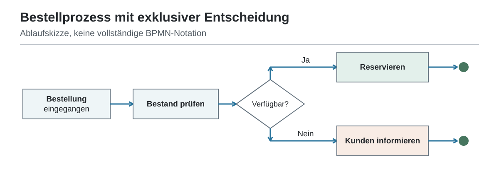

# M10-L1 – Prozessmodellierung und BPMN {#L1}

**Kursbereich:** M10 – Geschäftsprozessmanagement

**Niveau:** Bachelor · Kern/Grundlagen

**Vorwissen:** [M9-L2](M9-L2.md)

**Lernziel:** Exklusive und parallele Entscheidungen in einem Geschäftsprozess unterscheiden und modellieren.

## Einstieg und Grundbegriffe {#S1}

Ein Geschäftsprozess verbindet Ereignisse, Aktivitäten, Entscheidungen und Verantwortliche zu einem Ergebnis für interne oder externe Kunden. BPMN bietet eine standardisierte grafische Notation. Ereignisse markieren Prozesszustände, Aktivitäten beschreiben Arbeit, Gateways steuern Verzweigungen oder Zusammenführungen. Sequenzflüsse ordnen Aktivitäten innerhalb eines Prozesses; Nachrichtenflüsse beschreiben Kommunikation zwischen Teilnehmern.

## Begriffszusammenhang {#S2}

*Abbildung: Bestellung, Bestandsprüfung, genau ein Alternativpfad: reservieren oder Kunden informieren.*

## Beispiel und Anwendung {#S3}

Bestellung eingegangen → Bestand prüfen → Entscheidung verfügbar? → bei Ja reservieren, bei Nein Kunden informieren. Beide Pfade enden in einem definierten Abschluss. Verantwortlichkeiten können als Lanes dargestellt werden.

Das Beispiel verwendet eine gegenseitig ausschließende und vollständige Ja/Nein-Bedingung. Bei mehreren möglichen Bedingungen muss das Modell auch den Fall ohne passende Bedingung berücksichtigen.

Ein exklusiver Zusammenführungspunkt synchronisiert keine parallelen Zweige. Ein paralleler Split aktiviert alle ausgehenden Pfade; ein passender paralleler Join wartet im einfachen strukturierten Modell auf alle eingehenden Pfade. Das bedeutet keine Garantie für gleichzeitig laufende Threads. Ein Default-Pfad ist ausdrücklich zu modellieren, nicht bloß durch eine fehlende Bedingung.

## Selbstkontrolle {#S4}

### Aufgabe

Wann ist ein paralleles Gateway anstelle eines exklusiven Gateways sinnvoll?

::: {.lc-solutions data-lc-section="S4"}
Wenn mehrere Pfade ausgeführt werden sollen, beispielsweise Rechnung erstellen und Verpackung vorbereiten. Ein exklusives Gateway wählt einen alternativen Pfad anhand von Bedingungen.
:::

## Weiterführung {#S5}

[M10-L2](M10-L2.md)

## Quellen und Vertiefung {#S6}

- [Object Management Group – Business Process Model & Notation](https://www.omg.org/bpmn/) · Grafische Prozessnotation und Anwendungsbereich; Detailsemantik noch zu prüfen · Zuletzt abgerufen: 2026-11-25
- [OMG – BPMN 2.0.2](https://www.omg.org/spec/BPMN/2.0.2) · Normativer Spezifikationseinstieg; Normtext nicht vollständig ausgewertet · Zuletzt abgerufen: 2026-11-25
- [Camunda 8 Docs – Exclusive gateway](https://docs.camunda.io/docs/components/modeler/bpmn/exclusive-gateways/) · XOR-Verzweigung, Default und Zusammenführung; Implementierungsdokumentation · Zuletzt abgerufen: 2026-11-25
- [Camunda 8 Docs – Parallel gateway](https://docs.camunda.io/docs/components/modeler/bpmn/parallel-gateways/) · Parallele Verzweigung und Synchronisation; Implementierungsdokumentation · Zuletzt abgerufen: 2026-11-25
