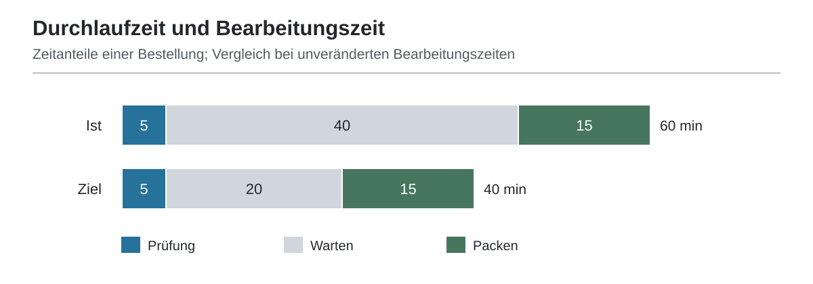

# M10-L2 – Prozessleistung und Automatisierung {#L2}

**Kursbereich:** M10 – Geschäftsprozessmanagement

**Niveau:** Bachelor · Kern/Grundlagen

**Vorwissen:** [M10-L1](M10-L1.md)

**Lernziel:** Prozessdurchlaufzeit mit Bestands- und Durchsatzdaten bestimmen und Automatisierungsprioritäten begründen.

## Einstieg und Grundbegriffe {#S1}

Durchlaufzeit misst die Dauer von definiertem Start bis Ende, Bearbeitungszeit nur aktive Arbeit. Wartezeiten, Übergaben und Nacharbeit können die Differenz erklären. Automatisierung verändert den Prozess und kann Fehler schneller verbreiten, wenn Daten oder Regeln ungeeignet sind. Ein Sollprozess braucht deshalb Ausnahmen, Verantwortlichkeiten und geeignete Erfolgsmaße.

## Begriffszusammenhang {#S2}

*Abbildung: 60 Minuten insgesamt: 5 prüfen, 40 warten, 15 verpacken; nach Halbierung der Wartezeit 40 Minuten.*

## Beispiel und Anwendung {#S3}

Eine Bestellung benötigt 5 Minuten Prüfung, 40 Minuten Wartezeit und 15 Minuten Verpackung. Durchlaufzeit 60 Minuten, Bearbeitungszeit 20 Minuten. Eine Halbierung der Wartezeit reduziert die Durchlaufzeit auf 40 Minuten, wenn sonst alles gleich bleibt.

### Vertiefung und Modellgrenzen

Prozesskennzahlen benötigen Start, Ende, Einheit und Population. In einem stabilen System verknüpft Little's Law mittleren Bestand L, mittlere Durchsatzrate λ und mittlere Verweilzeit W über L=λW. Der Zusammenhang sagt allein nicht, wie sich eine Intervention auf den Durchsatz auswirkt.

Für ein endliches Beobachtungsfenster, das mit leerem System beginnt und endet, lässt sich L exakt aus der Summe der Verweilzeiten geteilt durch die Fensterdauer bestimmen. Bei Restbestand am Rand müssen angeschnittene Aufenthalte berücksichtigt werden; allein die abgeschlossenen Fälle auszuwerten kann die Schätzung verzerren.

## Selbstkontrolle {#S4}

### Aufgabe

Warum kann die Optimierung der Verpackungszeit um zwei Minuten eine schlechte Priorität sein?

### Modul-Fallstudie

Ein Auftragsprozess hat langfristig 18 gleichzeitig offene Fälle und erledigt sechs Fälle pro Stunde. Schätze W. Ein Team möchte W bei unverändertem Durchsatz halbieren. Welches mittlere WIP wäre dafür erforderlich?

::: {.lc-solutions data-lc-section="S4"}
Die Wartezeit dominiert die Durchlaufzeit. Die tatsächliche Priorität hängt zusätzlich von Kosten, Fehlern, Abhängigkeiten und Kundenanforderungen ab.

**Lösung der Fallstudie:** W=18/6=3 Stunden. Ziel 1,5 Stunden, daher L=6·1,5=9 Fälle. Die Rechnung ist eine Zielbeziehung, keine Garantie, dass ein WIP-Limit den Durchsatz hält. Prüfe stabile Zu- und Abgänge, konsistente Fallgrenze und mögliche Verluste oder Rückstau außerhalb des Messfensters.

:::

## Weiterführung {#S5}

[M11-L1](M11-L1.md)

## Quellen und Vertiefung {#S6}

- [Universität Münster – Aufbau des Wirtschaftsinformatikstudiums (B.Sc.)](https://www.wi.uni-muenster.de/de/studieninteressierte/unsere-studiengaenge/bachelor-science-wirtschaftsinformatik/aufbau-des) · Studienprofil; curricularer Kontext, kein Einzelnachweis der Fachdetails · Zuletzt abgerufen: 2026-11-25
- [Alberto Lacort – Queueing theory](https://allabur.webs.upv.es/files/sheets/sheet-queueing-en.pdf?v=8ef34ff8aa) · Little-Gesetz und M/M/1-Formeln, S. 2; PDF-Text einsehbar, Screenshot-Abruf fehlgeschlagen · Zuletzt abgerufen: 2026-11-25
- [John D. C. Little – Little’s Law as Viewed on Its 50th Anniversary](https://projectproduction.org/journal/reprint-littles-law-as-viewed-on-its-50th-anniversary/) · Fachartikel, Abschnitte 2.1 und 4.2: endliches Fenster und Flusskennzahlen · Zuletzt abgerufen: 2026-11-25
