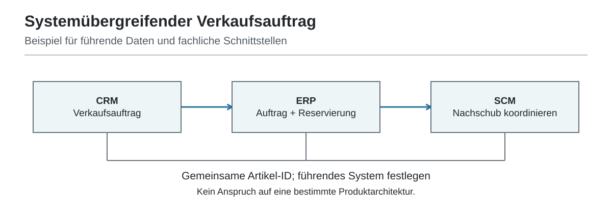

# M11-L1 – ERP, CRM und SCM {#L1}

**Kursbereich:** M11 – Betriebliche Anwendungssysteme

**Niveau:** Bachelor · Kern/Grundlagen

**Vorwissen:** [M10-L2](M10-L2.md)

**Lernziel:** ERP, CRM und SCM einem Verkaufsprozess zuordnen und die Verantwortung für Artikelstammdaten begründen.

## Einstieg und Grundbegriffe {#S1}

Enterprise Resource Planning integriert betriebliche Funktionen und gemeinsame Datenbestände, etwa Einkauf, Lager und Rechnungswesen. Customer Relationship Management unterstützt Kundenbeziehungen; Supply Chain Management koordiniert Material-, Informations- und gegebenenfalls Finanzflüsse über Organisationsgrenzen. Die Systeme überschneiden sich, benötigen jedoch konsistente Stammdaten, klare Zuständigkeiten und definierte Schnittstellen.

## Begriffszusammenhang {#S2}

*Abbildung: CRM-Verkaufsauftrag löst ERP-Auftrag und Reservierung aus; SCM koordiniert Nachschub anhand derselben Artikel-ID.*

## Beispiel und Anwendung {#S3}

Ein Verkaufsauftrag aus dem CRM erzeugt im ERP einen Auftrag und eine Bestandsreservierung. Ein SCM-System koordiniert Nachschub mit Lieferanten. Eine gemeinsame Artikelkennung verbindet die Informationen, ohne sämtliche Daten in allen Systemen zu duplizieren.

Eine einheitliche Artikel-ID stellt noch keine semantische Übereinstimmung sicher: Maßeinheit, Währung und Gültigkeitszeitraum müssen ebenfalls übereinstimmen. Bei einer Datenkorrektur ist festzulegen, welche historischen Belege unverändert bleiben.

## Selbstkontrolle {#S4}

### Aufgabe

Welches System sollte eine verbindliche Artikel-ID verwalten?

::: {.lc-solutions data-lc-section="S4"}
Das ist eine Architektur- und Governance-Entscheidung. Häufig ist ERP oder ein dediziertes Stammdatensystem führend; CRM und SCM verwenden die referenzierte ID.
:::

## Weiterführung {#S5}

[M11-L2](M11-L2.md)

## Quellen und Vertiefung {#S6}

- [Universität Münster – Aufbau des Wirtschaftsinformatikstudiums (B.Sc.)](https://www.wi.uni-muenster.de/de/studieninteressierte/unsere-studiengaenge/bachelor-science-wirtschaftsinformatik/aufbau-des) · Studienprofil; curricularer Kontext, kein Einzelnachweis der Fachdetails · Zuletzt abgerufen: 2026-11-25
- [IBM – What is ERP integration?](https://www.ibm.com/think/topics/erp-integration) · Praxisquelle zu Integration von ERP, CRM und SCM; Herstellerperspektive · Zuletzt abgerufen: 2026-11-25
