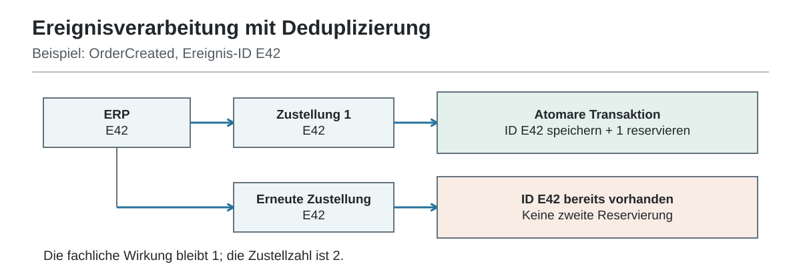

# M11-L2 – Integration, Schnittstellen und Stammdaten {#L2}

**Kursbereich:** M11 – Betriebliche Anwendungssysteme

**Niveau:** Bachelor · Kern/Grundlagen

**Vorwissen:** [M11-L1](M11-L1.md)

**Lernziel:** Ereignisse versionieren und Mehrfachverarbeitung durch konsistente Deduplizierung verhindern.

## Einstieg und Grundbegriffe {#S1}

Systemintegration überträgt Daten und löst organisationsübergreifende Prozesse aus. Synchrone Schnittstellen liefern eine Antwort im Aufruf; asynchrone Nachrichten entkoppeln Zeitpunkte und können gepuffert werden. Bei Wiederholungen sind Idempotenz, eindeutige Nachrichtenkennungen und nachvollziehbare Fehlerbehandlung wichtig. Stammdatenqualität erfordert definierte Regeln für Identifikation, Pflege und Konfliktauflösung.

## Begriffszusammenhang {#S2}

*Abbildung: Dieselbe Ereignis-ID wird zweimal geliefert; atomare Verarbeitung reserviert einmal und erkennt das Duplikat.*

## Beispiel und Anwendung {#S3}

Ein ERP sendet das Ereignis OrderCreated mit einer unveränderlichen Ereignis-ID. Das Lager verarbeitet es und speichert die ID zusammen mit dem Verarbeitungsergebnis. Trifft dieselbe Nachricht erneut ein, wird die Reservierung nicht dupliziert.

### Vertiefung und Modellgrenzen

Bei ereignisbasierter Integration können Nachrichten mehrfach, verspätet oder in abweichender Reihenfolge ankommen. Fachliche Ereignis-ID, Version, Quelle und Zeitbezug erleichtern die Verarbeitung. Stammdaten brauchen klare Eigentümerschaft; eine technische Kopie ist nicht automatisch führend.

Eine lokale Outbox kann die Änderung im ERP und das zu veröffentlichende Ereignis gemeinsam speichern. Der Versand erfolgt getrennt; Wiederholungen bleiben möglich. Auf Konsumentenseite müssen Ereignis-ID und Wirkung konsistent abgesichert werden. Das garantiert keine globale Exactly-once-Zustellung.

Die atomare Deduplizierung benötigt eine Eindeutigkeitsbedingung auf der Ereignis-ID im Geltungsbereich des Konsumenten. Ein bloßes vorheriges Nachschlagen ohne gemeinsame Transaktion kann bei konkurrierenden Aufrufen doppelte Wirkungen zulassen. Externe Wirkungen außerhalb der lokalen Transaktion brauchen eigene Wiederholungs- und Abgleichregeln.

## Selbstkontrolle {#S4}

### Aufgabe

Warum müssen Speicherung der Ereignis-ID und Reservierung gemeinsam abgesichert sein?

### Modul-Fallstudie

ERP sendet price_changed für Artikel A mit Version 8 und Preis 15, danach verspätet Version 7 mit Preis 12, danach Version 8 erneut. Skizziere die Regeln eines CRM-Konsumenten, der nur vollständige Preiszustände erhält.

::: {.lc-solutions data-lc-section="S4"}
Ein Absturz zwischen beiden Schritten kann eine Reservierung ohne Kennung oder eine Kennung ohne Reservierung hinterlassen. Eine geeignete atomare Verarbeitung oder ein gleichwertiges Konsistenzprotokoll ist erforderlich.

**Lösung der Fallstudie:** Je Artikel die letzte erfolgreich angewandte Version speichern. Version 8 übernehmen, Version 7 verwerfen und Version 8 als Duplikat behandeln. Preis bleibt 15. Bei gleicher Version und abweichendem Inhalt Alarm auslösen. Diese Regel gilt für vollständige Zustände; inkrementelle Ereignisse erfordern eine Strategie für Versionslücken. Änderungen am führenden Preis erfolgen im ERP.

:::

## Weiterführung {#S5}

[M12-L1](M12-L1.md)

## Quellen und Vertiefung {#S6}

- [Universität Münster – Aufbau des Wirtschaftsinformatikstudiums (B.Sc.)](https://www.wi.uni-muenster.de/de/studieninteressierte/unsere-studiengaenge/bachelor-science-wirtschaftsinformatik/aufbau-des) · Studienprofil; curricularer Kontext, kein Einzelnachweis der Fachdetails · Zuletzt abgerufen: 2026-11-25
- [Microsoft Learn – Transactional Outbox](https://learn.microsoft.com/en-us/power-platform/architecture/reference-architectures/transactional-outbox-pattern) · Lokale Transaktion und idempotente Konsumenten; anbieterbezogenes Architekturbeispiel · Zuletzt abgerufen: 2026-11-25
- [Microsoft Learn – Prevent message loss and duplicate processing](https://learn.microsoft.com/en-us/azure/service-bus-messaging/service-bus-message-loss-and-duplicates) · Wiederholte Zustellung, Idempotenz und begrenzte Deduplizierung · Zuletzt abgerufen: 2026-11-25
