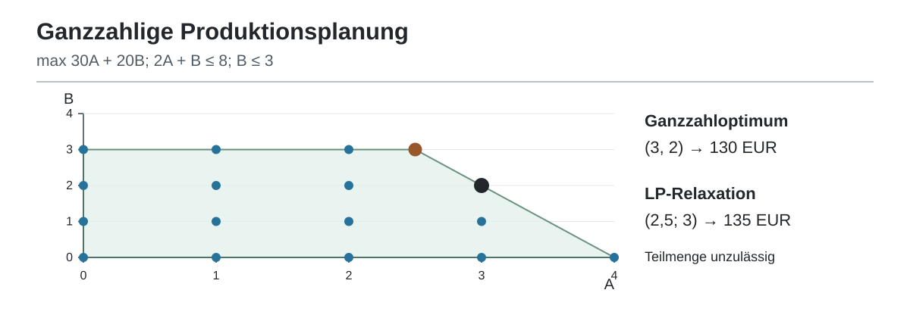

# M12-L1 – Lineare und ganzzahlige Optimierung {#L1}

**Kursbereich:** M12 – Operations Research

**Niveau:** Bachelor · Kern/Grundlagen

**Vorwissen:** [M11-L2](M11-L2.md)

**Lernziel:** Ein Produktionsproblem als lineares Modell formulieren und ganzzahlige Zulässigkeit prüfen.

## Einstieg und Grundbegriffe {#S1}

Operations Research übersetzt Entscheidungen in Variablen, Zielfunktionen und Nebenbedingungen. Bei linearer Optimierung sind Zielfunktion und Nebenbedingungen linear; Ganzzahligkeit kann für unteilbare Ressourcen erforderlich sein. Ein Optimum gilt ausschließlich für das formulierte Modell und seine Daten. Zulässigkeit, optimale Zielfunktionswerte und wirtschaftliche Interpretation sind getrennt zu prüfen.

## Begriffszusammenhang {#S2}

*Abbildung: Zulässige ganzzahlige Punkte für 2A+B≤8 und B≤3; Optimum A=3, B=2, 130 Euro; LP-Relaxation A=2,5, B=3, 135 Euro.*

## Beispiel und Anwendung {#S3}

Produkte A und B benötigen zwei beziehungsweise eine Arbeitsstunde und liefern 30 beziehungsweise 20 Euro Deckungsbeitrag. Bei acht Stunden und maximal drei B lautet das Modell maximiere 30A+20B unter 2A+B≤8, B≤3, A,B≥0 ganzzahlig. Mit A=3 und B=2 ergibt sich 130 Euro; A=4,B=0 ergibt 120; A=2,B=3 ergibt 120. Die erste Kombination ist optimal.

Für dieses kleine Modell kann man alle zulässigen ganzzahligen Kombinationen aufzählen. Die LP-Relaxation erlaubt reelle Werte und liefert mit 135 Euro eine obere Schranke, keine realisierbare ganzzahlige Lösung.

Die obere Schranke lässt sich auch algebraisch zeigen: 30A+20B = 15(2A+B)+5B ≤ 15·8+5·3 = 135. Die Schranke wird bei A=2,5 und B=3 erreicht. Die vollständige ganzzahlige Aufzählung liefert dagegen maximal 130.

## Selbstkontrolle {#S4}

### Aufgabe

Weshalb kann A=2,5 und B=3 in einem reinen LP günstiger sein, aber im Betrieb unzulässig?

::: {.lc-solutions data-lc-section="S4"}
Die Zielfunktion ergibt 135 Euro, doch halbe Einheiten sind bei unteilbaren Produkten unzulässig. Das Ganzzahlmodell bildet diese Bedingung ab.
:::

## Weiterführung {#S5}

[M12-L2](M12-L2.md)

## Quellen und Vertiefung {#S6}

- [Universität Münster – Aufbau des Wirtschaftsinformatikstudiums (B.Sc.)](https://www.wi.uni-muenster.de/de/studieninteressierte/unsere-studiengaenge/bachelor-science-wirtschaftsinformatik/aufbau-des) · Studienprofil; curricularer Kontext, kein Einzelnachweis der Fachdetails · Zuletzt abgerufen: 2026-11-25
- [Google OR-Tools – MathOpt](https://developers.google.com/optimization/math_opt) · Modellierung linearer und gemischt-ganzzahliger Probleme; kein Beweis der Beispiellösung · Zuletzt abgerufen: 2026-11-25
- [Google OR-Tools – Solving a MIP Problem](https://developers.google.com/optimization/mip/mip_example) · Ganzzahligkeit und LP-Relaxation; anderes Beispiel als im Kurs · Zuletzt abgerufen: 2026-11-25
