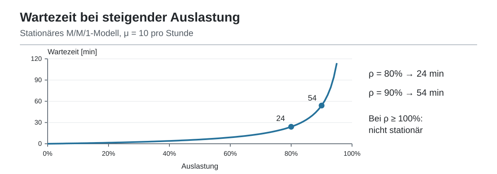

# M12-L2 – Bestandssteuerung und Warteschlangen {#L2}

**Kursbereich:** M12 – Operations Research

**Niveau:** Bachelor · Kern/Grundlagen

**Vorwissen:** [M12-L1](M12-L1.md)

**Lernziel:** Eine wirtschaftliche Bestellmenge bestimmen und die Auslastung eines Warteschlangensystems beurteilen.

## Einstieg und Grundbegriffe {#S1}

Bestandssteuerung balanciert Bestellkosten, Lagerhaltung und Fehlmengen. Ein deterministisches Grundmodell der optimalen Bestellmenge minimiert jährliche Bestell- und Lagerkosten unter konstanter Nachfrage, sofortiger Lieferung und ohne Fehlmengen. Warteschlangen entstehen bei schwankenden Ankünften oder Bearbeitungszeiten. Eine Auslastung nahe hundert Prozent kann Wartezeiten stark erhöhen.

## Begriffszusammenhang {#S2}

*Abbildung: M/M/1 bei Bedienrate 10 pro Stunde: Wartezeit steigt von 24 Minuten bei 80 Prozent auf 54 Minuten bei 90 Prozent Auslastung.*

## Beispiel und Anwendung {#S3}

Jahresnachfrage D=1.000, Bestellkosten K=20 Euro, Lagerkosten h=4 Euro pro Stück und Jahr. Die Modellbestellmenge sqrt(2DK/h)=100 Stück. Zehn Bestellungen verursachen 200 Euro Bestellkosten; der mittlere Bestand von 50 Stück verursacht 200 Euro Lagerkosten. Die Summe der jährlichen relevanten Kosten beträgt 400 Euro (ohne Einkaufskosten).

### Vertiefung und Modellgrenzen

Im klassischen M/M/1-Modell sind Ankünfte durch einen Poisson-Prozess modelliert, Bedienzeiten exponentialverteilt und es gibt einen Bediener. Bei λ<μ gilt mittlere Systemzeit W=1/(μ−λ), während die mittlere reine Wartezeit Wq=W−1/μ beträgt. Die stationäre Lösung setzt Stabilität und die Modellannahmen voraus.

Genauer setzt das M/M/1-Grundmodell einen Poisson-Ankunftsprozess (exponentialverteilte Zwischenankunftszeiten), unabhängige exponentialverteilte Bedienzeiten und hier einen unbegrenzten Warteraum ohne Abwanderung voraus. Im Bestellmengenmodell lautet die relevante Kostenfunktion C(Q)=DK/Q+hQ/2 für Q>0; bei positiven Parametern liefert C′(Q)=0 die angegebene Menge und C″(Q)>0 bestätigt das Minimum.

## Selbstkontrolle {#S4}

### Aufgabe

Was ändert sich an der optimalen Menge, wenn Bestellkosten auf 80 Euro steigen?

### Modul-Fallstudie

Ein Helpdesk empfängt acht Fälle pro Stunde und bearbeitet mit mittlerer Rate zehn pro Stunde. Berechne Auslastung, W und Wq. Wiederhole für neun Fälle pro Stunde. Begründe, warum hohe Auslastung zu langen Wartezeiten führen kann.

::: {.lc-solutions data-lc-section="S4"}
Die Menge verdoppelt sich auf 200, weil die Bestellkosten unter der Quadratwurzel um Faktor vier steigen. Lieferzeiten und Unsicherheit sind weiterhin ausgeblendet.

**Lösung der Fallstudie:** Bei λ=8, μ=10: ρ=0,8, W=0,5 h, Wq=0,4 h=24 min. Bei λ=9: ρ=0,9, W=1 h, Wq=0,9 h=54 min. Der Nenner μ−λ schrumpft. Ab λ≥μ gibt es keine stationäre Lösung dieses Typs. Prüfe bei realen Helpdesks Mehrfachbearbeiter, Prioritäten und zeitabhängige Last.

:::

## Weiterführung {#S5}

[M12-L3](M12-L3.md)

## Quellen und Vertiefung {#S6}

- [Universität Münster – Aufbau des Wirtschaftsinformatikstudiums (B.Sc.)](https://www.wi.uni-muenster.de/de/studieninteressierte/unsere-studiengaenge/bachelor-science-wirtschaftsinformatik/aufbau-des) · Studienprofil; curricularer Kontext, kein Einzelnachweis der Fachdetails · Zuletzt abgerufen: 2026-11-25
- [Alberto Lacort – Queueing theory](https://allabur.webs.upv.es/files/sheets/sheet-queueing-en.pdf?v=8ef34ff8aa) · Little-Gesetz und M/M/1-Formeln, S. 2; PDF-Text einsehbar, Screenshot-Abruf fehlgeschlagen · Zuletzt abgerufen: 2026-11-25
- [Kenneth S. Bigel – Corporate Finance, 9.16 Economic Ordering Quantity Model](https://pressbooks.pub/tourocorporatefinance/chapter/9-16-economic-ordering-quantity-eoq-model-inventory-optimal-order-quantities-model-2/) · Bestell- und Lagerhaltungskosten sowie EOQ-Formel; vereinfachtes Modell ohne Mengenrabatte · Zuletzt abgerufen: 2026-11-25
