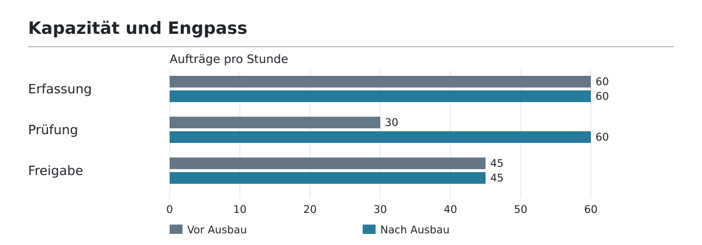

# M12-L3 – Kapazitätsplanung und Engpassmanagement {#L3}

**Kursbereich:** M12 – Operations Research

**Niveau:** Bachelor · Kern/Grundlagen

**Vorwissen:** [M12-L2](M12-L2.md)

**Lernziel:** Kapazität, Engpass, Durchsatz und Auslastung eines mehrstufigen Prozesses berechnen.

## Einstieg und Grundbegriffe {#S1}

Die Kapazität einer Ressource gibt an, wie viele Einheiten sie pro Zeiteinheit unter festgelegten Bedingungen bearbeiten kann. Bei einer seriellen Prozesskette, in der jede Einheit alle Stationen einmal durchläuft, begrenzt die kleinste Stationskapazität den maximalen Durchsatz. Parallele gleichartige Ressourcen addieren ihre Kapazitäten, sofern sie unabhängig arbeiten und ausreichend Aufgaben erhalten. Effektive Kapazität ist von theoretischer Kapazität zu unterscheiden: Pausen, Ausfälle, Umrüstungen und Qualitätsprobleme verringern die verfügbare Leistung.

Die Auslastung ist der tatsächliche Durchsatz geteilt durch die Kapazität derselben Ressource im gleichen Zeitraum. Hohe Auslastung bedeutet nicht zwangsläufig hohe Prozessleistung; Bestände und Wartezeiten können wachsen. Verbesserungen an einer Nichtengpassstation steigern den Gesamtdurchsatz nicht, solange der Engpass unverändert bleibt. Bei variablen Ankünften und Bearbeitungszeiten ist eine zusätzliche Warteschlangenanalyse erforderlich. Die hier verwendete stationäre Rechnung liefert eine Obergrenze, keinen garantierten Servicelevel.

## Begriffszusammenhang {#S2}

*Abbildung: Verschiebung des Engpasses nach Ausbau der Prüfung. Eigenes Modellbeispiel.*

## Beispiel und Anwendung {#S3}

Ein digitaler Auftragsprozess verarbeitet pro Stunde maximal 60 Datensätze bei der Erfassung, 30 bei der Prüfung und 45 bei der Freigabe. Bei Nachfrage 50/h beträgt der erreichbare langfristige Abfluss höchstens 30/h. Bei einer auf 30/h gedrosselten Aufnahme in die Prozesskette (die übrigen Aufträge warten davor) betragen die idealisierten Auslastungen 50 %, 100 % und 66,7 %. Bei dauerhaft 50 externen Ankünften je Stunde wächst der vorgelagerte Rückstand um 20/h. Werden dagegen alle 50/h sofort erfasst, beträgt die Auslastung der Erfassung 83,3 %; der Rückstand wächst dann vor der Prüfung. Eine zweite unabhängige Prüfstation gleicher Leistung erhöht die Prüfkapazität auf 60/h. Nun begrenzt die Freigabe mit 45/h den Prozess; der Rückstand wächst um 5/h. Eine Puffergrenze oder Annahmesteuerung ist weiterhin erforderlich.

Die Rechnung unterstellt einen ausgelasteten Engpass, eine bedarfsgerechte Drosselung der vorgelagerten Stationen und ausreichende Puffer ohne Verluste. Bei Ausbau der Prüfung kann die Aufnahme auf 45/h erhöht werden. Bei 50 Ankünften und maximal 30 Abschlüssen je Stunde ist der Gesamtbestand nicht stationär; 30/h ist die idealisierte nachhaltige Abflusskapazität, keine stationäre Verteilung der Warteschlange. Eine endliche Puffergrenze verschiebt Rückstau oder führt zu abgewiesenen Aufträgen, wenn die Annahme nicht angepasst wird.

## Selbstkontrolle {#S4}

### Aufgabe

Nach Ausbau der Prüfung steigt auch die Freigabekapazität auf 55/h. Berechne Kapazität, Durchsatz bei 50/h Nachfrage und Auslastung der Freigabe.

::: {.lc-solutions data-lc-section="S4"}
Kapazität 55/h; modellierter Durchsatz 50/h; Freigabeauslastung 50/55 ≈ 90,9 %. Schwankungen können weiterhin Wartezeiten verursachen.
:::

## Weiterführung {#S5}

[M13-L1](M13-L1.md)

## Quellen und Vertiefung {#S6}

- [Fundamentals of Operations Management – 4.9 Bottlenecks](https://ecampusontario.pressbooks.pub/fundamentalsopsmgmt/chapter/4-9-the-bottleneck-phenomenon-and-its-impact-on-process-capacity/) · Suchauszug eingesehen; Vollabruf 403, Prüfung offen.
