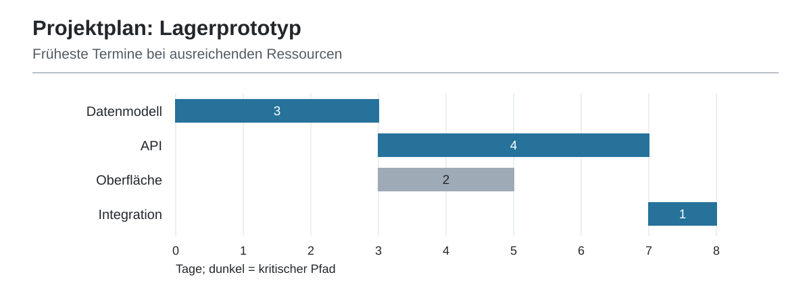

# M13-L1 – Projektplanung und agile Zusammenarbeit {#L1}

**Kursbereich:** M13 – Digitale Arbeit und Projekte

**Niveau:** Bachelor · Kern/Grundlagen

**Vorwissen:** [M12-L2](M12-L2.md)

**Lernziel:** Projektabhängigkeiten auswerten und den kritischen Pfad bestimmen.

## Einstieg und Grundbegriffe {#S1}

Ein Projekt besitzt ein Ziel, zeitliche Grenzen, Ressourcen und Risiken. Klassische Planung verwendet Arbeitspakete, Abhängigkeiten und Meilensteine; iterative Verfahren organisieren Lernen über kurze Lieferzyklen. Agilität ersetzt weder Priorisierung noch wirtschaftliche Steuerung. Ein Inkrement soll überprüfbaren Nutzen liefern, während offene Annahmen und Risiken sichtbar bleiben.

## Begriffszusammenhang {#S2}

*Abbildung: Datenmodell Tag 0–3, API Tag 3–7, Oberfläche Tag 3–5, Integration Tag 7–8. Kritischer Pfad dauert 8 Tage.*

## Beispiel und Anwendung {#S3}

Für einen Lagerprototyp benötigen Datenmodell 3 Tage, API danach 4 Tage, Benutzeroberfläche nach Datenmodell 2 Tage und Integration nach API und Oberfläche 1 Tag. Bei ausreichenden parallelen Ressourcen dauert der kritische Pfad 3+4+1=8 Tage.

Der Oberflächenpfad hat in diesem Netzplan zwei Tage Gesamtpuffer, sofern keine zusätzlichen Ressourcen- oder Terminrestriktionen gelten. Ein kritischer Pfad ist nicht mit dem gesamten Arbeitsaufwand gleichzusetzen.

Der früheste Integrationsbeginn ist das Maximum der beiden Vorgänger-Endzeiten, nicht deren Summe. Die acht Tage sind eine kalenderneutrale Modelldauer bei sofortiger Verfügbarkeit; Ressourcenbeschränkungen können den Plan verlängern.

## Selbstkontrolle {#S4}

### Aufgabe

Wie verändert sich die Projektdauer, wenn die Oberfläche statt zwei nun drei Tage benötigt?

::: {.lc-solutions data-lc-section="S4"}
Sie bleibt acht Tage, solange Ressourcen und Abhängigkeiten gleich bleiben. Der Oberflächenpfad dauert nun sieben Tage und ist noch nicht kritisch.
:::

## Weiterführung {#S5}

[M13-L2](M13-L2.md)

## Quellen und Vertiefung {#S6}

- [Universität Münster – Aufbau des Wirtschaftsinformatikstudiums (B.Sc.)](https://www.wi.uni-muenster.de/de/studieninteressierte/unsere-studiengaenge/bachelor-science-wirtschaftsinformatik/aufbau-des) · Studienprofil; curricularer Kontext, kein Einzelnachweis der Fachdetails · Zuletzt abgerufen: 2026-11-25
- [PMI – Critical path method calculations](https://www.pmi.org/learning/library/critical-path-method-calculations-scheduling-8040) · Kritischer Pfad, Puffer und Vorgangsknotennetz · Zuletzt abgerufen: 2026-11-25
