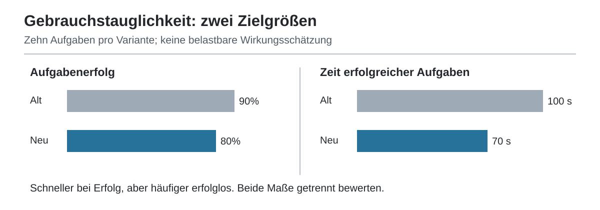

# M13-L2 – Digitale Arbeit, UX und Veränderung {#L2}

**Kursbereich:** M13 – Digitale Arbeit und Projekte

**Niveau:** Bachelor · Kern/Grundlagen

**Vorwissen:** [M13-L1](M13-L1.md)

**Lernziel:** Gebrauchstauglichkeit anhand von Aufgabenerfolg und Bearbeitungszeit bewerten.

## Einstieg und Grundbegriffe {#S1}

Digitale Systeme verändern Koordination, Handlungsspielräume und Informationszugang. Gebrauchstauglichkeit untersucht die wirksame, effiziente und zufriedenstellende Nutzung in einem bestimmten Kontext. Change Management begleitet organisatorische Veränderungen mit Beteiligung, Schulung und Rückmeldung. Nutzungskennzahlen sind vorsichtig zu interpretieren, da erzwungene Nutzung keine Akzeptanz beweist.

## Begriffszusammenhang {#S2}

*Abbildung: Aufgabenerfolg sinkt von 90 auf 80 Prozent; Dauer erfolgreicher Aufgaben sinkt von 100 auf 70 Sekunden.*

## Beispiel und Anwendung {#S3}

Ein neues Buchungssystem reduziert Eingabeschritte von zwölf auf sechs, erhöht aber Fehler bei seltenen Sonderfällen. Beobachte echte Aufgaben mit repräsentativen Nutzergruppen, dokumentiere Fehlertypen und passe den Ablauf an, statt nur Klickzahlen zu optimieren.

### Vertiefung und Modellgrenzen

Eine Usability-Untersuchung trennt Aufgabenqualität, Geschwindigkeit und subjektive Wahrnehmung. Eine Metrik kann eine andere verschlechtern. Vor einem Pilotversuch Zielgruppe, Aufgaben, Vergleichsbedingungen, Abbruchregeln und Datenschutz festlegen.

Die Erfolgsquoten unterscheiden sich um −10 Prozentpunkte. Die mittlere Zeit bezieht sich nur auf erfolgreiche Aufgaben; die unterschiedlich zusammengesetzten Teilmengen schränken den Vergleich ein.

Bei wiederholten Aufgaben derselben Person sind Beobachtungen möglicherweise abhängig. Ein Folgetest sollte daher die Auswertung auf Personen- beziehungsweise Aufgabenebene vorab festlegen; die zehn Aufgaben sind nicht automatisch zehn unabhängige Personen.

## Selbstkontrolle {#S4}

### Aufgabe

Nenne zwei Kennzahlen, die gemeinsam mehr aussagen als die Zahl der Logins.

### Modul-Fallstudie

Bei zehn Aufgaben werden im alten UI neun korrekt erledigt, im neuen acht. Die mittlere Dauer korrekt erledigter Aufgaben sinkt von 100 auf 70 Sekunden. Bewerte die Hypothese einer Verbesserung; entwirf einen Folgetest.

::: {.lc-solutions data-lc-section="S4"}
Aufgabenerfolgsquote und Zeit pro korrekt erledigter Aufgabe; ergänzt durch qualitative Rückmeldungen und getrennte Betrachtung von Sonderfällen.

**Lösung der Fallstudie:** Erfolgsquote 90 auf 80 Prozent, Zeit erfolgreicher Aufgaben −30 Prozent. Das neue UI ist nach diesen Daten nicht eindeutig besser; die Zeitmetrik blendet Fehlschläge aus. Definiere vorab Nichtunterlegenheitsgrenze für Erfolg und Zeitmetrik einschließlich Abbruch, randomisiere Reihenfolge, balanciere Erfahrung und untersuche Fehlertypen. Zehn Aufgaben sind kein belastbarer Beleg.

:::

## Weiterführung {#S5}

[M14-L1](M14-L1.md)

## Quellen und Vertiefung {#S6}

- [Universität Münster – Aufbau des Wirtschaftsinformatikstudiums (B.Sc.)](https://www.wi.uni-muenster.de/de/studieninteressierte/unsere-studiengaenge/bachelor-science-wirtschaftsinformatik/aufbau-des) · Studienprofil; curricularer Kontext, kein Einzelnachweis der Fachdetails · Zuletzt abgerufen: 2026-11-25
- [NIST – Usability Testing](https://www.nist.gov/programs-projects/usability-testing) · Aufgabenerfolg, Zeitbedarf und Zufriedenheit · Zuletzt abgerufen: 2026-11-25
