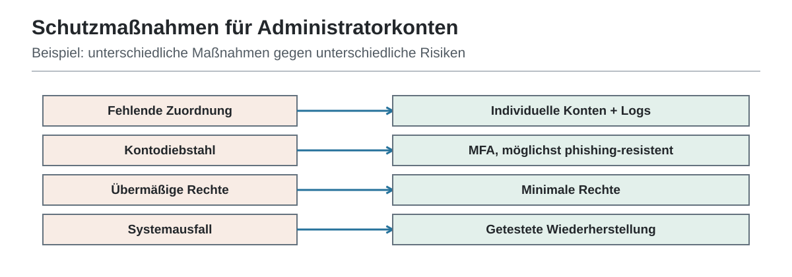

# M14-L1 – Informationssicherheit und Risikomanagement {#L1}

**Kursbereich:** M14 – IT-Recht, Sicherheit und Ethik

**Niveau:** Bachelor · Kern/Grundlagen

**Vorwissen:** [M13-L2](M13-L2.md)

**Lernziel:** Sicherheitsrisiken unterscheiden und ergänzende Schutzmaßnahmen für Administratorkonten begründen.

## Einstieg und Grundbegriffe {#S1}

Vertraulichkeit schützt vor unberechtigtem Zugriff, Integrität vor unzulässiger Veränderung und Verfügbarkeit vor Funktionsverlust. Risiken ergeben sich aus möglichen Ereignissen, Schwachstellen, Auswirkungen und Eintrittswahrscheinlichkeiten. Maßnahmen können Risiken vermeiden, verringern, übertragen oder bewusst akzeptieren. Verantwortliche müssen die verbleibenden Risiken dokumentieren und überwachen.

## Begriffszusammenhang {#S2}

*Abbildung: Gemeinsames Administratorkonto: individuelle Konten verbessern Zuordnung, MFA schützt Anmeldung, minimale Rechte begrenzen Zugriff, Wiederherstellung hilft bei Ausfall.*

## Beispiel und Anwendung {#S3}

Ein gemeinsam genutztes Administratorkonto erschwert Zuordnung und Rechtekontrolle. Individuelle Konten, Mehrfaktorauthentifizierung, minimale Rechte und Protokollierung begrenzen Risiken; ein Wiederherstellungsprozess bleibt für den Ausfall nötig.

Nicht jede Mehrfaktormethode ist phishing-resistent. Für privilegierte Zugriffe sind phishing-resistente Verfahren besonders sinnvoll; Rechtevergabe, Protokollierung und Wiederherstellung bleiben separate Kontrollen.

Eine Sicherung schützt die Verfügbarkeit nur, wenn die Wiederherstellung tatsächlich gelingt. Protokolle können zur Erkennung und Zuordnung beitragen, verhindern einen Vorfall aber nicht zwingend. Für jede Kontrolle sind Schutzwirkung, Verantwortlichkeit und Wirksamkeitsnachweis getrennt zu dokumentieren.

## Selbstkontrolle {#S4}

### Aufgabe

Warum ist eine Datensicherung allein kein ausreichender Schutz vor Datenabfluss?

::: {.lc-solutions data-lc-section="S4"}
Sie unterstützt Wiederherstellung, verhindert aber nicht das Lesen oder Kopieren durch Unberechtigte. Zugriffskontrollen und weitere passende Schutzmaßnahmen sind erforderlich.
:::

## Weiterführung {#S5}

[M14-L2](M14-L2.md)

## Quellen und Vertiefung {#S6}

- [NIST – SP 1303, Cybersecurity Framework 2.0: Enterprise Risk Management Quick-Start Guide](https://csrc.nist.gov/pubs/sp/1303/final) · Abstract: Einbettung von Cybersicherheitsrisiken in Unternehmensrisiken; Leitfaden noch nicht vollständig geprüft · Zuletzt abgerufen: 2026-11-25
- [NIST – Cybersecurity Framework 2.0](https://www.nist.gov/publications/nist-cybersecurity-framework-csf-20) · Rahmenwerk zur Organisation und Bewertung von Cybersicherheitsrisiken; Veröffentlichungsseite, kein Volltextreview · Zuletzt abgerufen: 2026-11-25
- [NIST SP 800-63B-4 – Authentication and Authenticator Management](https://pages.nist.gov/800-63-4/sp800-63b.html) · Authentisierung und Phishing-Resistenz; Abschnitte zu AAL2 und Phishing · Zuletzt abgerufen: 2026-11-25
