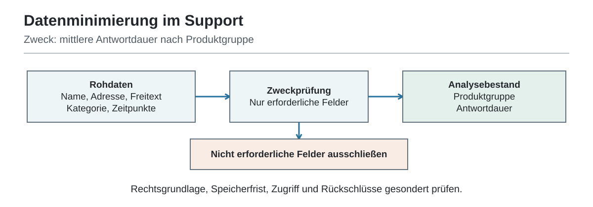

# M14-L2 – Datenschutz, IT-Recht und Ethik {#L2}

**Kursbereich:** M14 – IT-Recht, Sicherheit und Ethik

**Niveau:** Bachelor · Kern/Grundlagen

**Vorwissen:** [M14-L1](M14-L1.md)

**Lernziel:** Einen zweckgebundenen Analysebestand entwerfen und rechtliche Prüffragen einschließlich Rechtsgrundlage benennen.

## Einstieg und Grundbegriffe {#S1}

Informationssysteme können personenbezogene Daten verarbeiten und rechtliche sowie ethische Folgen auslösen. Die DSGVO enthält unter anderem Grundsätze zur Verarbeitung und verlangt eine geeignete Rechtsgrundlage. IT-Verträge, Urheberrecht, Haftung und Schutzrechte bilden weitere Rechtsbereiche. Rechtskonformität allein beantwortet nicht, ob ein System fair, verständlich oder verhältnismäßig ist. Die konkrete Rechtslage ist für den Anwendungsfall gesondert zu prüfen.

## Begriffszusammenhang {#S2}

*Abbildung: Supportdaten: Produktgruppe und Antwortdauer für Analyse übernehmen; Name, Adresse und Freitext bei fehlendem Bedarf ausschließen; kleine Gruppen prüfen.*

## Beispiel und Anwendung {#S3}

Eine Werkstatt möchte Kundenaufträge analysieren. Statt Namen und Adressen in den Analysebestand zu kopieren, prüft sie, ob Auftragsart, Zeit und eine geeignete pseudonyme Kennung genügen. Pseudonymisierte Daten können weiterhin personenbezogen sein.

### Vertiefung und Modellgrenzen

Datenschutz durch Technikgestaltung betrifft den gesamten Lebenszyklus einer Verarbeitung. Datenminimierung bedeutet nicht bloß Verschlüsselung; die Datenmenge und Granularität müssen am Zweck ausgerichtet werden. Pseudonymisierte Daten können weiterhin personenbezogen sein. Die Rechtsgrundlage ist kontextabhängig.

**Rechtsbezug:** Art. 5 DSGVO verlangt unter anderem Zweckbindung, Datenminimierung und Nachweisbarkeit. Art. 6 regelt die Rechtsgrundlagen; bei Zweckänderungen ist insbesondere Art. 6 Abs. 4 zu beachten. Art. 25 betrifft geeignete technische und organisatorische Maßnahmen einschließlich datenschutzfreundlicher Voreinstellungen. Bei voraussichtlich hohem Risiko ist vorab eine Datenschutz-Folgenabschätzung nach Art. 35 erforderlich. Die Auswahl der Rechtsgrundlage und die Prüfung weiterer Vorschriften bleiben fallabhängig.

Auch die Auswertung kleiner Gruppen kann Rückschlüsse auf einzelne Personen ermöglichen. Aggregation allein garantiert keine Anonymität; die Identifizierbarkeit ist unter Berücksichtigung realistischer Zusatzinformationen zu beurteilen. Eine Einwilligung ist nur eine von mehreren möglichen Rechtsgrundlagen.

## Selbstkontrolle {#S4}

### Aufgabe

Welche Fragen müssen vor Nutzung der Daten für ein neues Prognoseziel gestellt werden?

### Modul-Fallstudie

Ein Supportsystem soll durchschnittliche Antwortdauer nach Produktgruppe auswerten. Der Rohdatensatz enthält Kundenname, Adresse, Freitext, Kategorie und Zeitpunkte. Entwirf einen minimierten Analysebestand und eine Zugriffskontrolle. Benenne zwei Fragen, die vor produktivem Einsatz geklärt werden müssen.

::: {.lc-solutions data-lc-section="S4"}
Zweck, Rechtsgrundlage, Datenbedarf, Zugriffsrechte, Speicherfrist, Transparenz und Risiken prüfen. Ob die Nutzung erlaubt ist, hängt vom konkreten Kontext ab; keine pauschale Freigabe.

**Lösung der Fallstudie:** Wenn fachlich ausreichend: Produktgruppe und Dauer, optional Zeitraum in geeigneter Granularität. Namen, Adressen und Freitext nicht übernehmen. Zugriff auf Aggregate beschränken; kleine Gruppen und Rückschlüsse prüfen. Vor Einsatz u. a. Zweck/Rechtsgrundlage und Aufbewahrungsdauer klären, gegebenenfalls Informationspflichten und Datenschutz-Folgenabschätzung prüfen. Keine abschließende Rechtsberatung.

:::

## Weiterführung {#S5}

[M14-L3](M14-L3.md)

## Quellen und Vertiefung {#S6}

- [EUR-Lex – General data protection regulation (GDPR)](https://eur-lex.europa.eu/EN/legal-content/summary/general-data-protection-regulation-gdpr.html) · Rechtsquelle identifiziert; Volltextabruf und aktuelle juristische Prüfung offen · Abrufdatum unbekannt (Suchvorschau)
- [EUR-Lex – Verordnung (EU) 2016/679](https://eur-lex.europa.eu/legal-content/DE-EN/TXT/?uri=CELEX%3A32016R0679) · Rechtstext, insbesondere Art. 5, 6, 25; Volltextabruf unvollständig, Prüfung offen · Volltextabruf unvollständig; Abrufdatum unbekannt
- [EUR-Lex – Regulation (EU) 2016/679 (English Official Journal text)](https://eur-lex.europa.eu/eli/reg/2016/679/oj/eng) · Art. 4, 5, 6, 25 und 35 der englischen Amtsblattfassung eingesehen; aktuelle juristische Einzelfallprüfung offen · Zuletzt abgerufen: 2026-11-25
