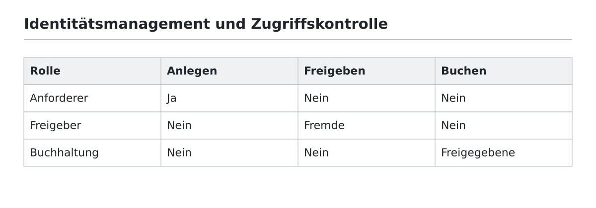

# M14-L3 – Identitätsmanagement und Zugriffskontrolle {#L3}

**Kursbereich:** M14 – IT-Recht, Sicherheit und Ethik

**Niveau:** Bachelor · Kern/Grundlagen

**Vorwissen:** [M14-L2](M14-L2.md)

**Lernziel:** Zugriffsentscheidungen aus Rollen und Funktionstrennung ableiten und serverseitige Kontrollen begründen.

## Einstieg und Grundbegriffe {#S1}

Identitätsmanagement umfasst die Zuordnung digitaler Konten zu Personen oder technischen Akteuren sowie deren Lebenszyklus. Authentisierung prüft die vorgelegten Identitätsnachweise; Autorisierung entscheidet anschließend, welche Operationen erlaubt sind. Eine erfolgreiche Anmeldung begründet nicht automatisch die Berechtigung zum Lesen oder Ändern jeder Ressource. Rollenbasierte Zugriffskontrolle bündelt Berechtigungen nach Aufgaben. Das Minimalprinzip begrenzt sie auf das Erforderliche; Funktionstrennung verhindert, dass eine Person einen gesamten kritischen Vorgang allein beherrscht.

Mehrfaktor-Authentisierung nutzt unterschiedliche Faktortypen. Zwei Passwörter sind nicht zwei verschiedene Faktoren. Manuell eingegebene Einmalcodes können durch eine betrügerische Gegenstelle weitergereicht werden; NIST unterscheidet sie daher von phishingresistenten kryptografischen Verfahren mit Bindung an den Verifier. Für kritische Geschäftssysteme müssen auch Wiederherstellung, Kontoentzug und Servicekonten betrachtet werden. Der Leitfaden ist eine technische Referenz, keine pauschale Rechtsverpflichtung für jedes Unternehmen.

## Begriffszusammenhang {#S2}

*Abbildung: Beispiel einer Rollenmatrix mit objektbezogener Funktionstrennung. Eigenes Modellbeispiel.*

## Beispiel und Anwendung {#S3}

Ein Einkaufssystem trennt die Rollen Anforderer, Freigeber und Buchhaltung. Der Anforderer legt Bestellungen an, der Freigeber genehmigt sie und die Buchhaltung verarbeitet freigegebene Belege. Der Server prüft für jede Anfrage sowohl die Rolle als auch die Objektregel: Eine eigene Bestellung darf nicht selbst genehmigt werden, auch wenn dieselbe Person mehrere Rollen besitzt. Eine Ausnahmeregel für Vertretungen benötigt eine dokumentierte zeitliche Begrenzung und unabhängige Kontrolle. Beim Austritt werden aktive Sitzungen und Berechtigungen entzogen; eine bloße Entfernung aus der sichtbaren Mitarbeiterliste reicht nicht.

Ohne passende Freigaberegel wird der Zugriff verweigert. Die Objektregel muss auch für direkte API-Aufrufe gelten; ein Test sollte fremde und eigene Belege, fehlende Rollen, abgelaufene Sitzungen und Mehrfachrollen abdecken. Bei parallelen Freigaben muss die Zustandsprüfung mit der Änderung konsistent sein.

## Selbstkontrolle {#S4}

### Aufgabe

Eine Person hat Anforderer- und Freigeberrolle und versucht eine eigene Bestellung zu genehmigen. Welche Entscheidung folgt? Warum reicht ein ausgeblendeter Button nicht aus?

::: {.lc-solutions data-lc-section="S4"}
Ablehnen aufgrund der Objektregel. Die Oberfläche ist keine Sicherheitsgrenze; direkte Anfragen müssen serverseitig ebenfalls abgelehnt werden.
:::

## Weiterführung {#S5}

[M14-L4](M14-L4.md)

## Quellen und Vertiefung {#S6}

- [NIST SP 800-63B-4 – Authentication and Authenticator Management, § 3.2.5](https://pages.nist.gov/800-63-4/sp800-63b.html) · Methodischer Fachbeleg; relevante Passage im Web eingesehen. Zuletzt abgerufen: 2026-11-25.
- [OWASP – Authorization Cheat Sheet](https://cheatsheetseries.owasp.org/cheatsheets/Authorization_Cheat_Sheet.html) · Standardmäßige Ablehnung, Prüfung pro Anfrage und Tests · Zuletzt abgerufen: 2026-11-25
