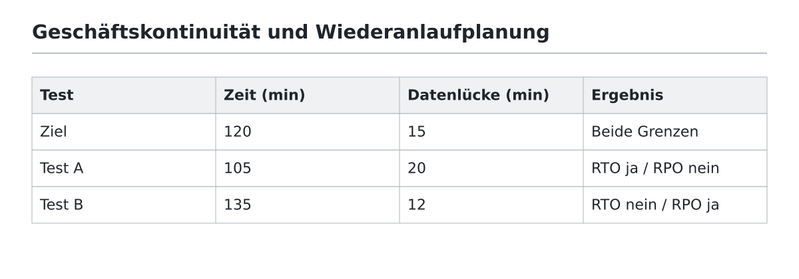

# M14-L4 – Geschäftskontinuität und Wiederanlaufplanung {#L4}

**Kursbereich:** M14 – IT-Recht, Sicherheit und Ethik

**Niveau:** Bachelor · Kern/Grundlagen

**Vorwissen:** [M14-L3](M14-L3.md)

**Lernziel:** Wiederanlauftests anhand von RTO und RPO bewerten.

## Einstieg und Grundbegriffe {#S1}

Eine Business Impact Analysis (BIA) untersucht, welche Geschäftsprozesse bei einer Unterbrechung betroffen sind, welche Abhängigkeiten bestehen und ab wann Folgen nicht mehr tolerierbar sind. Das Recovery Time Objective (RTO) beschreibt die angestrebte Zeit bis zur Wiederherstellung einer definierten Leistung; das Recovery Point Objective (RPO) bezeichnet den tolerierbaren zeitlichen Datenverlust. Beide sind Ziele und keine automatisch erreichten Eigenschaften einer Sicherungslösung. Die maximal tolerierbare Unterbrechung umfasst auch betriebliche Wiederanlaufarbeiten.

Ein Wiederanlaufplan definiert Reihenfolge, Verantwortliche, Ressourcen, Kommunikationswege und Prüfkriterien. Eine Sicherungsdatei beweist weder ihre Wiederherstellbarkeit noch die Konsistenz zusammenhängender Systeme. Regelmäßige Wiederherstellungstests sollten deshalb technische Rekonstruktion, fachliche Abgleiche und die tatsächliche Wiederaufnahme der Arbeit prüfen. Isolierte oder unveränderliche Sicherungen können Risiken reduzieren, ersetzen jedoch keine dokumentierten Zugriffskontrollen und Tests.

## Begriffszusammenhang {#S2}

*Abbildung: Unabhängige Bewertung von RTO und RPO. Eigenes Modellbeispiel.*

## Beispiel und Anwendung {#S3}

Ein Händler definiert ein RTO von 120 Minuten und ein RPO von 15 Minuten für den Bestelldienst. Im Test benötigt die Erkennung 10 Minuten, die Datenbankrekonstruktion 45 Minuten, der anschließende Anwendungsstart 20 Minuten und der fachliche Abgleich 30 Minuten. Bei serieller Ausführung sind es 105 Minuten; die Zielzeit wird um 15 Minuten unterschritten. Die jüngste konsistente Sicherung liegt 20 Minuten vor der simulierten Störung. Das RPO ist um fünf Minuten verfehlt, obwohl das RTO erfüllt ist.

Wenn die gesamten 20 Minuten für den Anwendungsstart sicher parallel zur Datenbankrekonstruktion ausgeführt werden können und kein weiterer Startschritt erforderlich ist, verkürzt sich der Pfad im Modell um 20 Minuten. Das ändert den Datenverlust nicht. Eine zusätzliche Sicherungsstrategie muss auf konsistente Wiederherstellungspunkte und tatsächliche Wiederherstellungsfähigkeit geprüft werden. Bei durchschnittlich 30 Bestellungen je Minute könnten 20 Minuten rund 600 Bestellungen betreffen; der tatsächliche Verlust ist anhand der Protokolle zu ermitteln.

Die Messgrenze für das RTO muss vor dem Test vereinbart werden: Hier beginnt die Zeit mit der Störung und endet mit dem fachlich nutzbaren Dienst. Das RPO wird am tatsächlich wiederherstellbaren konsistenten Datenstand beurteilt, nicht am konfigurierten Sicherungsintervall.

## Selbstkontrolle {#S4}

### Aufgabe

Ein zweiter Test benötigt 135 Minuten und rekonstruiert einen Stand von zwölf Minuten vor der Störung. Welche Ziele sind erfüllt?

::: {.lc-solutions data-lc-section="S4"}
RTO um 15 Minuten verfehlt, RPO um drei Minuten unterschritten. Beide Ziele getrennt berichten; Wiederanlaufzeit und Datenverlust getrennt verbessern.
:::

## Weiterführung {#S5}

[M15-L1](M15-L1.md)

## Quellen und Vertiefung {#S6}

- [ISACA – Information System Contingency Planning Guidance](https://www.isaca.org/resources/isaca-journal/issues/2021/volume-3/information-system-contingency-planning-guidance) · Methodischer Fachbeleg; relevante Passage im Web eingesehen. Zuletzt abgerufen: 2026-11-25.
