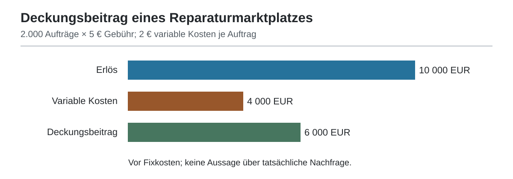

# M15-L1 – Digitale Geschäftsmodelle und Plattformen {#L1}

**Kursbereich:** M15 – Digital Business

**Niveau:** Bachelor · Kern/Grundlagen

**Vorwissen:** [M14-L2](M14-L2.md)

**Lernziel:** Den Deckungsbeitrag eines Marktplatzes bestimmen und Wechselwirkungen zwischen Marktseiten beurteilen.

## Einstieg und Grundbegriffe {#S1}

Ein Geschäftsmodell beschreibt, wie eine Organisation Nutzen erzeugt, bereitstellt und wirtschaftlich abschöpft. Abonnement, Transaktionsgebühr und Lizenz sind unterschiedliche Erlösmechanismen. Mehrseitige Plattformen vermitteln zwischen Nutzergruppen; direkte und indirekte Netzwerkeffekte können ihre Attraktivität beeinflussen. Preisgestaltung muss beide Seiten, Kosten, Wettbewerb und Teilnahmebedingungen berücksichtigen.

## Begriffszusammenhang {#S2}

*Abbildung: Bei 2.000 Aufträgen und 5 Euro Gebühr entstehen 10.000 Euro Erlös, 4.000 Euro variable Kosten und 6.000 Euro Deckungsbeitrag.*

## Beispiel und Anwendung {#S3}

Ein Reparaturmarktplatz erhält fünf Euro je vermitteltem Auftrag. Bei 2.000 Aufträgen und variablen Kosten von zwei Euro je Auftrag ergeben sich 6.000 Euro Deckungsbeitrag vor Fixkosten. Ohne ausreichende Nachfrage oder Anbieterqualität hilft die Gebührenrechnung allein nicht.

Der Deckungsbeitrag ist nicht der Gewinn. Bei unveränderten variablen Stückkosten von 2 Euro und Fixkosten von beispielsweise 7.500 Euro wären 2.500 Aufträge nötig, um diese Fixkosten zu decken. Das Modell unterstellt konstante Preise und Kosten.

Die Zahl der Transaktionen kann auf eine Gebührenänderung reagieren. Bei einem Preis von vier Euro und unveränderten variablen Kosten wären 3.000 statt 2.000 Aufträge erforderlich, um denselben Deckungsbeitrag von 6.000 Euro zu erzielen. Das ist eine Vergleichsschwelle, keine Nachfrageprognose.

## Selbstkontrolle {#S4}

### Aufgabe

Warum kann eine niedrigere Gebühr für Anbieter auch für Kunden einen Nutzen haben?

::: {.lc-solutions data-lc-section="S4"}
Mehr Anbieter können Auswahl und Verfügbarkeit erhöhen. Ob dies geschieht, hängt von Teilnahmeverhalten, Qualität und Wettbewerb ab.
:::

## Weiterführung {#S5}

[M15-L2](M15-L2.md)

## Quellen und Vertiefung {#S6}

- [Universität Münster – Aufbau des Wirtschaftsinformatikstudiums (B.Sc.)](https://www.wi.uni-muenster.de/de/studieninteressierte/unsere-studiengaenge/bachelor-science-wirtschaftsinformatik/aufbau-des) · Studienprofil; curricularer Kontext, kein Einzelnachweis der Fachdetails · Zuletzt abgerufen: 2026-11-25
- [OECD – Going Digital: Understanding digital transformation](https://www.oecd.org/en/publications/going-digital-shaping-policies-improving-lives_9789264312012-en/full-report/component-6.html) · Abschnitt 1.6 zu mehrseitigen Plattformen und Netzwerkeffekten · Zuletzt abgerufen: 2026-11-25
