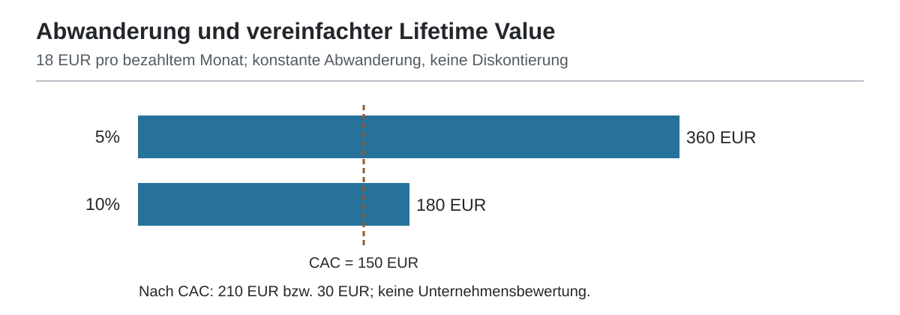

# M15-L2 – IT-getriebene Innovation und Geschäftsvalidierung {#L2}

**Kursbereich:** M15 – Digital Business

**Niveau:** Bachelor · Kern/Grundlagen

**Vorwissen:** [M15-L1](M15-L1.md)

**Lernziel:** Eine falsifizierbare Geschäftshypothese formulieren und Kundenwert unter vereinfachten Annahmen berechnen.

## Einstieg und Grundbegriffe {#S1}

Eine technische Möglichkeit wird erst dann zur tragfähigen Innovation, wenn sie ein relevantes Problem besser löst und organisatorisch sowie wirtschaftlich eingeführt werden kann. Hypothesen zu Bedarf, Zahlungsbereitschaft und Machbarkeit sollten getrennt getestet werden. Ein Prototyp dient dem Lernen; Pilotbetrieb prüft die Anwendung unter begrenzten realen Bedingungen. Skalierung bringt neue Anforderungen an Betrieb und Governance.

## Begriffszusammenhang {#S2}

*Abbildung: Bei 18 Euro monatlichem Deckungsbeitrag beträgt der erwartete Beitrag vor CAC 360 Euro bei 5 Prozent Churn und 180 Euro bei 10 Prozent.*

## Beispiel und Anwendung {#S3}

Eine Werkstatt entwickelt einen digitalen Terminassistenten. Vor einer vollständigen Integration testet sie in einem Pilot, ob Kunden freie Termine finden, Mitarbeitende Sonderfälle bearbeiten und Fehlbuchungen abnehmen.

### Vertiefung und Modellgrenzen

Unit Economics beschreibt Erlöse und zurechenbare Kosten pro betrachteter Einheit. Customer Acquisition Cost (CAC) setzt Akquisitionskosten zu gewonnenen Kunden in Beziehung; ein vereinfachter Lifetime Value setzt regelmäßigen Deckungsbeitrag zur Abwanderungsrate in Beziehung. Ohne Kohorten, Diskontierung und stabile Annahmen ist das nur eine grobe Modellgröße.

Bei einer Abwanderungsrate von 10 Prozent verbleiben nach CAC 30 Euro statt 210 Euro im Ausgangsszenario. Die Rechnung setzt unabhängige, zeitlich konstante Abwanderung nach jeder bezahlten Periode voraus.

Die geometrische Reihe 1+(1−p)+(1−p)²+… ergibt 1/p für 0<p≤1. Die erste Zahlung erfolgt sicher im Modell; erfolgt der erste Abwanderungsschritt vorher, ändert sich die Erwartung. CAC muss zur gleichen Akquisitionskohorte und zur definierten Kundeneinheit passen.

## Selbstkontrolle {#S4}

### Aufgabe

Formuliere eine falsifizierbare Hypothese zur Verbesserung der Terminbuchung.

### Modul-Fallstudie

Ein Abo erzielt 30 Euro Monatsumsatz und 12 Euro variable Kosten pro aktivem Kunden. Die konstante monatliche Abwanderungswahrscheinlichkeit beträgt 5 Prozent, CAC 150 Euro. Unter dem vereinfachten Modell ohne Diskontierung: berechne erwartete bezahlte Monate und Deckungsbeitrag über die Lebensdauer vor CAC.

::: {.lc-solutions data-lc-section="S4"}
Beispiel: Unter vergleichbaren Bedingungen sinkt der Anteil nicht erfolgreich abgeschlossener Buchungsversuche im Pilot um mindestens zehn Prozentpunkte gegenüber dem definierten Ausgangswert. Erhebung und Stichprobe müssen festgelegt sein.

**Lösung der Fallstudie:** Bei erster bezahlter Periode und anschließender geometrischer Abwanderung: 1/0,05=20 Monate. Deckungsbeitrag 18·20=360 Euro vor CAC, danach 210 Euro. Bei 10 Prozent Churn sinkt er auf 180 Euro vor CAC. Fixkosten, Rückerstattungen, heterogene Kohorten und Kapitalwert fehlen; daraus folgt keine Unternehmensbewertung.

:::

## Weiterführung {#S5}

[M16-L1](M16-L1.md)

## Quellen und Vertiefung {#S6}

- [Universität Münster – Aufbau des Wirtschaftsinformatikstudiums (B.Sc.)](https://www.wi.uni-muenster.de/de/studieninteressierte/unsere-studiengaenge/bachelor-science-wirtschaftsinformatik/aufbau-des) · Studienprofil; curricularer Kontext, kein Einzelnachweis der Fachdetails · Zuletzt abgerufen: 2026-11-25
- [OpenStax – Entrepreneurship, 10.1 Launching the Imperfect Business: Lean Startup](https://openstax.org/books/entrepreneurship/pages/10-1-launching-the-imperfect-business-lean-startup) · Iterative Hypothesenprüfung, MVP und Kundenfeedback · Zuletzt abgerufen: 2026-11-25
- [OpenStax – Introductory Business Statistics, 4.3 Geometric Distribution](https://openstax.org/books/introductory-business-statistics/pages/4-3-geometric-distribution) · Erwartungswert 1/p für die Anzahl Versuche einschließlich des ersten Erfolgs; eigene Übertragung auf bezahlte Perioden, nicht auf CLV allgemein · Zuletzt abgerufen: 2026-11-25
