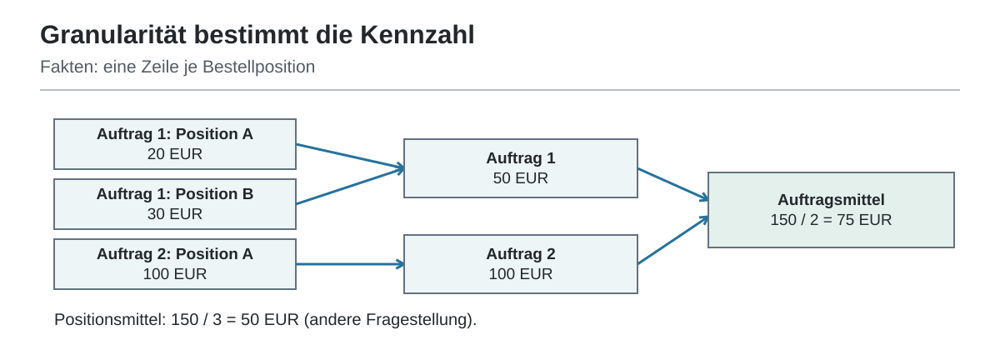

# M16-L1 – Data Warehouse und Kennzahlensysteme {#L1}

**Kursbereich:** M16 – Business Intelligence

**Niveau:** Bachelor/Übergang/Master · Kern/Grundlagen

**Vorwissen:** [M15-L2](M15-L2.md)

**Lernziel:** Fakten- und Dimensionstabellen unterscheiden und eine Kennzahl auf der richtigen Granularität berechnen.

## Einstieg und Grundbegriffe {#S1}

Ein Data Warehouse integriert Daten aus mehreren Quellen für historische Analysen. In einem dimensionalen Modell enthält eine Faktentabelle messbare Ereignisse auf einer definierten Granularität; Dimensionen liefern Auswertungskontext. Kennzahlen benötigen klare Definitionen, Einheiten, Zeitbezug und Datenherkunft. Aggregationen dürfen keine Doppelzählungen oder unzulässige Summen erzeugen.

## Begriffszusammenhang {#S2}

*Abbildung: Drei Positionen mit 20, 30 und 100 Euro gehören zu zwei Aufträgen: Positionsmittel 50 Euro, Auftragsmittel 75 Euro.*

## Beispiel und Anwendung {#S3}

Eine Faktentabelle enthält eine Zeile pro Bestellposition mit Menge und Nettoerlös. Zeit- und Artikeldimensionen erlauben Monats- und Produktvergleiche. Der durchschnittliche Auftragswert muss auf Auftragsebene und nicht als Durchschnitt der Positionswerte berechnet werden.

Eine Bestell-ID kann als Attribut in der Faktentabelle verbleiben. Bei eindeutigen, nicht fehlenden Auftragskennungen ergibt sich der mittlere Auftragswert im Beispiel aus SUM(Nettoerlös) geteilt durch COUNT(DISTINCT Bestell-ID). Filter auf einzelne Artikel können allerdings Teilaufträge erfassen.

Bei einem Produktfilter kann dieselbe Bestellung in mehreren Produktgruppen enthalten sein. Gruppenweise gezählte Bestellungen sind daher nicht ohne Weiteres addierbar. Für den durchschnittlichen vollständigen Auftragswert muss die Auswahl der Aufträge von der Summierung ihrer vollständigen Positionen getrennt werden.

## Selbstkontrolle {#S4}

### Aufgabe

Zwei Aufträge haben Positionserlöse 20,30 beziehungsweise 100 Euro. Berechne den durchschnittlichen Auftragswert.

::: {.lc-solutions data-lc-section="S4"}
(20+30+100)/2=75 Euro. Der Durchschnitt der drei Positionen wäre 50 Euro und beantwortet eine andere Frage.
:::

## Weiterführung {#S5}

[M16-L2](M16-L2.md)

## Quellen und Vertiefung {#S6}

- [Universität Münster – Aufbau des Wirtschaftsinformatikstudiums (B.Sc.)](https://www.wi.uni-muenster.de/de/studieninteressierte/unsere-studiengaenge/bachelor-science-wirtschaftsinformatik/aufbau-des) · Studienprofil; curricularer Kontext, kein Einzelnachweis der Fachdetails · Zuletzt abgerufen: 2026-11-25
- [Microsoft Learn – Understand star schema](https://learn.microsoft.com/en-us/power-bi/guidance/star-schema) · Fakten, Dimensionen und Granularität; produktspezifische Modellierungshinweise · Zuletzt abgerufen: 2026-11-25
