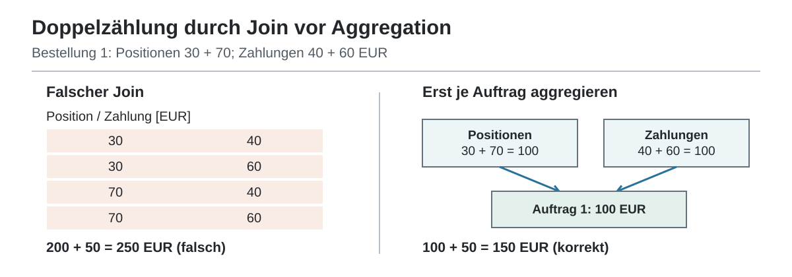

# M16-L2 – Datenpipelines und Datenqualität {#L2}

**Kursbereich:** M16 – Business Intelligence

**Niveau:** Bachelor/Übergang/Master · Kern/Grundlagen

**Vorwissen:** [M16-L1](M16-L1.md)

**Lernziel:** Datenqualitätsregeln formulieren und Doppelzählungen durch Verknüpfungen erkennen.

## Einstieg und Grundbegriffe {#S1}

Eine Datenpipeline extrahiert, transformiert und lädt Daten oder lädt sie vor der Transformation. ETL und ELT unterscheiden sich im Ort beziehungsweise Zeitpunkt der Transformation. Datenqualität umfasst etwa Vollständigkeit, Konsistenz, Aktualität und fachliche Gültigkeit. Pipeline-Tests sollen Schemaänderungen, Duplikate und fachliche Grenzfälle erkennen; Herkunft und Transformationsregeln machen Ergebnisse nachvollziehbar.

## Begriffszusammenhang {#S2}

*Abbildung: Zwei Positionen und zwei Zahlungen für Auftrag 1 erzeugen vier Join-Zeilen. Falsche Gesamtsumme 250 Euro statt 150 Euro.*

## Beispiel und Anwendung {#S3}

Eine tägliche Importdatei enthält 1.000 Zeilen, davon 20 doppelte Geschäftsereignisse. Nach fachlich definierter Deduplikation werden 980 Ereignisse verarbeitet. Eine Protokollierung hält die ausgeschlossenen Zeilen und Gründe fest.

### Vertiefung und Modellgrenzen

Die Granularität der Faktentabelle definiert, welche Summen sinnvoll sind. Eine Bestellung mit mehreren Positionen darf bei einem Join auf mehrere Zahlungen nicht unabsichtlich vervielfacht werden. Datenqualitätsregeln brauchen sowohl eine technische Prüfung als auch fachliche Zuständigkeit.

Eine fehlende Zahlung ist nicht automatisch eine Zahlung von null Euro. LEFT JOIN erhält den Auftrag auch ohne Zahlung; NULL muss fachlich interpretiert werden. SUM(DISTINCT Betrag) ist keine allgemeine Lösung, da verschiedene gültige Positionen denselben Betrag haben können.

Voraggregation benötigt je Tabelle einen fachlich eindeutigen Schlüssel und eine definierte Behandlung stornierter beziehungsweise fehlender Werte. Eine Prüfung der Gesamtsumme allein reicht nicht: Gegenläufige Fehler können sich aufheben. Kontrollsummen je Auftrag und Zahl der nicht zugeordneten Datensätze ergänzen die Gesamtprüfung.

## Selbstkontrolle {#S4}

### Aufgabe

Warum ist es riskant, alle Zeilen mit gleicher Kundennummer zu deduplizieren?

### Modul-Fallstudie

Bestellung 1 hat Positionen 30 und 70 Euro sowie zwei Zahlungen 40 und 60 Euro. Bestellung 2 hat eine Position über 50 Euro und eine Zahlung über 50 Euro. Welche falsche Positionssumme entsteht, wenn beide Tabellen vor Aggregation allein über Bestell-ID verbunden werden? Korrigiere den Abfrageplan.

::: {.lc-solutions data-lc-section="S4"}
Ein Kunde kann mehrere gültige Bestellungen haben. Deduplikation benötigt einen Schlüssel für das Geschäftsereignis, nicht nur für die beteiligte Person.

**Lösung der Fallstudie:** Für Bestellung 1 entstehen 2·2=4 Zeilen; Positionssumme 200 statt 100. Zusammen 250 statt 150 Euro. Aggregiere Positionen und Zahlungen getrennt je Bestell-ID; verbinde dann die beiden Ergebnisse mit eindeutiger Bestell-ID. Teste je Bestellung die Zeilenanzahl, die erwartete Summe und fehlende Zahlungen mittels LEFT JOIN.

:::

## Weiterführung {#S5}

[M16-L3](M16-L3.md)

## Quellen und Vertiefung {#S6}

- [Universität Münster – Aufbau des Wirtschaftsinformatikstudiums (B.Sc.)](https://www.wi.uni-muenster.de/de/studieninteressierte/unsere-studiengaenge/bachelor-science-wirtschaftsinformatik/aufbau-des) · Studienprofil; curricularer Kontext, kein Einzelnachweis der Fachdetails · Zuletzt abgerufen: 2026-11-25
- [PostgreSQL 16 – Table Expressions](https://www.postgresql.org/docs/16/queries-table-expressions.html) · Abschnitt 7.2.1.1 zu Join-Kardinalität und Outer Joins · Zuletzt abgerufen: 2026-11-25
