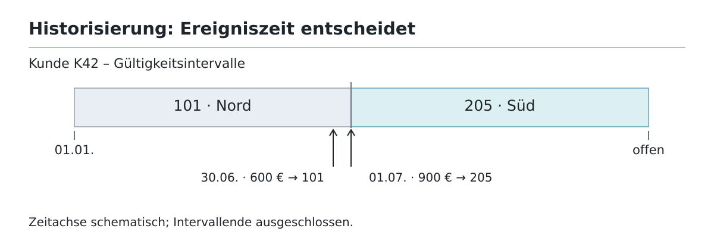

# M16-L3 – Historisierung im Data Warehouse {#L3}

**Kursbereich:** M16 – Business Intelligence

**Niveau:** Bachelor/Übergang/Master · Kern/Grundlagen

**Vorwissen:** [M16-L2](M16-L2.md)

**Lernziel:** Geschäftsvorgänge der zum Ereigniszeitpunkt gültigen Stammdatenversion zuordnen.

## Einstieg und Grundbegriffe {#S1}

Ein Data Warehouse trennt messbare Geschäftsvorfälle in Faktentabellen von beschreibenden Dimensionen. Eine Kundendimension enthält beispielsweise Kundennummer und Region. Ändert sich die Region, kann eine Typ-1-Historisierung den alten Wert überschreiben; dann lassen sich vergangene Umsätze nach dem aktuellen Regionsstand auswerten. Bei Slowly Changing Dimension Type 2 (SCD2) wird dagegen eine weitere Dimensionszeile mit eigenem technischem Schlüssel erzeugt. Der stabile fachliche Schlüssel bleibt gleich. Gültigkeitsintervalle und ein aktueller Status unterstützen die Zuordnung.

Eine Faktzeile verweist auf den technischen Dimensionsschlüssel, der zum fachlich definierten Ereigniszeitpunkt passt. Halb offene Intervalle [Beginn, Ende) verhindern Doppelzuordnungen an einer Intervallgrenze. Überschneidungen und Lücken müssen geprüft werden. Bei verspätet gelieferten Fakten ist der Ereigniszeitpunkt vom Ladezeitpunkt zu unterscheiden. Historisierung ist keine Aufforderung, personenbezogene Daten unbegrenzt zu speichern; Lösch-, Korrektur- und Aufbewahrungsregeln sind gesondert zu definieren.

## Begriffszusammenhang {#S2}

*Abbildung: Zwei zeitlich gültige Dimensionsversionen und zugeordnete Umsätze. Eigenes Modellbeispiel.*

## Beispiel und Anwendung {#S3}

Kunde K42 gehört bis zum 1. Juli zur Region Nord, danach zu Süd. Dimensionsschlüssel 101 gilt von 1. Januar bis ausschließlich 1. Juli; 205 ab 1. Juli. Ein Umsatz von 600 € am 30. Juni referenziert 101, ein Umsatz von 900 € am 1. Juli referenziert 205. Historische Auswertung: Nord 600 €, Süd 900 €. Bei Typ 1 und Auswertung nach aktueller Region würden beide Umsätze Süd zugeordnet, insgesamt 1.500 €. Die passende Variante hängt von der Fragestellung ab; eine Auswertung nach aktueller Organisationsstruktur kann legitim sein, muss aber als solche gekennzeichnet werden.

Historisierte Schlüssel dürfen nicht durch eine vollständige Neunummerierung ungültig werden, solange Fakten darauf verweisen. Bei rückwirkenden Änderungen ist zu klären, welche fachlichen Zeitintervalle korrigiert und welche Fakten neu zugeordnet werden. Fehlende oder mehrdeutige Treffer werden als Datenqualitätsfälle behandelt.

## Selbstkontrolle {#S4}

### Aufgabe

Ein Umsatz von 200 € mit Ereignisdatum 29. Juni wird erst im August geladen. Welcher Schlüssel passt? Berechne die neuen historischen Regionssummen.

::: {.lc-solutions data-lc-section="S4"}
Schlüssel 101. Nord 800 €, Süd 900 €, gesamt 1.700 €. Die Ladezeit darf die Ereigniszuordnung nicht verschieben.
:::

## Weiterführung {#S5}

[M17-L1](M17-L1.md)

## Quellen und Vertiefung {#S6}

- [Kimball Group – Type 2: Add New Row](https://www.kimballgroup.com/data-warehouse-business-intelligence-resources/kimball-techniques/dimensional-modeling-techniques/type-2/) · Methodischer Fachbeleg; relevante Passage im Web eingesehen. Zuletzt abgerufen: 2026-11-25.
- [Microsoft Learn – Load tables in a dimensional model](https://learn.microsoft.com/en-us/fabric/data-warehouse/dimensional-modeling-load-tables) · SCD2, stabile Ersatzschlüssel und historische Zuordnung; produktbezogene Dokumentation · Zuletzt abgerufen: 2026-11-25
