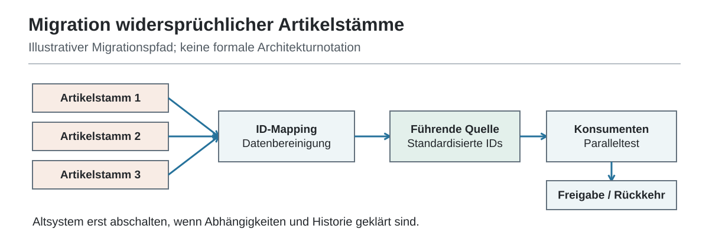

# M17-L1 – IT-Strategie und Unternehmensarchitektur {#L1}

**Kursbereich:** M17 – IT-Strategie und Governance

**Niveau:** Master · Kern/Grundlagen

**Vorwissen:** [M16-L2](M16-L2.md)

**Lernziel:** Architekturabhängigkeiten identifizieren und eine Migration widersprüchlicher Stammdaten begründen.

## Einstieg und Grundbegriffe {#S1}

IT-Strategie richtet technische Fähigkeiten auf organisatorische Ziele aus. Unternehmensarchitektur beschreibt Zusammenhänge zwischen Geschäftsprozessen, Daten, Anwendungen und Technik. Architekturentscheidungen müssen Abhängigkeiten und Übergangsrisiken sichtbar machen. Ein Zielbild ist keine vollständige Migrationsplanung; Istzustand, Zwischenschritte und Verantwortlichkeiten gehören dazu.

## Begriffszusammenhang {#S2}

*Abbildung: Drei alte Artikelstämme werden über ID-Mapping und Bereinigung auf eine führende Quelle migriert. Konsumenten testen, dann Freigabe oder Rückkehr.*

## Beispiel und Anwendung {#S3}

Ein Handelsunternehmen betreibt drei widersprüchliche Artikelstämme. Das Zielbild definiert eine führende Artikelquelle, standardisierte IDs und Schnittstellen. Die Migration braucht Mapping, Datenbereinigung, Parallelbetrieb und eine Strategie zur Rückkehr bei Fehlern.

Für den Paralleltest werden alte und neue Artikelkennungen anhand repräsentativer Bestellungen verglichen. Vor einer Abschaltung müssen verbleibende Abhängigkeiten und die Lesbarkeit historischer Datensätze geklärt sein; ein Rückkehrplan muss auch zwischenzeitliche Schreibvorgänge berücksichtigen.

Die Entscheidung über eine führende Quelle muss für jedes betroffene Datenobjekt und gegebenenfalls einzelne Attribute gelten. Ein technischer Schnittstellentest allein genügt nicht: Stichproben sollen auch Mengen, Preise, Einheiten und historische Belegzuordnungen abgleichen.

## Selbstkontrolle {#S4}

### Aufgabe

Welche fachliche Abhängigkeit ist vor Abschalten eines alten Artikelstamms zu prüfen?

::: {.lc-solutions data-lc-section="S4"}
Alle konsumierenden Prozesse und Anwendungen müssen entweder erfolgreich umgestellt oder bewusst behandelt sein. Historische IDs, Berichte und Audit-Anforderungen sind einzubeziehen.
:::

## Weiterführung {#S5}

[M17-L2](M17-L2.md)

## Quellen und Vertiefung {#S6}

- [Universität Mannheim – Master Wirtschaftsinformatik](https://www.wim.uni-mannheim.de/studium/im-studium/master-wirtschaftsinformatik/) · Studienstruktur; Forschungsseminare und Abschlussarbeit, curricularer Kontext · Zuletzt abgerufen: 2026-11-25
- [CMS – Federal Enterprise Architecture Framework](https://www.cms.gov/data-research/cms-information-technology/enterprise-architecture/federal-enterprise-architecture-framework) · Geschäfts-, Daten-, Anwendungs- und Technologiearchitektur am Beispiel einer öffentlichen Institution · Zuletzt abgerufen: 2026-11-25
