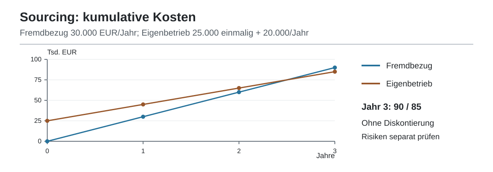

# M17-L2 – IT-Governance, Portfolio und Sourcing {#L2}

**Kursbereich:** M17 – IT-Strategie und Governance

**Niveau:** Master · Kern/Grundlagen

**Vorwissen:** [M17-L1](M17-L1.md)

**Lernziel:** IT-Sourcing-Kosten vergleichen und Portfolioentscheidungen unter Ressourcenbeschränkungen begründen.

## Einstieg und Grundbegriffe {#S1}

Governance legt Entscheidungsrechte, Verantwortlichkeiten und Kontrollmechanismen fest. Portfoliomanagement priorisiert Vorhaben unter Budget-, Kapazitäts- und Risikogrenzen. Sourcing entscheidet über Eigenleistung und Fremdbezug; neben dem Preis sind Abhängigkeiten, Vertragsbedingungen, Datenportabilität und Exit-Kosten relevant. Wirtschaftliche Bewertung muss unterschiedliche Zeithorizonte und Unsicherheit berücksichtigen.

## Begriffszusammenhang {#S2}

*Abbildung: Undiskontierte kumulative Kosten für Fremdbezug und Eigenbetrieb nach null, einem, zwei und drei Jahren: 0/25, 30/45, 60/65, 90/85 Tausend Euro.*

## Beispiel und Anwendung {#S3}

Ein Fremddienst kostet 30.000 Euro jährlich; interner Betrieb 20.000 Euro jährlich plus 25.000 Euro Einrichtung. Undiskontiert über drei Jahre sind es 90.000 gegenüber 85.000 Euro. Ein knappes Kostenergebnis genügt nicht, wenn Betriebsrisiken oder Exit-Bedingungen unterschiedlich sind.

### Vertiefung und Modellgrenzen

Eine Portfoliobewertung muss knappe Ressourcen, Abhängigkeiten und Nutzenunsicherheit berücksichtigen. Ein gewichtetes Scoring unterstützt Transparenz, ersetzt aber keine verbindliche Ressourcen- oder Risikoprüfung. Der gewichtete Score ist von der Skalierung abhängig.

Bei unveränderten Kosten liegt der rechnerische Schnittpunkt der undiskontierten Kostenfunktionen bei 2,5 Jahren. Bei ausschließlich jährlicher Abrechnung ist dies eine Interpolation, kein tatsächlicher Zahlungszeitpunkt. Ein positiver Kalkulationszins und zusätzliche Exit-Kosten können die Rangfolge ändern.

Bei nachschüssigen Jahreszahlungen und 5 Prozent Kalkulationszins beträgt der Barwert des externen Dienstes über drei Jahre rund 81.697 Euro, der des Eigenbetriebs rund 79.465 Euro einschließlich Einrichtung zum Zeitpunkt null. Der Kostenvorteil sinkt damit auf etwa 2.232 Euro; gleiche Leistungen und keine weiteren Zahlungen bleiben vorausgesetzt.

## Selbstkontrolle {#S4}

### Aufgabe

Welche Information benötigst du zusätzlich für einen Vergleich per Kapitalwert?

### Modul-Fallstudie

Projekt A benötigt 40 Personentage und hat Nutzenpunkte 8; B benötigt 30 und hat 7; C benötigt 20 und hat 4. Budget 60 Tage; B setzt C voraus. Wähle die zulässige Kombination mit maximalem additivem Nutzen. Prüfe, was bei 50 Tagen passiert.

::: {.lc-solutions data-lc-section="S4"}
Zeitpunkte der Zahlungen, geeigneter Kalkulationszins, erwartete Restwerte und relevante zusätzliche Kosten sowie Annahmen zu Risiken.

**Lösung der Fallstudie:** A+C benötigt 60 und erreicht 12. B+C benötigt 50 und erreicht 11. A allein erreicht 8, C allein 4; B allein unzulässig. Bei 60 gewinnt A+C, bei 50 B+C. Die Additivität ist eine Modellannahme; Nutzenüberschneidungen, Pflichtprojekte und mehrere Ressourcentypen erfordern weitere Nebenbedingungen.

:::

## Weiterführung {#S5}

[M17-L3](M17-L3.md)

## Quellen und Vertiefung {#S6}

- [Universität Mannheim – Master Wirtschaftsinformatik](https://www.wim.uni-mannheim.de/studium/im-studium/master-wirtschaftsinformatik/) · Studienstruktur; Forschungsseminare und Abschlussarbeit, curricularer Kontext · Zuletzt abgerufen: 2026-11-25
- [Google OR-Tools – MathOpt](https://developers.google.com/optimization/math_opt) · Modellierung linearer und gemischt-ganzzahliger Probleme; kein Beweis der Beispiellösung · Zuletzt abgerufen: 2026-11-25
