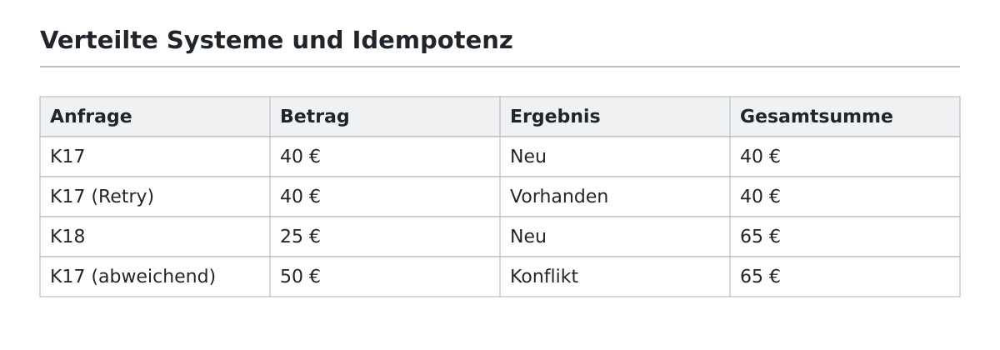

# M17-L3 – Verteilte Systeme und Idempotenz {#L3}

**Kursbereich:** M17 – IT-Strategie und Governance

**Niveau:** Master · Kern/Grundlagen

**Vorwissen:** [M17-L2](M17-L2.md)

**Lernziel:** Wiederholte Zahlungsanforderungen anhand eines Idempotenzschlüssels sicher behandeln.

## Einstieg und Grundbegriffe {#S1}

Bei verteilten Systemen kann ein Server eine Anfrage bereits verarbeitet haben, obwohl die Antwort den Client nicht erreicht. Ein Timeout bedeutet daher nicht zwangsläufig, dass keine Zustandsänderung stattgefunden hat. Idempotente Operationen erzeugen bei Wiederholung derselben logisch identifizierten Anfrage keinen zusätzlichen beabsichtigten Geschäftseffekt. Für nicht von sich aus idempotente Operationen kann der Client einen stabilen Anfrage- oder Idempotenzschlüssel übergeben. Der Empfänger speichert Schlüssel und Ergebnis und erkennt Wiederholungen. Ein eindeutiger Datenbank-Constraint und atomare Speicherung des Schlüssels mit der lokalen Zustandsänderung verhindern konkurrierende Doppelverarbeitung in dieser Datenbank. Externe Seiteneffekte sind dadurch allein nicht geschützt. Bei gleicher ID und abweichenden Daten sollte ein Konflikt gemeldet werden. Aufbewahrungsdauer, Berechtigung und Fehlerfälle müssen definiert sein. Wiederholungen sollten begrenzt und mit Rückoff-Zeiten versehen werden, um Überlastung zu vermeiden.

## Begriffszusammenhang {#S2}

*Abbildung: Anfragefolge mit stabilen Schlüsseln und ohne doppelte Gutschrift. Eigenes Modellbeispiel.*

## Beispiel und Anwendung {#S3}

Ein ERP erhält den Auftrag, eine Gutschrift über 40 € mit Schlüssel K17 anzulegen. Es speichert Gutschrift und Schlüssel in einer Transaktion. Die Antwort geht verloren; die erneute Anfrage mit K17 erhält das vorhandene Ergebnis zurück. Eine neue Gutschrift K18 über 25 € wird einmal angelegt. Ohne Deduplizierung könnten drei erfolgreiche Verarbeitungsvorgänge 105 € ergeben; mit korrekter Deduplizierung entstehen zwei Geschäftsvorfälle über zusammen 65 €. Ein nachgeschaltetes Buchhaltungssystem benötigt eine eigene idempotente Schnittstelle oder geeignete Zustell- und Abstimmungsmechanismen.

Der Schlüssel muss im definierten Mandanten- und Operationsbereich eindeutig sein. Vor Rückgabe eines gespeicherten Ergebnisses wird die Berechtigung erneut geprüft. Die Speicherdauer muss zum maximalen Wiederholungsfenster passen; eine Wiederholung nach Ablauf der Frist benötigt eine definierte Behandlung.

## Selbstkontrolle {#S4}

### Aufgabe

K17 wird erneut mit 50 € übermittelt. Was soll passieren? Warum genügt eine flüchtige Liste bereits bearbeiteter IDs nicht?

::: {.lc-solutions data-lc-section="S4"}
Die Anfrage soll als Konflikt abgelehnt werden, nicht als neue Gutschrift oder als scheinbar erfolgreicher 50-€-Vorgang. Nach Prozessneustart geht eine flüchtige Liste verloren; ohne atomare Kopplung von Geschäftsänderung und ID-Speicherung kann ein Absturz zwischen beiden zu Doppel- oder Nichtverarbeitung führen.
:::

## Weiterführung {#S5}

[M17-L4](M17-L4.md)

## Quellen und Vertiefung {#S6}

- [Unmesh Joshi – Idempotent Receiver](https://martinfowler.com/articles/patterns-of-distributed-systems/idempotent-receiver.html) · Methodischer Fachbeleg; relevante Passage im Web eingesehen. Zuletzt abgerufen: 2026-11-25.
