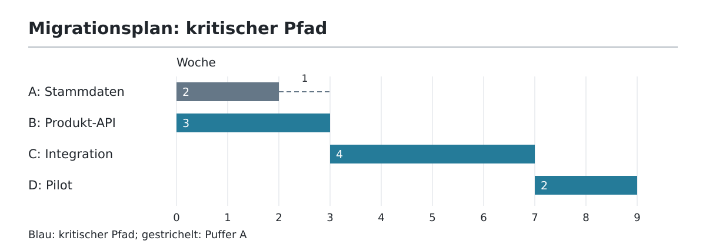

# M17-L4 – Architekturtransformation und Migrationsplanung {#L4}

**Kursbereich:** M17 – IT-Strategie und Governance

**Niveau:** Master · Kern/Grundlagen

**Vorwissen:** [M17-L3](M17-L3.md)

**Lernziel:** Migrationsabhängigkeiten auswerten, Endtermin und Puffer bestimmen und Rückfallbedingungen nennen.

## Einstieg und Grundbegriffe {#S1}

Unternehmensarchitektur verbindet Geschäftsziele mit Fähigkeiten, Daten, Anwendungen und Infrastruktur. Ein Ist-Modell beschreibt die heutige Landschaft; das Zielmodell beschreibt die für einen definierten Zeithorizont gewünschte Landschaft. Die Differenz wird nicht bloß als Liste fehlender Technologien erfasst, sondern als Lücke zwischen benötigten Fähigkeiten und realisierbaren Leistungen. Architekturentscheidungen müssen daher auf Anforderungen, Verantwortliche und messbare Ergebnisse zurückführbar sein. TOGAF bietet hierfür einen Entwicklungs- und Governance-Rahmen, ArchiMate eine Modellierungssprache. Die folgende Abhängigkeitsplanung verwendet bewusst keine formale ArchiMate-Notation.

Eine Transition ist ein betriebsfähiger Zwischenzustand. Migrationen können schrittweise erfolgen, wenn die Schnittstellen zu Altsystemen, Datenverantwortung und Rückfalloptionen eindeutig sind. Bei einer parallelen Datenführung muss festgelegt werden, welches System für welche Felder führend ist; andernfalls entstehen widersprüchliche Wahrheiten. Ein Architekturentscheidungsprotokoll hält Kontext, Alternativen, Entscheidung und Konsequenzen fest. Eine technische Abhängigkeit allein begründet noch keinen wirtschaftlichen Vorrang: Der Nutzen eines früheren Releases muss gegen Risiken und Übergangskosten abgewogen werden.

## Begriffszusammenhang {#S2}

*Abbildung: Migrationsabhängigkeiten und früheste Endtermine. Eigenes Modellbeispiel.*

## Beispiel und Anwendung {#S3}

Ein Händler migriert seine Bestellplattform. A bereinigt Kundenstammdaten (2 Wochen), B errichtet die Produkt-API (3 Wochen). Beide beginnen gleichzeitig. C integriert den Bestellservice (4 Wochen) und benötigt A und B; D erprobt die neue Plattform (2 Wochen) nach C. Bei unbegrenzter Ressourcenkapazität endet A in Woche 2, B in Woche 3, C in Woche 7 und D in Woche 9. B–C–D ist der kritische Pfad; A besitzt eine Woche Puffer. Die Datenfreigabe ist ein explizites Gate vor C. Eine Verzögerung von A um genau eine Woche verändert den Endtermin nicht.

Der Pilot arbeitet zunächst mit einer Kundengruppe. Erfolgskriterien sind mindestens 99,5 % erfolgreiche Bestelltransaktionen und keine ungeklärten Abweichungen zwischen Alt- und Neusystem bei der täglichen Abstimmung. Ein Rückfall darf nicht bereits bestätigte Bestellungen vernichten: Ereignisprotokoll und wiederholbare Schnittstellenoperationen müssen vorab erprobt sein. Die neun Wochen sind ein deterministischer Plan, keine Prognose mit Konfidenzintervall.

Eine Woche Puffer ergibt sich im Modell nur bei unveränderten Abhängigkeiten und ohne weitere Ressourcenengpässe. Wenn beide Pfade gleich lang werden, können mehrere kritische Pfade entstehen. Ein Freigabegate mit unbekannter Dauer muss als eigene Planannahme kenntlich gemacht werden.

## Selbstkontrolle {#S4}

### Aufgabe

B dauert jetzt fünf statt drei Wochen. Berechne Endtermin und Puffer von A. Nenne eine Bedingung für einen sicheren Rückfall.

::: {.lc-solutions data-lc-section="S4"}
Endtermin: 5 + 4 + 2 = 11 Wochen. A hat 5 − 2 = 3 Wochen Puffer. Bestätigte Bestellungen müssen nach Rückfall vollständig rekonstruierbar sein; ein bloßes Zurückspielen eines alten Datenbanksnapshots genügt nicht.
:::

## Weiterführung {#S5}

[M17-L5](M17-L5.md)

## Quellen und Vertiefung {#S6}

- [The Open Group – ArchiMate and TOGAF](https://help.opengroup.org/hc/en-us/articles/32115987894930-How-the-ArchiMate-Language-and-the-TOGAF-Standard-Complement-Each-Other) · Methodischer Fachbeleg; relevante Passage im Web eingesehen. Zuletzt abgerufen: 2026-11-25.
