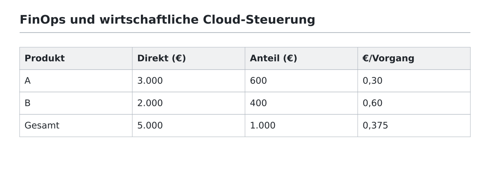

# M17-L5 – FinOps und wirtschaftliche Cloud-Steuerung {#L5}

**Kursbereich:** M17 – IT-Strategie und Governance

**Niveau:** Master · Kern/Grundlagen

**Vorwissen:** [M17-L4](M17-L4.md)

**Lernziel:** Cloud-Gemeinkosten zuordnen und produktbezogene Stückkosten sowie Gesamtkennzahlen berechnen.

## Einstieg und Grundbegriffe {#S1}

FinOps verbindet technische Verbrauchsdaten mit finanzieller Verantwortung und betrieblichem Nutzen. Ein Cloud-Budget allein verrät nicht, ob Kosten durch mehr Nachfrage, ineffiziente Verarbeitung oder höhere Preise steigen. Stückkosten beziehen zurechenbare Gesamtkosten auf eine relevante Leistungseinheit, etwa erfolgreich abgewickelte Bestellungen. Die Kostenabgrenzung muss dokumentiert werden: direkte Ressourcen, gemeinsam genutzte Infrastruktur, Support, Rabatte und gegebenenfalls interne Personalkosten. Ein Kostenstellen-Tag ist lediglich ein Zuordnungshinweis, keine Garantie für vollständige Kostenrechnung.

Durchschnittskosten und Grenzkosten sind verschieden. Wenn eine Ressource bei geringer Auslastung ohnehin bezahlt wird, können zusätzliche Vorgänge fast ohne Zusatzkosten verarbeitet werden; bei Kapazitätssprüngen gilt das nicht. Eine niedrigere Stückkostenkennzahl darf nicht durch den Ausschluss fehlgeschlagener Kosten oder durch schlechtere Servicequalität erkauft werden. Neben der Stückkostenentwicklung sind deshalb Durchsatz, Fehlerquote, Latenz und Geschäftsertrag zu beobachten. Showback weist Kosten aus, Chargeback belastet interne Einheiten tatsächlich.

## Begriffszusammenhang {#S2}

*Abbildung: Kostenallokation und gewichtete Stückkosten. Eigenes Modellbeispiel.*

## Beispiel und Anwendung {#S3}

Zwei Produkte A und B verursachen direkte Monatskosten von 3.000 € und 2.000 €. Eine gemeinsam genutzte Plattform kostet weitere 1.000 €. A verbraucht 60 % der gemessenen Plattformressourcen, B 40 %. Die zugerechneten Kosten betragen 3.600 € und 2.400 €. Bei 12.000 beziehungsweise 4.000 erfolgreichen Vorgängen ergeben sich 0,30 € und 0,60 € je Vorgang. Die Gesamtkennzahl ist 6.000 / 16.000 = 0,375 € und nicht das ungewichtete Mittel der beiden Stückkosten.

Im Folgemonat steigt die Zahl erfolgreicher A-Vorgänge auf 18.000 bei unveränderten zugerechneten Kosten. Die Stückkosten sinken auf 0,20 €. Die Aussage setzt voraus, dass der Leistungsumfang und die Zuordnungsregeln gleich bleiben. Eine alternative Aufteilung der Gemeinkosten nach Umsatz kann organisatorisch sinnvoll sein, ist jedoch nicht mit der verbrauchsorientierten Kennzahl gleichzusetzen.

Nicht zugeordnete Kosten müssen explizit ausgewiesen werden. Bei null erfolgreichen Vorgängen ist die Stückkostenkennzahl für die Einheit nicht definiert; sie beträgt nicht null. Die Gesamtstückkosten ergeben sich aus der Gesamtsumme und der gesamten vergleichbaren Leistungsmenge, nicht aus einem ungewichteten Mittel.

## Selbstkontrolle {#S4}

### Aufgabe

Gemeinkosten steigen auf 1.500 €, die Verteilung bleibt gleich. Berechne die Stückkosten beider Produkte bei ursprünglichem Durchsatz und die Gesamtkennzahl.

::: {.lc-solutions data-lc-section="S4"}
A: (3.000 + 900)/12.000 = 0,325 €. B: (2.000 + 600)/4.000 = 0,65 €. Gesamt: 6.500/16.000 = 0,40625 €. Die Zuordnung summiert sich exakt auf die Gesamtkosten.
:::

## Weiterführung {#S5}

[M17-L6](M17-L6.md)

## Quellen und Vertiefung {#S6}

- [FinOps Foundation – Unit Economics](https://www.finops.org/framework/capabilities/unit-economics/) · Methodischer Fachbeleg; relevante Passage im Web eingesehen. Zuletzt abgerufen: 2026-11-25.
- [FinOps Foundation – Allocation](https://www.finops.org/framework/capabilities/allocation/) · Gemeinkostenverteilung und Zuordnungsregeln · Zuletzt abgerufen: 2026-11-25
