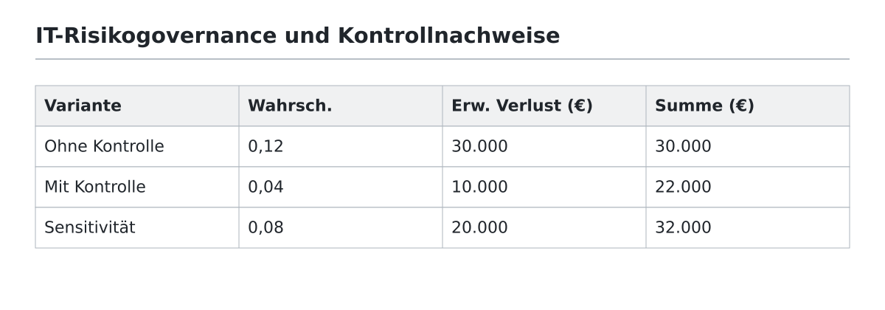

# M17-L6 – IT-Risikogovernance und Kontrollnachweise {#L6}

**Kursbereich:** M17 – IT-Strategie und Governance

**Niveau:** Master · Kern/Grundlagen

**Vorwissen:** [M17-L5](M17-L5.md)

**Lernziel:** Erwartete Risikoverluste vergleichen und Kontrollmaßnahmen anhand weiterer Entscheidungskriterien beurteilen.

## Einstieg und Grundbegriffe {#S1}

Governance bestimmt, wer Risiken bewertet, Maßnahmen verantwortet und verbleibende Risiken akzeptieren darf. Die Govern-Funktion des NIST CSF 2.0 hebt diese organisatorische Ebene ausdrücklich hervor. Eine Risikotoleranz ist eine Entscheidung der zuständigen Leitung, keine Eigenschaft eines technischen Systems. Ein Risikoregister enthält Szenario, betroffene Geschäftsziele, Eintrittsannahmen, Auswirkungen, vorhandene Kontrollen, Maßnahmenverantwortliche und einen Termin für die erneute Bewertung. Kontrollnachweise zeigen, ob eine Maßnahme tatsächlich ausgeführt wird, etwa ein datierter Wiederherstellungstest statt einer bloßen Backup-Richtlinie.

Für ein einzelnes binäres Jahresszenario kann der erwartete Verlust als Wahrscheinlichkeit mal Schadenshöhe angenähert werden. Diese Kennzahl hilft beim Vergleich, erfasst aber weder extreme Schadensausprägungen noch Abhängigkeiten zwischen Szenarien. Ein geringerer Erwartungswert bedeutet nicht automatisch akzeptables Risiko. Rechtliche, vertragliche und sicherheitskritische Vorgaben sowie Liquiditätsrisiken können eine Maßnahme unabhängig von der Erwartungswertrechnung erforderlich machen.

## Begriffszusammenhang {#S2}

*Abbildung: Erwarteter Verlust mit und ohne Kontrollmaßnahme. Eigenes Modellbeispiel.*

## Beispiel und Anwendung {#S3}

Ein Modellunternehmen nimmt für einen jährlichen Ausfall eine Eintrittswahrscheinlichkeit von 0,12 und einen Schaden von 250.000 € an. Der erwartete Verlust beträgt 30.000 €. Eine Maßnahme kostet jährlich 12.000 € und reduziert unter Modellannahmen die Wahrscheinlichkeit auf 0,04 bei unveränderter Schadenshöhe. Der Restverlust beträgt 10.000 €, die Summe aus Restverlust und Maßnahme 22.000 €. Die erwartete jährliche Verbesserung beträgt 8.000 €. Das ist keine Garantie für eine tatsächliche Ersparnis.

Die Geschäftsleitung setzt zusätzlich eine maximale Wiederanlaufzeit von acht Stunden. Der IT-Betrieb liefert quartalsweise Testprotokolle. Ein Test mit zehn Stunden Wiederanlaufzeit löst eine Korrektur aus, selbst wenn die wirtschaftliche Modellrechnung positiv bleibt. Für das Szenario sind Wirkung und Kosten zu aktualisieren, sobald reale Test- oder Schadensdaten vorliegen.

Für mehrere mögliche Schadenshöhen ist der Erwartungswert als Summe der gewichteten Schäden zu berechnen. Abhängigkeiten verändern zwar nicht die Summe der Erwartungswerte additiver Verluste, wohl aber die gemeinsame Verlustverteilung und damit etwa die Wahrscheinlichkeit eines extremen Gesamtverlusts. Doppelzählungen gleicher Schäden sind zu vermeiden.

## Selbstkontrolle {#S4}

### Aufgabe

Die Maßnahme reduziert die Wahrscheinlichkeit nur auf 0,08. Berechne die erwartete Verbesserung. Muss die Maßnahme deshalb zwingend abgelehnt werden?

::: {.lc-solutions data-lc-section="S4"}
Restverlust 20.000 €, Gesamtkosten 32.000 €, Verbesserung −2.000 €. Nein: verbindliche Kontrollen, Verlustgrenzen und Wiederanlaufziele können die Maßnahme weiterhin begründen.
:::

## Weiterführung {#S5}

[M18-L1](M18-L1.md)

## Quellen und Vertiefung {#S6}

- [NIST – Cybersecurity Framework FAQ](https://www.nist.gov/cyberframework/faqs) · Methodischer Fachbeleg; relevante Passage im Web eingesehen. Zuletzt abgerufen: 2026-11-25.
