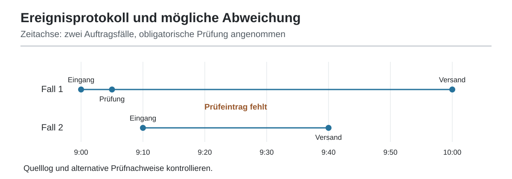

# M18-L1 – Process Mining und Ereignisprotokolle {#L1}

**Kursbereich:** M18 – Fortgeschrittene Prozessanalyse

**Niveau:** Master · Wahlvertiefung

**Vorwissen:** [M17-L2](M17-L2.md)

**Lernziel:** Ereignisprotokolle interpretieren und Nachweise für mögliche Prozessabweichungen identifizieren.

## Einstieg und Grundbegriffe {#S1}

Process Mining nutzt Ereignisdaten zur Untersuchung tatsächlich ausgeführter Prozesse. Ein klassisches Ereignisprotokoll enthält Fallkennung, Aktivität und Zeitstempel; zusätzliche Attribute liefern Kontext. Discovery leitet ein Modell aus beobachteten Abläufen ab, Conformance Checking vergleicht Beobachtungen mit einem Referenzmodell. Datenqualität und Wahl der Fallgrenze bestimmen die Aussagekraft.

## Begriffszusammenhang {#S2}

*Abbildung: Fall 1: Eingang 9:00, Prüfung 9:05, Versand 10:00. Fall 2: Eingang 9:10, kein Prüfeintrag, Versand 9:40. Fehlendes Ereignis ist kein Beweis einer Regelverletzung.*

## Beispiel und Anwendung {#S3}

Fall 1: Eingang 9:00, Prüfung 9:05, Versand 10:00. Fall 2: Eingang 9:10, Versand 9:40. Falls Prüfung obligatorisch ist, zeigt Fall 2 eine mögliche Abweichung. Ein fehlendes Ereignis kann jedoch auch auf unvollständige Protokollierung zurückgehen.

Die beiden beobachteten Durchlaufzeiten betragen 60 und 30 Minuten. Der kürzere zweite Fall beweist keine Effizienzsteigerung: Unterschiede im Auftragsmix, fehlende Prüfeinträge und alternative Prüfpfade sind zunächst zu untersuchen.

Vor der Analyse sind Zeitzone, Zeitstempelauflösung und die Regel für gleichzeitige Ereignisse festzulegen. Bei mehreren Objekten pro Geschäftsvorgang kann eine einzige Fallkennung Beziehungen verzerren. Die beiden beobachteten Zeiten erlauben nur eine deskriptive Aussage über diese Fälle.

## Selbstkontrolle {#S4}

### Aufgabe

Welche Daten benötigst du, um den Verdacht auf einen ausgelassenen Prüfschritt zu überprüfen?

::: {.lc-solutions data-lc-section="S4"}
Prozessregel, Quellprotokolle, Zuordnung der Ereignisse zum Fall und Informationen über mögliche alternative Prüfnachweise. Erst dann kann zwischen Datenfehler und Prozessabweichung unterschieden werden.
:::

## Weiterführung {#S5}

[M18-L2](M18-L2.md)

## Quellen und Vertiefung {#S6}

- [Universität Mannheim – Master Wirtschaftsinformatik](https://www.wim.uni-mannheim.de/studium/im-studium/master-wirtschaftsinformatik/) · Studienstruktur; Forschungsseminare und Abschlussarbeit, curricularer Kontext · Zuletzt abgerufen: 2026-11-25
- [IEEE Task Force on Process Mining – Overview](https://www.tf-pm.org/) · Überblick: Prozessanalyse auf Grundlage von Ereignisdaten · Zuletzt abgerufen: 2026-11-25
