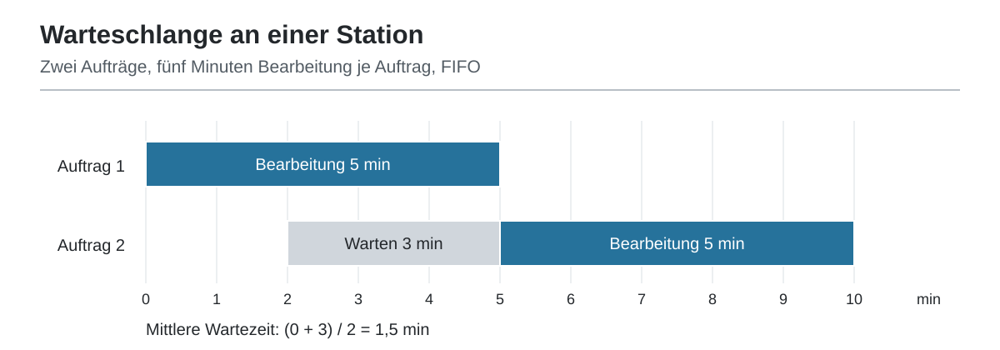

# M18-L2 – Simulation, Konformität und Prozessgestaltung {#L2}

**Kursbereich:** M18 – Fortgeschrittene Prozessanalyse

**Niveau:** Master · Wahlvertiefung

**Vorwissen:** [M18-L1](M18-L1.md)

**Lernziel:** Eine Warteschlangensimulation auswerten und ihre Grenzen für Investitionsentscheidungen benennen.

## Einstieg und Grundbegriffe {#S1}

Diskrete Ereignissimulation modelliert Zustandsänderungen zu einzelnen Zeitpunkten, beispielsweise Ankunft, Bearbeitungsbeginn und Abschluss. Sie ermöglicht Vergleiche von Szenarien mit stochastischen Eingaben, sofern das Modell kalibriert und validiert ist. Konformitätsmaße und Leistungsmaße beantworten unterschiedliche Fragen: Ein regelkonformer Ablauf kann langsam, ein schneller Ablauf regelwidrig sein.

## Begriffszusammenhang {#S2}

*Abbildung: Auftrag 1 bearbeitet Minute 0 bis 5; Auftrag 2 wartet von Minute 2 bis 5 und wird von 5 bis 10 bearbeitet.*

## Beispiel und Anwendung {#S3}

Zwei Aufträge treffen bei Minute 0 und 2 ein; eine Station braucht je fünf Minuten. Auftrag 1 endet bei 5, Auftrag 2 beginnt bei 5 und endet bei 10. Die Wartezeiten betragen 0 und 3 Minuten. Ein zweiter paralleler Arbeitsplatz könnte die Wartezeit verringern, kostet aber Ressourcen.

### Vertiefung und Modellgrenzen

Ein Directly-Follows-Graph zählt unmittelbar aufeinanderfolgende Aktivitäten pro Fall. Er kann Parallelität, Schleifen und fehlende Ereignisse nicht ohne Zusatzannahmen eindeutig erklären. Konformitätsmessung und Entdeckung sind verschiedene Aufgaben; die Qualität des Logs begrenzt beide.

Unter der Annahme identischer paralleler Stationen ohne zusätzliche Rüstzeiten würde Auftrag 2 bei Minute 2 beginnen und bei Minute 7 enden. Die mittlere Wartezeit sinkt in diesem deterministischen Beispiel von 1,5 auf 0 Minuten; die Auswirkung auf reale Nachfrage muss gesondert simuliert werden.

Die mittlere Durchlaufzeit beträgt im Modell mit einer Station (5+8)/2=6,5 Minuten, mit zwei Stationen 5 Minuten. Für stochastische Experimente sind Startzustand, Aufwärmphase bei stationären Modellen, unabhängige Replikationen und Unsicherheitsintervalle zu begründen. Die Modellprüfung umfasst sowohl die Implementierung als auch die Eignung für den vorgesehenen Einsatz.

## Selbstkontrolle {#S4}

### Aufgabe

Warum reicht ein einzelner Simulationslauf mit zwei Aufträgen nicht für eine Investitionsentscheidung?

### Modul-Fallstudie

Drei Ereignisspuren lauten A,B,C; A,C; A,B,B,C. Berechne die Kantenhäufigkeiten. Eine Sollregel verlangt mindestens ein B vor C. Welche Spuren entsprechen der Regel? Begründe, warum das noch keine vollständige Konformitätsprüfung ist.

::: {.lc-solutions data-lc-section="S4"}
Er enthält keine ausreichende Abbildung schwankender Nachfrage, Bearbeitungszeiten, Kosten oder seltener Störungen. Mehrere validierte Szenarien und Unsicherheitsmaße sind erforderlich.

**Lösung der Fallstudie:** A→B:2, B→C:2, A→C:1, B→B:1. Spur 1 und 3 erfüllen die angegebene Regel, Spur 2 verletzt sie (2/3 regelkonform). Ob wiederholtes B erlaubt ist oder A zwingend zuerst kommen muss, wurde nicht spezifiziert. Prüfe Logvollständigkeit, Sortierung und weitere Sollregeln, bevor du einen Gesamtwert berichtest.

:::

## Weiterführung {#S5}

[M18-L3](M18-L3.md)

## Quellen und Vertiefung {#S6}

- [Universität Mannheim – Master Wirtschaftsinformatik](https://www.wim.uni-mannheim.de/studium/im-studium/master-wirtschaftsinformatik/) · Studienstruktur; Forschungsseminare und Abschlussarbeit, curricularer Kontext · Zuletzt abgerufen: 2026-11-25
- [SimPy – Shared Resources](https://simpy.readthedocs.io/en/stable/simpy_intro/shared_resources.html) · Ressourcenkapazität und FIFO-Warteschlange · Zuletzt abgerufen: 2026-11-25
