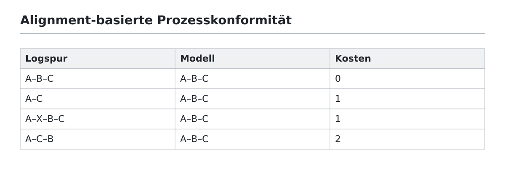

# M18-L3 – Alignment-basierte Prozesskonformität {#L3}

**Kursbereich:** M18 – Fortgeschrittene Prozessanalyse

**Niveau:** Master · Wahlvertiefung

**Vorwissen:** [M18-L2](M18-L2.md)

**Lernziel:** Einfache Alignment-Kosten bestimmen und beobachtete Abweichungen fachlich einordnen.

## Einstieg und Grundbegriffe {#S1}

Konformitätsprüfung vergleicht beobachtete Ereignisfolgen mit zulässigem Modellverhalten. Ein Alignment ordnet Log- und Modellschritte einander zu. Ein synchroner Schritt stimmt überein, ein reiner Logschritt besitzt kein Gegenstück im Modell, ein reiner Modellschritt besitzt kein Gegenstück im Log. Eine Kostenfunktion bestimmt, welche Abweichungen als schwerwiegend gelten. Die Suche nach einem Alignment minimaler Kosten setzt ein präzises Prozessmodell und eine definierte Kostenfunktion voraus. Bei realen Modellen mit Nebenläufigkeit oder Schleifen genügt ein einfacher Zeichenkettenvergleich nicht.

Fitness bewertet, wie gut ein Modell beobachtetes Verhalten erklären kann; Präzision erfasst, ob es zu viel zusätzliches Verhalten erlaubt. Ein Modell, das alles zulässt, kann hohe Fitness und schlechte Präzision besitzen. Datenqualität ist gesondert zu prüfen: Ein fehlender Logeintrag ist nicht automatisch ein unterlassener Geschäftsschritt. Die folgende Übung berechnet einfache Alignmentkosten, nicht die normalisierte Fitness einer konkreten Process-Mining-Software.

## Begriffszusammenhang {#S2}

*Abbildung: Minimale Alignmentkosten für vier Ereignisspuren. Eigenes Modellbeispiel.*

## Beispiel und Anwendung {#S3}

Ein vereinfachtes Freigabemodell erlaubt ausschließlich A–B–C (Antrag, Prüfung, Auszahlung). Synchrone Schritte kosten null, reine Modell- und Logschritte je eins. Für die Spur A–C wird B als reiner Modellschritt eingefügt; die Kosten betragen 1. Für A–X–B–C ist X ein reiner Logschritt, ebenfalls Kosten 1. Für A–C–B ist es nicht möglich, beide B und C synchron in der richtigen Modellreihenfolge zu halten: ein zusätzlicher und ein fehlender Schritt ergeben Kosten 2.

Die Kosten lassen sich mit dynamischer Programmierung bestimmen. D(i,j) ist der geringste Preis für die ersten i Log- und j Modellereignisse. Initialisierung D(i,0)=i und D(0,j)=j. Für verschiedene Ereignisse sind nur D(i−1,j)+1 und D(i,j−1)+1 zulässig; bei Übereinstimmung kommt D(i−1,j−1) hinzu. Dieses vereinfachte Verfahren hat quadratischen Aufwand bei gleich langen Spuren. In der Praxis müssen beispielsweise gleichzeitige Prüfungen oder alternative Freigabepfade explizit modelliert werden.

Für Loglänge n und Modellspurlänge m benötigt die angegebene vollständige Matrix O(n·m) Zeit und Speicher; für den reinen Kostenwert genügen zwei Zeilen. Kosten null bei identischen Spuren belegen nur Übereinstimmung mit diesem vereinfachten Modell, keine allgemeine Rechtskonformität.

## Selbstkontrolle {#S4}

### Aufgabe

Für A–B–B–C und A–X–C die minimalen Kosten bestimmen. Welche fachliche Prüfung ist bei fehlendem B notwendig?

::: {.lc-solutions data-lc-section="S4"}
A–B–B–C kostet 1 (doppeltes B); A–X–C kostet 2 (X zusätzlich und B fehlt). Vor einem Compliance-Befund klären, ob die Prüfung fehlte oder lediglich nicht protokolliert wurde.
:::

## Weiterführung {#S5}

[M19-L1](M19-L1.md)

## Quellen und Vertiefung {#S6}

- [Process Mining – Conformance Checking](https://www.processmining.org/conformance.html) · Methodischer Fachbeleg; relevante Passage im Web eingesehen. Zuletzt abgerufen: 2026-11-25.
