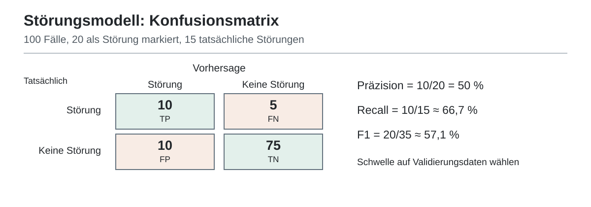

# M19-L1 – Maschinelles Lernen und Modellbewertung {#L1}

**Kursbereich:** M19 – Data Science und KI

**Niveau:** Master · Wahlvertiefung

**Vorwissen:** [M18-L2](M18-L2.md)

**Lernziel:** Präzision, Recall und F1 aus einer Konfusionsmatrix berechnen und den Schwellenwert beurteilen.

## Einstieg und Grundbegriffe {#S1}

Überwachtes Lernen schätzt Zusammenhänge aus Eingaben und bekannten Zielwerten. Training passt Modellparameter an, Validierung unterstützt die Auswahl und Testdaten bewerten eine zuvor festgelegte Lösung. Datenleckage entsteht, wenn bei Training oder Auswahl Informationen genutzt werden, die später nicht verfügbar wären. Geschäftsrelevante Fehlerkosten können eine andere Bewertung verlangen als reine Genauigkeit.

## Begriffszusammenhang {#S2}

*Abbildung: 100 Fälle: 10 richtig positive, 10 falsch positive, 5 falsch negative, 75 richtig negative. Präzision 50 %, Recall rund 66,7 %.*

## Beispiel und Anwendung {#S3}

Ein Störungsmodell markiert 20 von 100 Fällen. Zehn markierte Fälle sind tatsächliche Störungen, fünf weitere tatsächliche Störungen wurden übersehen. Präzision ist 10/20=50 Prozent, Recall 10/15≈66,7 Prozent.

Aus 10 richtig positiven, 10 falsch positiven und 5 falsch negativen Fällen ergibt sich F1 = 2 × 10 / (20 + 10 + 5) ≈ 57,1 Prozent. Die übrigen 75 Fälle sind richtig negativ. Eine Schwellenwahl anhand der Testdaten würde die unabhängige Bewertung beeinträchtigen.

Die positive Klasse muss vor der Auswertung feststehen. Bei keinem positiven Vorhersagefall ist die Präzision nicht definiert; ein Softwarepaket kann dafür einen dokumentierten Ersatzwert ausgeben. F1 gewichtet Präzision und Recall symmetrisch, berücksichtigt richtig negative Fälle jedoch nicht.

## Selbstkontrolle {#S4}

### Aufgabe

Was geschieht mit dem Recall, wenn eine niedrigere Schwelle alle 15 tatsächlichen Störungen erkennt?

::: {.lc-solutions data-lc-section="S4"}
Recall steigt auf 100 Prozent. Präzision kann sinken, falls mehr Nicht-Störungen markiert werden. Die passende Schwelle hängt von Kosten und Kapazität ab.
:::

## Weiterführung {#S5}

[M19-L2](M19-L2.md)

## Quellen und Vertiefung {#S6}

- [Universität Mannheim – Master Wirtschaftsinformatik](https://www.wim.uni-mannheim.de/studium/im-studium/master-wirtschaftsinformatik/) · Studienstruktur; Forschungsseminare und Abschlussarbeit, curricularer Kontext · Zuletzt abgerufen: 2026-11-25
- [scikit-learn – Common pitfalls and recommended practices](https://scikit-learn.org/stable/common_pitfalls.html) · Trennung von Trainings- und Testdaten, Datenleckage · Zuletzt abgerufen: 2026-11-25
- [scikit-learn – Metrics and scoring](https://scikit-learn.org/stable/modules/model_evaluation.html) · Abschnitt 3.4.4.9.1: binäre Klassifikation, Präzision, Recall und F1 · Zuletzt abgerufen: 2026-11-25
