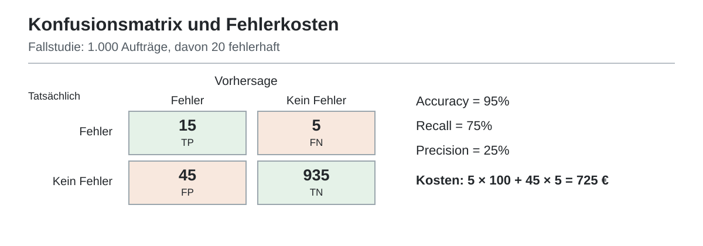

# M19-L2 – KI-Systeme, Betrieb und Modellrisiko {#L2}

**Kursbereich:** M19 – Data Science und KI

**Niveau:** Master · Wahlvertiefung

**Vorwissen:** [M19-L1](M19-L1.md)

**Lernziel:** Modellalternativen anhand von Fehlentscheidungen bewerten und Überwachungsbedarf nach Einführung begründen.

## Einstieg und Grundbegriffe {#S1}

Ein lernendes Modell ist Teil einer Daten- und Softwarearchitektur. Im Betrieb können sich Datenverteilung, Zusammenhänge und organisatorische Ziele ändern. Monitoring muss Eingaben, Qualität, Latenz und relevante Auswirkungen beobachten; Qualität erfordert geeignete Referenzwerte. Generative Modelle können plausible, aber unzutreffende Ausgaben erzeugen. Kritische Entscheidungen benötigen abgestufte Prüf- und Rückfallverfahren.

## Begriffszusammenhang {#S2}

*Abbildung: Modell B: 15 richtig positive, 5 falsch negative, 45 falsch positive, 935 richtig negative Klassifikationen.*

## Beispiel und Anwendung {#S3}

Ein KI-Assistent formuliert Antwortentwürfe für Supporttickets. Das System markiert Quellen, protokolliert Versionen und fordert bei Rückerstattungen menschliche Prüfung. Ein Pilot misst fachlich korrekte Antworten, Eskalationen und Bearbeitungszeit, nicht nur Textflüssigkeit.

### Vertiefung und Modellgrenzen

Bei seltenen Zielereignissen kann eine hohe Accuracy täuschen. Präzision und Recall beantworten verschiedene Fragen, und ein Schwellenwert verändert beide. Die Wahl eines Modells und des Schwellenwerts gehört in Training/Validierung, nicht in die abschließende Testauswertung.

Modellgüte und Systemgüte sind getrennt zu bewerten: Selbst ein korrekt klassifiziertes Ticket kann falsch weitergeleitet werden. Vor dem Pilotbetrieb sind Eskalationsregeln, erlaubte Aktionen, Referenzantworten und Prüfintervalle zu definieren. Eine Stichprobe mit menschlicher Bewertung benötigt nachvollziehbare Kriterien und einen Umgang mit Uneinigkeit.

## Selbstkontrolle {#S4}

### Aufgabe

Warum genügt ein positives Testergebnis vor dem Start nicht für dauerhaften Betrieb?

### Modul-Fallstudie

Bei 1000 Aufträgen sind 20 fehlerhaft. Modell A meldet keinen Fehler. Modell B erkennt 15 Fehler und meldet 45 korrekte Aufträge falsch. Berechne Accuracy, Recall und Precision beider Modelle. Bei Kosten von 100 Euro pro übersehenem Fehler und 5 Euro pro Fehlalarm vergleiche Gesamtkosten.

::: {.lc-solutions data-lc-section="S4"}
Eingaben, Geschäftsregeln und Modellversionen können sich ändern. Laufende Evaluation, Eskalation und Rückfallmöglichkeiten sind erforderlich.

**Lösung der Fallstudie:** A: 980/1000=98 Prozent Accuracy, Recall 0, Precision nicht definiert (kein positiver Alarm), Kosten 2.000 Euro. B: TP=15, FN=5, FP=45, TN=935; Accuracy 95 Prozent, Recall 75 Prozent, Precision 25 Prozent, Kosten 725 Euro. Unter den angenommenen Kosten ist B günstiger trotz niedrigerer Accuracy. Bei geänderten Prävalenzen oder Kosten neu validieren.

:::

## Weiterführung {#S5}

[M19-L3](M19-L3.md)

## Quellen und Vertiefung {#S6}

- [Universität Mannheim – Master Wirtschaftsinformatik](https://www.wim.uni-mannheim.de/studium/im-studium/master-wirtschaftsinformatik/) · Studienstruktur; Forschungsseminare und Abschlussarbeit, curricularer Kontext · Zuletzt abgerufen: 2026-11-25
- [scikit-learn – Common pitfalls and recommended practices](https://scikit-learn.org/stable/common_pitfalls.html) · Trennung von Trainings- und Testdaten, Datenleckage · Zuletzt abgerufen: 2026-11-25
