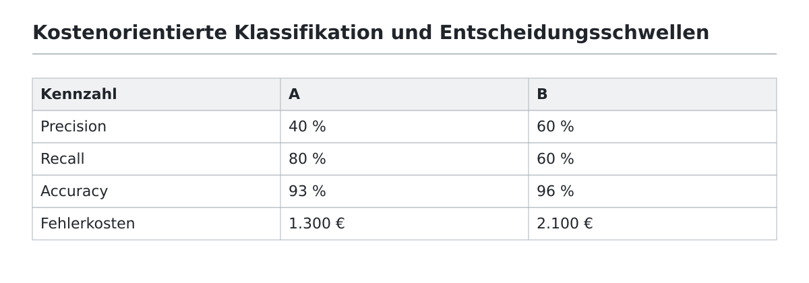

# M19-L3 – Kostenorientierte Klassifikation und Entscheidungsschwellen {#L3}

**Kursbereich:** M19 – Data Science und KI

**Niveau:** Master · Wahlvertiefung

**Vorwissen:** [M19-L2](M19-L2.md)

**Lernziel:** Klassifikationskosten und eine kostenbasierte Entscheidungsschwelle berechnen.

## Einstieg und Grundbegriffe {#S1}

Ein binärer Klassifikator liefert einen Score, der anhand einer Schwelle in eine Entscheidung umgewandelt wird. Die Konfusionsmatrix zählt richtig positive (TP), falsch positive (FP), falsch negative (FN) und richtig negative (TN) Fälle. Precision = TP/(TP+FP) beschreibt den Anteil zutreffender Alarme; Recall = TP/(TP+FN) die Erkennungsquote tatsächlicher Positiver. Accuracy = (TP+TN)/N kann bei seltenen Ereignissen irreführend sein. Bei einem Nenner von null ist die jeweilige Kennzahl nicht definiert; die Auswertungsregel muss angegeben werden.

Die Entscheidungsschwelle sollte an die Folgen von Fehlentscheidungen angepasst werden. In einem einfachen Kostenmodell gilt K = c_FP × FP + c_FN × FN. Diese Rechnung setzt feste Fehlerkosten und eine repräsentative Stichprobe voraus. Wenn der Score eine kalibrierte Wahrscheinlichkeit p ist, korrekte Entscheidungen keine zusätzlichen Kosten haben und die Kosten konstant sind, ist eine positive Entscheidung sinnvoll, wenn (1−p)c_FP < p c_FN, also p > c_FP/(c_FP+c_FN). Die Schwelle wird auf Validierungsdaten gewählt, nicht durch wiederholtes Optimieren am finalen Testdatensatz.

## Begriffszusammenhang {#S2}

*Abbildung: Kennzahlen und Fehlerkosten zweier Rechnungsprüfmodelle. Eigenes Modellbeispiel.*

## Beispiel und Anwendung {#S3}

Bei 1.000 Rechnungen sind 50 tatsächlich fehlerhaft. Modell A meldet 40 davon und fälschlich 60 korrekte Rechnungen. Modell B meldet 30 Fehler und 20 korrekte Rechnungen. A: TP 40, FN 10, FP 60, TN 890, Precision 40 %, Recall 80 %, Accuracy 93 %. B: TP 30, FN 20, FP 20, TN 930, Precision 60 %, Recall 60 %, Accuracy 96 %. Kostet ein Fehlalarm 5 € und ein übersehener Fehler 100 €, so kostet A 1.300 €, B 2.100 €. A ist trotz niedrigerer Accuracy im Modell günstiger. Ein kalibrierter Score würde unter den vereinfachten Annahmen eine Schwelle von 5/105 ≈ 4,76 % ergeben.

Die Wahrscheinlichkeitsschwelle folgt aus dem Vergleich der erwarteten Verluste: Alarm kostet (1−p)·C_FP, kein Alarm p·C_FN. Gleichheit ergibt p=C_FP/(C_FP+C_FN). Das gilt bei kalibrierten Wahrscheinlichkeiten, konstanten Fehlerkosten, null Kosten richtiger Entscheidungen und ohne Kapazitätsbeschränkung. Bei Gleichheit sind beide Aktionen im Modell gleichwertig.

## Selbstkontrolle {#S4}

### Aufgabe

Fehlalarme kosten nun 30 €, übersehene Fehler weiterhin 100 €. Vergleiche A und B; bestimme auch die neue Wahrscheinlichkeitsschwelle.

::: {.lc-solutions data-lc-section="S4"}
A: 60 × 30 + 10 × 100 = 2.800 €. B: 20 × 30 + 20 × 100 = 2.600 €. B ist günstiger; Schwelle 30/130 ≈ 23,08 %.
:::

## Weiterführung {#S5}

[M19-L4](M19-L4.md)

## Quellen und Vertiefung {#S6}

- [Google ML Crash Course – Accuracy, recall and precision](https://developers.google.com/machine-learning/crash-course/classification/accuracy-precision-recall) · Methodischer Fachbeleg; relevante Passage im Web eingesehen. Zuletzt abgerufen: 2026-11-25.
- [scikit-learn – Tuning the decision threshold for class prediction](https://scikit-learn.org/stable/modules/classification_threshold.html) · Trennung von Score und Entscheidung; Validierung des Schwellenwerts · Zuletzt abgerufen: 2026-11-25
