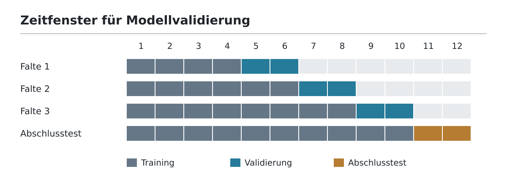

# M19-L4 – Zeitabhängige Validierung und Datenleckage {#L4}

**Kursbereich:** M19 – Data Science und KI

**Niveau:** Master · Wahlvertiefung

**Vorwissen:** [M19-L3](M19-L3.md)

**Lernziel:** Chronologische Validierungsfenster bilden und Modellfehler über unterschiedlich große Testmengen aggregieren.

## Einstieg und Grundbegriffe {#S1}

Bei Prognosen dürfen Modelltraining und Merkmalsbildung nur Informationen nutzen, die zum jeweiligen Entscheidungszeitpunkt tatsächlich verfügbar waren. Zufälliges Mischen zeitabhängiger Beobachtungen kann Zukunftsinformationen in das Training übertragen. Auch ein korrekt chronologischer Split schützt nicht vor Merkmalen, deren Berechnung später veröffentlichte Daten verwendet. Ein wachsendes Trainingsfenster nutzt die bisherigen Perioden und prüft das Modell an einem späteren Zeitabschnitt. Ein rollierendes Fenster entfernt ältere Perioden und kann bei Strukturbrüchen sinnvoll sein.

Ein Abstand zwischen Training und Test kann nötig werden, wenn Zielwerte erst verzögert vorliegen oder sich Prognosehorizonte überlappen. Datenaufbereitung, Skalierung und Merkmalsauswahl müssen innerhalb jedes Trainingsfensters angepasst werden. Hyperparameter werden mit Validierungsdaten gewählt; ein abschließender Testzeitraum bleibt bis zur Modellauswahl unangetastet. Zeitfenster gleicher Dauer erleichtern den Vergleich, insbesondere bei regelmäßig erhobenen Daten. Ein Modell soll mit einer einfachen Prognosebasis verglichen werden, etwa dem letzten verfügbaren Wert.

## Begriffszusammenhang {#S2}

*Abbildung: Chronologische Validierungsfenster mit separatem Abschlusstest. Eigenes Modellbeispiel.*

## Beispiel und Anwendung {#S3}

Ein Händler hat monatliche Nachfragewerte von Januar bis Dezember. Für drei Validierungsfalten werden Monate 1–4 für Training und 5–6 für Validierung, 1–6 und 7–8 sowie 1–8 und 9–10 verwendet. Monate 11–12 bleiben für den Abschlusstest reserviert. Die mittleren absoluten Fehler (MAE) der drei gleich großen Validierungsblöcke seien 10, 14 und 12 Einheiten; der gemeinsame MAE ist 12. Eine naive Referenz erreicht 15 Einheiten. Die relative Fehlerreduktion beträgt (15−12)/15=20 %.

Für Dezemberprognosen dürfen beispielsweise im Januar verbuchte Retouren nicht nachträglich als Eingabevariable für Dezember benutzt werden. Ein zusätzliches Audit speichert für jedes Merkmal den Zeitpunkt, zu dem es im produktiven System verfügbar war. Falls das Prognosemodell trotz guter Validierung im Abschlusstest schlechter abschneidet, wird das Ergebnis berichtet; die Testmonate werden nicht heimlich erneut zur Auswahl benutzt.

Auch Skalierung, Imputation und Merkmalsauswahl müssen je Falte nur anhand der Trainingsdaten angepasst werden. Bei zeitlich überlappenden Zielintervallen kann ein Abstand zwischen Training und Validierung erforderlich sein. Die Güte auf den Testmonaten bleibt eine zeitlich begrenzte Schätzung.

## Selbstkontrolle {#S4}

### Aufgabe

Ein zweites Modell erzielt MAE 9, 12 und 18 in den drei Falten. Berechne den gemeinsamen MAE. Wie ändert sich die Beurteilung, wenn die dritte Falte doppelt so viele Beobachtungen enthält?

::: {.lc-solutions data-lc-section="S4"}
Gleich große Falten: 39/3=13. Bei doppelter Größe der dritten Falte: (9+12+2·18)/4=14,25. Auch Modell 1 muss dann entsprechend neu gewichtet werden (10+14+2·12)/4=12.
:::

## Weiterführung {#S5}

[M20-L1](M20-L1.md)

## Quellen und Vertiefung {#S6}

- [scikit-learn – TimeSeriesSplit](https://scikit-learn.org/stable/modules/generated/sklearn.model_selection.TimeSeriesSplit.html) · Methodischer Fachbeleg; relevante Passage im Web eingesehen. Zuletzt abgerufen: 2026-11-25.
