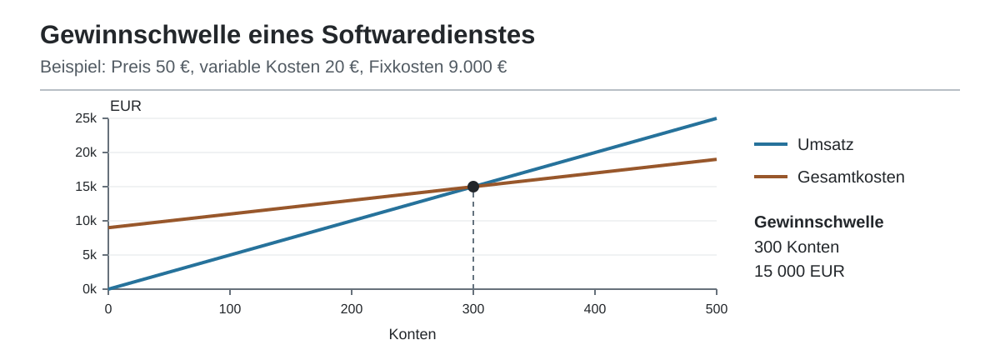

# M2-L1 – Rechnungswesen und Deckungsbeitrag {#L1}

**Kursbereich:** M2 – Betriebswirtschaft

**Niveau:** Bachelor · Kern/Grundlagen

**Vorwissen:** [M1-L2](M1-L2.md)

**Lernziel:** Deckungsbeitrag, Break-even-Menge und Gewinn eines Geschäftsmodells berechnen.

## Einstieg und Grundbegriffe {#S1}

Externes Rechnungswesen dokumentiert Vermögen, Schulden und Erfolg; internes Rechnungswesen dient der Planung und Steuerung. Ertrag und Einzahlung fallen zeitlich nicht zwingend zusammen. Für kurzfristige Entscheidungen werden variable Kosten von Fixkosten getrennt. Der Stückdeckungsbeitrag ist Verkaufspreis minus variable Stückkosten; die Gewinnschwelle liegt bei Fixkosten geteilt durch positiven Stückdeckungsbeitrag, sofern der Stückpreis, die variablen Stückkosten und die gesamten Fixkosten im relevanten Mengenbereich konstant bleiben. Bei unteilbaren Einheiten ist eine nicht ganzzahlige Gewinnschwelle auf die nächste ganze Einheit aufzurunden, um mindestens kostendeckend zu arbeiten.

## Begriffszusammenhang {#S2}

*Abbildung: Umsatz und Gesamtkosten schneiden sich bei 300 Konten und 15.000 Euro.*

## Beispiel und Anwendung {#S3}

Ein Softwaredienst verlangt 50 Euro pro Monat und Kundenkonto. Variable Kosten betragen 20 Euro je Kundenkonto und Monat, Fixkosten 9.000 Euro pro Monat. Der Deckungsbeitrag beträgt 30 Euro, die Gewinnschwelle 300 Konten.

## Selbstkontrolle {#S4}

### Aufgabe

Berechne den monatlichen Gewinn bei 400 Konten unter denselben Annahmen.

::: {.lc-solutions data-lc-section="S4"}
400 mal 30 minus 9.000 ergibt 3.000 Euro Gewinn.
:::

## Weiterführung {#S5}

[M2-L2](M2-L2.md)

## Quellen und Vertiefung {#S6}

- [Universität Münster – Aufbau des Wirtschaftsinformatikstudiums (B.Sc.)](https://www.wi.uni-muenster.de/de/studieninteressierte/unsere-studiengaenge/bachelor-science-wirtschaftsinformatik/aufbau-des) · Studienprofil; curricularer Kontext, kein Einzelnachweis der Fachdetails · Zuletzt abgerufen: 2026-11-25
- [OpenStax – Managerial Accounting, 3.2 Calculate a Break-Even Point](https://openstax.org/books/principles-managerial-accounting/pages/3-2-calculate-a-break-even-point-in-units-and-dollars) · Deckungsbeitrag, Gewinnschwelle und Modellannahmen · Zuletzt abgerufen: 2026-11-25
