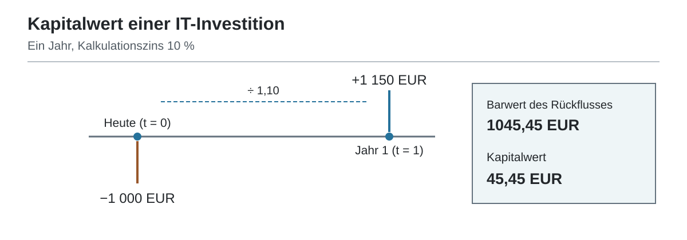

# M2-L2 – Investition, Finanzierung und Marketing {#L2}

**Kursbereich:** M2 – Betriebswirtschaft

**Niveau:** Bachelor · Kern/Grundlagen

**Vorwissen:** [M2-L1](M2-L1.md)

**Lernziel:** Investitionsalternativen anhand diskontierter Zahlungen beurteilen und die Grenzen des Kapitalwerts erklären.

## Einstieg und Grundbegriffe {#S1}

Investitionen binden Mittel heute für erwartete zukünftige Rückflüsse. Finanzierung beantwortet, woher die Mittel stammen. Der Kapitalwert diskontiert zukünftige Nettozahlungen mit einem risikoadäquaten Kalkulationszins. Marketing untersucht unter anderem Zielgruppen, Leistungsangebot, Preis, Vertrieb und Kommunikation. Ein Geschäftsmodell muss Kundenwert und Zahlungsbereitschaft gemeinsam mit Kosten und Finanzierung betrachten.

## Begriffszusammenhang {#S2}

*Abbildung: Zahlungsstrom: heute −1.000 Euro, in einem Jahr +1.150 Euro; Barwert 1.045,45 Euro, Kapitalwert 45,45 Euro.*

## Beispiel und Anwendung {#S3}

Ein System kostet heute 1.000 Euro und liefert in einem Jahr 1.150 Euro Nettozahlung. Bei 10 Prozent Kalkulationszins beträgt der Barwert rund 1.045,45 Euro; der Kapitalwert ist 45,45 Euro. Unsichere Zahlungen erfordern Szenarien.

### Vertiefung und Modellgrenzen

Die Kapitalwertrechnung vergleicht Zahlungsreihen, nicht periodisierte Gewinne. Bei konstanter Rate r und Zahlungen am Periodenende gilt NPV = −I + Σ CF_t/(1+r)^t. Sensitivitätsanalysen ändern Annahmen einzeln und in Szenarien; die Finanzierung ist getrennt zu modellieren, um Zinsen nicht doppelt zu erfassen.

## Selbstkontrolle {#S4}

### Aufgabe

Wie ändert sich das Ergebnis bei einem Rückfluss von 1.100 Euro?

### Modul-Fallstudie

Eine ERP-Einführung kostet 60.000 Euro heute. In den nächsten drei Jahren werden jeweils 25.000 Euro Nettozahlungen erwartet. Berechne NPV bei 5 Prozent und bei 12 Prozent. Prüfe außerdem, ab welcher jährlichen Nettozahlung der NPV bei 5 Prozent null ist.

::: {.lc-solutions data-lc-section="S4"}
Der Barwert ist genau 1.000 Euro; der Kapitalwert ist null. Die Investition deckt den angesetzten Zins, erzeugt aber keinen Mehrwert darüber hinaus.

**Lösung der Fallstudie:** Rentenbarwertfaktor a = Σ(1+r)^−t, t=1 bis 3. Bei 5 Prozent a≈2,72325, NPV≈8.081 Euro; bei 12 Prozent a≈2,40183, NPV≈46 Euro. Die Schwelle bei 5 Prozent ist 60.000/a≈22.032,51 Euro pro Jahr. Ein positiver NPV ist unter Modellannahmen vorteilhaft, nicht garantiert. Restwerte, Migration, Schulung und Unsicherheit gesondert prüfen.

:::

## Weiterführung {#S5}

[M2-L3](M2-L3.md)

## Quellen und Vertiefung {#S6}

- [Universität Münster – Aufbau des Wirtschaftsinformatikstudiums (B.Sc.)](https://www.wi.uni-muenster.de/de/studieninteressierte/unsere-studiengaenge/bachelor-science-wirtschaftsinformatik/aufbau-des) · Studienprofil; curricularer Kontext, kein Einzelnachweis der Fachdetails · Zuletzt abgerufen: 2026-11-25
- [OpenStax – Principles of Finance, 16.2 Net Present Value (NPV) Method](https://openstax.org/books/principles-finance/pages/16-2-net-present-value-npv-method) · Kapitalwert, Diskontierung und Grenzen bei Kapitalrationierung · Zuletzt abgerufen: 2026-11-25
