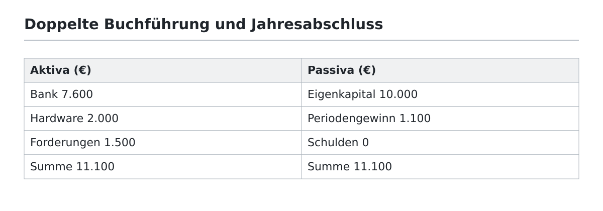

# M2-L3 – Doppelte Buchführung und Jahresabschluss {#L3}

**Kursbereich:** M2 – Betriebswirtschaft

**Niveau:** Bachelor · Kern/Grundlagen

**Vorwissen:** [M2-L2](M2-L2.md)

**Lernziel:** Buchungsvorgänge auf Bilanz und Gewinn abbilden und die Aussagekraft einer Summenliste beurteilen.

## Einstieg und Grundbegriffe {#S1}

Die Bilanz ordnet das Vermögen (Aktiva) seiner Finanzierung durch Eigen- und Fremdkapital (Passiva) zu. Die Bilanzgleichung lautet Vermögen = Eigenkapital + Schulden. Jeder Geschäftsfall wird mit mindestens zwei Konten erfasst; die Summen der Soll- und Habenbuchungen sind gleich. Bei Aktivkonten erhöht eine Sollbuchung den Bestand, bei Verbindlichkeiten und Eigenkapital eine Habenbuchung. Aufwand und Ertrag verändern das Periodenergebnis und damit das Eigenkapital. Zahlung und Erfolg fallen nicht zwingend zusammen: Eine auf Ziel erbrachte Leistung kann bereits Ertrag sein, obwohl noch kein Geld eingegangen ist. Das Journal dokumentiert Geschäftsfälle chronologisch; das Hauptbuch aggregiert nach Konten. Die Summen- und Saldenliste deckt ungleiche Buchungssummen auf, nicht jedoch jede falsche Kontierung. Ein ERP-System muss Beleg-ID, Buchungsdatum, Periode, Konten und Betrag nachvollziehbar verknüpfen. Das Beispiel abstrahiert von Umsatzsteuer, Abschreibungen und nationalen Bilanzierungsregeln.

## Begriffszusammenhang {#S2}

*Abbildung: Vereinfachte Schlussbilanz mit 11.100 Euro auf beiden Seiten. Eigenes Modellbeispiel.*

## Beispiel und Anwendung {#S3}

Ein Unternehmen startet mit 10.000 € Bank und 10.000 € Eigenkapital. Es kauft Hardware für 2.000 € per Bankzahlung, erbringt Leistungen auf Ziel für 1.500 € und bezahlt 400 € laufende Kosten. Die Buchungssätze sind: Hardware an Bank 2.000; Forderungen an Ertrag 1.500; Aufwand an Bank 400. Am Ende: Bank 7.600, Hardware 2.000, Forderungen 1.500, also Aktiva 11.100. Gewinn 1.100; Eigenkapital 11.100. Der Zahlungssaldo ist dagegen −2.400. Eine nachträgliche Zahlung der Forderung verändert nur die Zusammensetzung der Aktiva.

## Selbstkontrolle {#S4}

### Aufgabe

Der Kunde zahlt 1.000 € der Forderung. Ermittle Bank, Forderungen, Bilanzsumme und Gewinn. Warum garantiert eine ausgeglichene Summenliste keine korrekte Buchführung?

::: {.lc-solutions data-lc-section="S4"}
Bank 8.600 €, Forderungen 500 €, Bilanzsumme 11.100 €, Gewinn unverändert 1.100 €. Ein falsches Kontenpaar oder ein komplett fehlender Beleg kann die Soll-Haben-Gleichheit bewahren.
:::

## Weiterführung {#S5}

[M2-L4](M2-L4.md)

## Quellen und Vertiefung {#S6}

- [OpenStax – Financial Accounting, 3.5 Journal Entries and T-Accounts](https://openstax.org/books/principles-financial-accounting/pages/3-5-use-journal-entries-to-record-transactions-and-post-to-t-accounts) · Methodischer Fachbeleg; relevante Passage im Web eingesehen. Zuletzt abgerufen: 2026-11-25.
