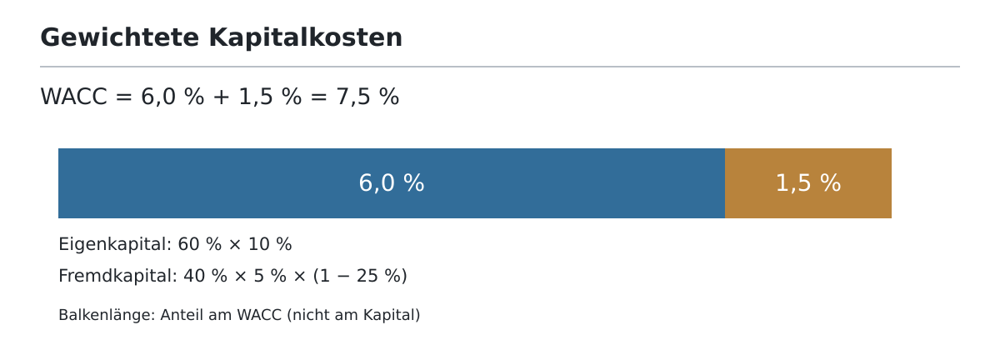

# M2-L4 – Kapitalstruktur und Finanzierungskosten {#L4}

**Kursbereich:** M2 – Betriebswirtschaft

**Niveau:** Bachelor · Kern/Grundlagen

**Vorwissen:** [M2-L3](M2-L3.md)

**Lernziel:** Gewichtete Kapitalkosten und Kapitalwert berechnen und Finanzierungsannahmen hinterfragen.

## Einstieg und Grundbegriffe {#S1}

Eigenkapitalgeber tragen das Residualrisiko und erwarten eine entsprechende Rendite. Fremdkapitalgeber erhalten vertraglich vereinbarte Zinsen und Tilgungen; ein höherer Verschuldungsgrad kann das Ausfallrisiko steigern. Der gewichtete durchschnittliche Kapitalkostensatz WACC kombiniert die Renditeforderungen anhand der Marktwertanteile. Im vereinfachten Modell mit steuerlich abzugsfähigen Zinsen gilt WACC = w_E r_E + w_D r_D (1 − t), wobei die Gewichte eins ergeben, r_E und r_D die Kapitalkosten und t den angenommenen marginalen Steuersatz bezeichnen. Der WACC ist nicht die durchschnittliche Verzinsung vergangener Kredite. Er dient als Diskontsatz für operative, unverschuldete freie Cashflows eines Projekts, wenn dessen Risiko und Finanzierungsstruktur zur Schätzung passen. Für andere Risiken ist ein angepasster Satz erforderlich. Die Modellrechnung unterstellt konstante Kapitalstruktur und nutzbaren Steuervorteil; sie ist keine steuerliche Beratung.

## Begriffszusammenhang {#S2}

*Abbildung: WACC-Beiträge: 6,0 Prozentpunkte Eigenkapital, 1,5 Prozentpunkte Fremdkapital. Eigenes Modellbeispiel.*

## Beispiel und Anwendung {#S3}

Eine IT-Plattform kostet 100.000 € und liefert in drei Jahren je 40.000 € freien Cashflow am Jahresende. Die Marktwertanteile betragen 60 % Eigenkapital und 40 % Fremdkapital. Die Renditeforderung liegt bei 10 %, der Fremdkapitalzins bei 5 %, der angenommene Steuersatz bei 25 %. WACC = 0,60 × 0,10 + 0,40 × 0,05 × 0,75 = 7,5 %. Kapitalwert = −100.000 + 40.000/1,075 + 40.000/1,075² + 40.000/1,075³ ≈ 4.021 €. Die Entscheidung ist empfindlich gegenüber Cashflow-Schätzungen und dem Diskontsatz.

## Selbstkontrolle {#S4}

### Aufgabe

Berechne den WACC ohne nutzbaren Steuervorteil und den Kapitalwert bei 10 % Diskontsatz. Ist mehr Fremdkapital grundsätzlich günstiger?

::: {.lc-solutions data-lc-section="S4"}
Ohne Steuervorteil: 8 %. Bei 10 %: Kapitalwert ≈ −526 €. Nein; mit höherer Verschuldung können Eigen- und Fremdkapitalkosten steigen. Auch Liquidität, Kreditauflagen und Refinanzierungsrisiko sind zu beachten.
:::

## Weiterführung {#S5}

[M2-L5](M2-L5.md)

## Quellen und Vertiefung {#S6}

- [OpenStax – Principles of Finance, 17.3 Calculating the Weighted Average Cost of Capital](https://openstax.org/books/principles-finance/pages/17-3-calculating-the-weighted-average-cost-of-capital) · Methodischer Fachbeleg; relevante Passage im Web eingesehen. Zuletzt abgerufen: 2026-11-25.
