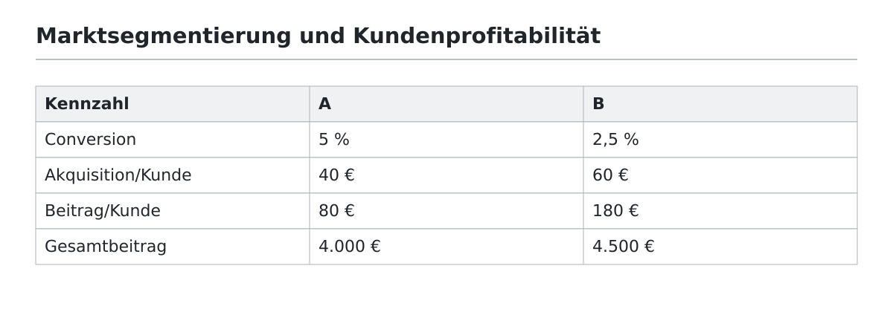

# M2-L5 – Marktsegmentierung und Kundenprofitabilität {#L5}

**Kursbereich:** M2 – Betriebswirtschaft

**Niveau:** Bachelor · Kern/Grundlagen

**Vorwissen:** [M2-L4](M2-L4.md)

**Lernziel:** Kundenbeiträge nach Segmenten berechnen und Kampagnenalternativen unter ihren Modellannahmen vergleichen.

## Einstieg und Grundbegriffe {#S1}

Segmentierung zerlegt einen heterogenen Markt in Gruppen mit ähnlichen Bedürfnissen. Die Zielmarktauswahl prüft, welche Gruppen ein Unternehmen bedienen kann und will; die Positionierung bestimmt das angestrebte Nutzenversprechen im Vergleich zum Wettbewerb. Bei Unternehmenssoftware unterscheiden sich beispielsweise kleine Betriebe mit geringem Integrationsaufwand von größeren Betrieben mit komplexen Freigabeprozessen. Ein CRM-System unterstützt die Segmentbildung, indem es Vertrags-, Kontakt- und Nutzungsdaten zusammenführt. Merkmale müssen für die Entscheidung relevant, rechtmäßig erhoben und ausreichend stabil sein. Ein Segment ist keine unveränderliche Eigenschaft eines Menschen.

Ein ökonomisches Auswahlkriterium ist der erwartete Deckungsbeitrag pro gewonnenem Kunden nach Akquisitionskosten. Für eine vereinfachte Einperiodenrechnung gilt: Deckungsbeitrag = Umsatz − variable Leistungskosten − Akquisitionskosten. Bei mehreren Perioden müssen Bindungswahrscheinlichkeiten und Abzinsung berücksichtigt werden. Eine hohe Conversion allein reicht nicht aus; sie kann mit hohen Betreuungsaufwendungen einhergehen. Die Kosten einer Kampagne sind von den Kosten je tatsächlich gewonnenem Kunden zu unterscheiden. Um eine Zielgruppe zu vergleichen, braucht man zusätzlich die erreichbare Gruppengröße und Kapazitätsrestriktionen.

## Begriffszusammenhang {#S2}

*Abbildung: Vergleich zweier SaaS-Zielsegmente nach Conversion und Beitrag. Eigenes Modellbeispiel.*

## Beispiel und Anwendung {#S3}

Ein SaaS-Anbieter vergleicht zwei Kampagnen mit jeweils 1.000 Kontakten. Segment A gewinnt 50 Kunden bei 2.000 € Kampagnenkosten; je Kunde fallen 180 € Jahresumsatz und 60 € variable Kosten an. Segment B gewinnt 25 Kunden bei 1.500 € Kampagnenkosten; je Kunde betragen Umsatz und variable Kosten 400 € und 160 €. A: Akquisitionskosten 40 €, Beitrag 80 € je Kunde, insgesamt 4.000 €. B: 60 €, 180 € je Kunde, insgesamt 4.500 €. B liefert trotz niedrigerer Conversion in diesem Modell einen höheren Gesamtdeckungsbeitrag; ein vollständiger Gewinnvergleich erfordert zusätzlich die relevanten Fixkosten. Fixkosten, Wiederkäufe, Unsicherheit und mögliche Kundenabwanderung bleiben unberücksichtigt.

## Selbstkontrolle {#S4}

### Aufgabe

Bei B steigen die Kampagnenkosten auf 2.250 €. Berechne den Gesamtbeitrag und den Vergleich zu A. Nenne zwei Gründe, warum der Vergleich in einem Mehrjahresmodell anders ausfallen kann.

::: {.lc-solutions data-lc-section="S4"}
B: 25 × 240 − 2.250 = 3.750 €, also 250 € weniger als A. Bindungsraten, künftige Betreuungskosten und Abzinsung können das Ergebnis verändern.
:::

## Weiterführung {#S5}

[M3-L1](M3-L1.md)

## Quellen und Vertiefung {#S6}

- [OpenStax – Principles of Marketing, 5.6 Product Positioning](https://openstax.org/books/principles-marketing/pages/5-6-product-positioning) · Methodischer Fachbeleg; relevante Passage im Web eingesehen. Zuletzt abgerufen: 2026-11-25.
