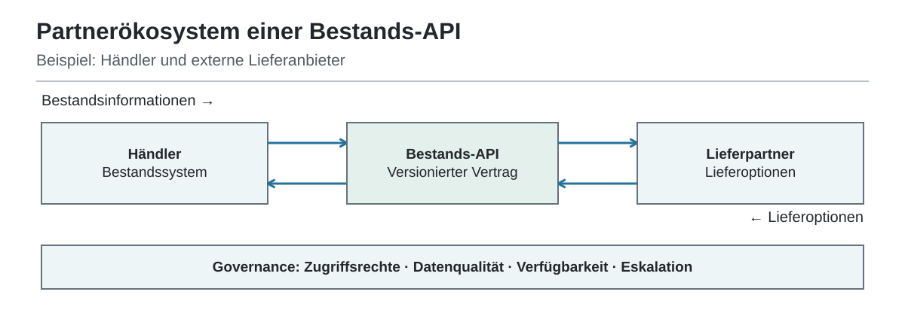

# M20-L1 – Digitale Transformation und Ökosysteme {#L1}

**Kursbereich:** M20 – Digitale Transformation

**Niveau:** Master · Wahlvertiefung

**Vorwissen:** [M19-L2](M19-L2.md)

**Lernziel:** Risiken und Nutzen einer Öffnung betrieblicher Schnittstellen für Partner beurteilen.

## Einstieg und Grundbegriffe {#S1}

Digitale Transformation betrifft nicht nur einzelne IT-Projekte, sondern die Veränderung von Wertschöpfung, Organisation und Fähigkeiten. Ökosysteme bestehen aus voneinander abhängigen Akteuren mit gemeinsamen Schnittstellen und eigenen Interessen. Modularität kann Innovation erleichtern, gleichzeitig können Abhängigkeiten und Koordinationskosten wachsen. Die Gestaltung muss Anreize und Governance berücksichtigen.

## Begriffszusammenhang {#S2}

*Abbildung: Händler stellt Bestandsdaten über eine API bereit; Partner liefern Lieferoptionen zurück. Verträge, Zugriffsregeln, Datenqualität und Eskalation bilden die Governance.*

## Beispiel und Anwendung {#S3}

Ein Händler öffnet eine Bestands-API für Partner. Externe Anbieter können Liefermöglichkeiten integrieren, benötigen aber stabile Verträge, Datenqualität, Zugriffsregeln und Eskalation bei Ausfällen. Die API ist nur ein Teil der organisatorischen Veränderung.

Ein messbares Ziel könnte die Quote korrekt angezeigter Lieferoptionen sein. Dazu sind eine definierte Stichprobe und ein Abgleich mit tatsächlich erfüllbaren Lieferungen nötig; API-Aufrufzahlen allein belegen keinen geschäftlichen Nutzen.

Die Kennzahl sollte die Zahl korrekter Lieferauskünfte durch die Zahl aller geprüften Auskünfte teilen; nicht beantwortete Anfragen sind gesondert oder gemäß vorab definierter Regel zu behandeln. Zusätzlich sind Partnerabhängigkeit, Änderungsverträge und Ausstiegsmöglichkeiten zu prüfen.

## Selbstkontrolle {#S4}

### Aufgabe

Welche zwei Risiken entstehen aus der Öffnung einer Plattform für Partner?

::: {.lc-solutions data-lc-section="S4"}
Beispielsweise Abhängigkeit von kritischen Partnern und unberechtigte Datennutzung. Beides erfordert passende Verträge, technische Kontrollen und Überwachung.
:::

## Weiterführung {#S5}

[M20-L2](M20-L2.md)

## Quellen und Vertiefung {#S6}

- [Universität Mannheim – Master Wirtschaftsinformatik](https://www.wim.uni-mannheim.de/studium/im-studium/master-wirtschaftsinformatik/) · Studienstruktur; Forschungsseminare und Abschlussarbeit, curricularer Kontext · Zuletzt abgerufen: 2026-11-25
- [Hein et al. – Digital platform ecosystems (Electronic Markets)](https://link.springer.com/article/10.1007/s12525-019-00377-4) · Plattform-Governance, APIs und Öffnung gegenüber Komplementoren · Zuletzt abgerufen: 2026-11-25
