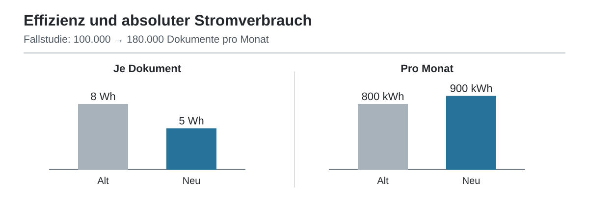

# M20-L2 – Nachhaltigkeit und verantwortliche Digitalisierung {#L2}

**Kursbereich:** M20 – Digitale Transformation

**Niveau:** Master · Wahlvertiefung

**Vorwissen:** [M20-L1](M20-L1.md)

**Lernziel:** Energiebedarf pro Vorgang und Gesamtenergieverbrauch vergleichen und weitere Umweltgrößen benennen.

## Einstieg und Grundbegriffe {#S1}

Digitalisierung kann Material- und Energieverbräuche senken oder zusätzliche Verbräuche erzeugen. Eine Bewertung benötigt eine funktionale Einheit, Systemgrenzen und Vergleichsszenario. Effizienzgewinne pro Vorgang können durch höhere Nutzung teilweise aufgehoben werden. Soziale Aspekte wie Zugänglichkeit, Arbeitsbedingungen und Ausschlussrisiken müssen neben ökologischen und ökonomischen Größen berücksichtigt werden.

## Begriffszusammenhang {#S2}

*Abbildung: Je Dokument sinkt der Verbrauch von 8 auf 5 Wh, insgesamt steigt er von 800 auf 900 kWh pro Monat.*

## Beispiel und Anwendung {#S3}

Ein neuer Dienst benötigt statt 10 nun 6 Wh je Anfrage. Die Zahl der Anfragen steigt von 1.000 auf 2.000 täglich. Der Verbrauch steigt innerhalb dieser Messgrenze von 10 auf 12 kWh täglich, obwohl der Einzelvorgang effizienter ist.

### Vertiefung und Modellgrenzen

Eine Vergleichsbilanz braucht eine funktionale Einheit, eine einheitliche Systemgrenze und eine Zeitperiode. Direkte Betriebsemissionen oder Stromverbräuche allein sind nicht mit dem gesamten Lebenszyklus gleichzusetzen. Rebound bedeutet, dass steigende Nutzung einen Teil der Effizienzgewinne aufzehren kann.

Der Energieverbrauch bei unveränderter alter Stückeffizienz und neuer Nachfrage wäre 20 kWh täglich. Dieser hypothetische Vergleich verdeutlicht vermiedene Energie relativ zur gestiegenen Nachfrage; gegenüber dem Ausgangszustand steigt der absolute Verbrauch trotzdem um 20 %. Der Fall allein identifiziert nicht die Ursache des Nachfrageanstiegs.

## Selbstkontrolle {#S4}

### Aufgabe

Welche zusätzlichen Größen wären für einen umfassenderen Umweltvergleich nötig?

### Modul-Fallstudie

Alt: 8 Wh je Dokument, 100.000 Dokumente monatlich. Neu: 5 Wh je Dokument, 180.000 Dokumente monatlich. Berechne spezifische und absolute Stromänderung und die maximale neue Dokumentzahl bei gleicher Betriebsenergie.

::: {.lc-solutions data-lc-section="S4"}
Unter anderem Hardwareherstellung, Kühlung, Netzübertragung, Strommix, Lebensdauer und vermiedene oder zusätzliche Aktivitäten. Die Systemgrenze muss offengelegt werden.

**Lösung der Fallstudie:** Spezifisch −37,5 Prozent. Alt 800 kWh, neu 900 kWh, also +12,5 Prozent absolut. Schwelle 800.000 Wh/5 Wh=160.000 Dokumente. Diese Bilanz enthält nur den definierten Betriebsstrom; Hardware, Netze und Emissionsfaktoren ergänzen, wenn Lebenszykluswirkung untersucht wird.

:::

## Weiterführung {#S5}

[M20-L3](M20-L3.md)

## Quellen und Vertiefung {#S6}

- [Universität Mannheim – Master Wirtschaftsinformatik](https://www.wim.uni-mannheim.de/studium/im-studium/master-wirtschaftsinformatik/) · Studienstruktur; Forschungsseminare und Abschlussarbeit, curricularer Kontext · Zuletzt abgerufen: 2026-11-25
- [OpenStax – Principles of Economics 3e, Ch. 12 Summary](https://openstax.org/books/principles-economics-3e/pages/12-key-concepts-and-summary) · Externe Effekte und Marktversagen; keine Bilanzierungsmethode · Zuletzt abgerufen: 2026-11-25
