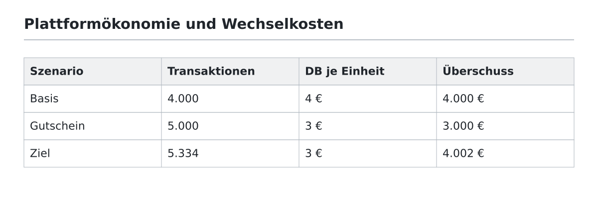

# M20-L3 – Plattformökonomie und Wechselkosten {#L3}

**Kursbereich:** M20 – Digitale Transformation

**Niveau:** Master · Wahlvertiefung

**Vorwissen:** [M20-L2](M20-L2.md)

**Lernziel:** Transaktionszahlen für einen Zielüberschuss berechnen und Wechselkosten berücksichtigen.

## Einstieg und Grundbegriffe {#S1}

Eine mehrseitige Plattform koordiniert unterschiedliche Teilnehmergruppen. Bei indirekten Netzwerkeffekten steigt der Nutzen für eine Gruppe mit der Teilnahme der anderen Gruppe; bei direkten Effekten entsteht der Nutzen innerhalb derselben Gruppe. Das unterscheidet sich von Skaleneffekten, die auf der Kostenseite liegen. Eine wachsende Plattform kann gleichzeitig unter Überlastung, Betrug oder Qualitätsproblemen leiden. Teilnehmerzahlen allein sind daher keine ausreichende Erfolgskennzahl.

Ein Betreiber kann eine Marktseite subventionieren und von der anderen eine Gebühr verlangen. Für die Wirtschaftlichkeitsrechnung zählt der Deckungsbeitrag des gesamten Systems. Wechselkosten umfassen etwa Datenmigration, Schulung, Prozessumstellung und verlorene Integrationen. Multihoming bedeutet, dass Teilnehmer mehrere Plattformen parallel nutzen. Offene Datenformate und interoperable Schnittstellen können Wechselkosten senken; Netzwerkeffekte verschwinden dadurch nicht automatisch. Eine belastbare Strategie prüft zusätzlich Marktqualität, faire Zugangsregeln und Abhängigkeiten.

## Begriffszusammenhang {#S2}

*Abbildung: Deckungsbeiträge eines mehrseitigen Marktplatzes. Eigenes Modellbeispiel.*

## Beispiel und Anwendung {#S3}

Ein B2B-Marktplatz wickelt monatlich 4.000 Transaktionen ab. Je Transaktion erhält er 6 Euro Gebühr und trägt 2 Euro variable Kosten. Fixkosten betragen 12.000 Euro. Der Monatsüberschuss vor weiteren Kosten ist 4.000 × (6 − 2) − 12.000 = 4.000 Euro. Die Gewinnschwelle liegt bei 3.000 Transaktionen. Ein Gutscheinprogramm kostet zusätzlich 1 Euro je Transaktion; es müsste mindestens 4.000 Transaktionen erreichen, um die Fixkosten zu decken. Bei 5.000 Transaktionen ergäbe es 3.000 Euro Überschuss, also trotz größerer Aktivität weniger als zuvor.

Ein Händler schätzt die Kosten für den Wechsel auf 1.200 Euro Datenmigration und 800 Euro Schulung. Spart die Alternative monatlich 250 Euro, beträgt die einfache Amortisationszeit acht Monate. Das Modell unterstellt unveränderte Leistungsqualität und vernachlässigt Diskontierung sowie laufende Parallelbetriebskosten.

Die neue Stückmarge von drei Euro gilt nur, wenn der Gutschein auf jede Transaktion entfällt. Für eine Beurteilung von Netzwerkeffekten müssen zusätzlich aktive Teilnehmer beider Marktseiten, erfolgreiche Vermittlungen und Änderungen der Transaktionsqualität beobachtet werden. Die einfache Amortisation ist kein Kapitalwert.

## Selbstkontrolle {#S4}

### Aufgabe

Wie viele Transaktionen braucht das Gutscheinprogramm für denselben Überschuss wie zuvor? Welche nichtfinanzielle Größe sollte zusätzlich gemessen werden?

::: {.lc-solutions data-lc-section="S4"}
16.000/3 = 5.333,33; mindestens 5.334 Transaktionen. Zusätzlich etwa der Anteil erfolgreich abgeschlossener Transaktionen oder die Streitfallquote; bloße Registrierungen genügen nicht.
:::

## Weiterführung {#S5}

[M20-L4](M20-L4.md)

## Quellen und Vertiefung {#S6}

- [OECD – Going Digital, section 1.6](https://www.oecd.org/en/publications/going-digital-shaping-policies-improving-lives_9789264312012-en/full-report/component-6.html) · Methodischer Fachbeleg; relevante Passage im Web eingesehen. Zuletzt abgerufen: 2026-11-25.
