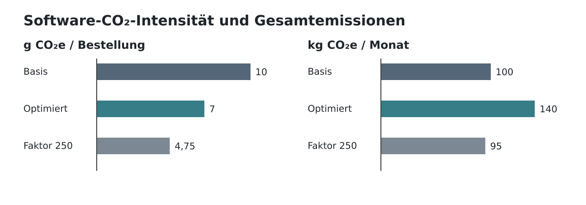

# M20-L4 – Software-CO₂-Intensität und Rebound-Effekt {#L4}

**Kursbereich:** M20 – Digitale Transformation

**Niveau:** Master · Wahlvertiefung

**Vorwissen:** [M20-L3](M20-L3.md)

**Lernziel:** Softwareemissionen je funktionaler Einheit und insgesamt berechnen und Rebound-Effekte erkennen.

## Einstieg und Grundbegriffe {#S1}

Die Umweltwirkung eines Informationssystems lässt sich nicht allein aus der Stromrechnung ablesen. Die Software Carbon Intensity (SCI) setzt betriebliche Emissionen und anteilig zugeordnete Hardwareemissionen ins Verhältnis zu einer funktionalen Einheit. Für einen abgegrenzten Zeitraum gilt im vereinfachten Modell SCI = (E × I + M)/R. E ist Energie in kWh, I der Emissionsfaktor in g CO₂e/kWh, M die anteiligen Hardwareemissionen in g CO₂e und R die Zahl funktionaler Einheiten. Vergleichbare Messungen erfordern gleiche Systemgrenzen und Leistungsqualität.

Ein niedrigerer Wert je Vorgang bedeutet nicht zwingend niedrigere Gesamtemissionen. Wenn eine Effizienzsteigerung zu mehr Nutzung führt, kann die absolute Belastung steigen. Dieser mögliche Rebound-Effekt muss von der technischen Effizienz unterschieden werden; die bloße Beobachtung einer Nachfragezunahme belegt noch keine kausale Rebound-Wirkung. Bei einem Cloud-Dienst sind außerdem Datengrundlage, zeitliche Zuordnung und die Allokation geteilter Hardware zu dokumentieren.

## Begriffszusammenhang {#S2}

*Abbildung: Intensität und absolute Emissionen im Vergleich. Eigenes Modellbeispiel.*

## Beispiel und Anwendung {#S3}

Ein Bestelldienst benötigt im Monat 200 kWh bei 400 g CO₂e/kWh. Die zugeordneten Hardwareemissionen betragen 20.000 g. Bei 10.000 erfolgreich abgeschlossenen Bestellungen ergibt sich (80.000 + 20.000)/10.000 = 10 g CO₂e je Bestellung. Nach einer Optimierung benötigt der Dienst bei 20.000 Bestellungen 300 kWh; die Hardwareemissionen bleiben im Modell unverändert. Die Rate beträgt (120.000 + 20.000)/20.000 = 7 g CO₂e je Bestellung. Die Intensität sinkt um 30 %, die Gesamtemissionen steigen aber von 100 auf 140 kg, also um 40 %.

Eine Entscheidungsvorlage berichtet beide Größen. Sie prüft auch, ob Bestellungen in beiden Zeiträumen dieselbe Leistungsqualität besitzen und ob fehlgeschlagene Versuche in der Energiegrenze enthalten sind. Die Zahlen sind hypothetisch, keine gemessene Ökobilanz.

Die Hardwareemissionen sind im Modell bereits zeitlich und nach Ressourcenanteil zugeordnet. In einer realen Bilanz müssen diese Allokationsannahmen, reservierte Kapazitäten, Stromfaktor, Systemgrenze und funktionale Einheit dokumentiert werden. Der Quotient ist bei null erfolgreichen Bestellungen nicht definiert.

## Selbstkontrolle {#S4}

### Aufgabe

Bei 20.000 Bestellungen und 300 kWh sinkt der Faktor auf 250 g/kWh. Berechne Rate und Gesamtmenge bei unveränderter Hardwareallokation.

::: {.lc-solutions data-lc-section="S4"}
300 × 250 + 20.000 = 95.000 g = 95 kg; 4,75 g je Bestellung. Gegenüber der Ausgangslage sind die Gesamtemissionen im Modell 5 % geringer.
:::

## Weiterführung {#S5}

[M20-L5](M20-L5.md)

## Quellen und Vertiefung {#S6}

- [Green Software Foundation – SCI Specification](https://sci.greensoftware.foundation/) · Methodischer Fachbeleg; relevante Passage im Web eingesehen. Zuletzt abgerufen: 2026-11-25.
