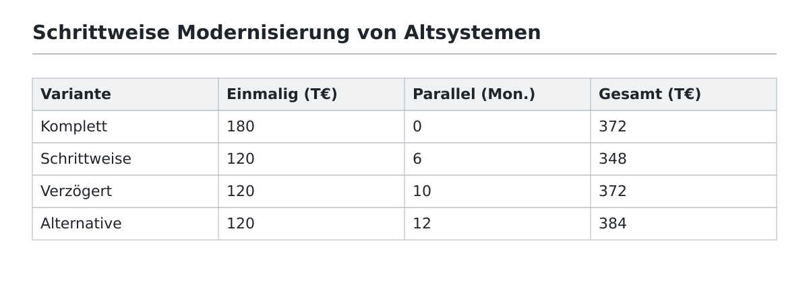

# M20-L5 – Schrittweise Modernisierung von Altsystemen {#L5}

**Kursbereich:** M20 – Digitale Transformation

**Niveau:** Master · Wahlvertiefung

**Vorwissen:** [M20-L4](M20-L4.md)

**Lernziel:** Kosten einer schrittweisen Modernisierung berechnen und Nachweise für die Abschaltung eines Altsystems formulieren.

## Einstieg und Grundbegriffe {#S1}

Bei einer Altsystemmodernisierung werden technische Schulden, Geschäftsrisiken und Investitionsbedarf gemeinsam betrachtet. Ein vollständiger Austausch ist nicht immer sinnvoll: zentrale Funktionen können schwer dokumentiert, voneinander abhängig und für den laufenden Betrieb unverzichtbar sein. Beim Strangler-Ansatz leitet eine vorgeschaltete Komponente Anfragen je nach Funktionsbereich an alte oder neue Komponenten. Funktionen werden schrittweise ersetzt. Voraussetzung ist eine geeignete Abgrenzung und kontrollierbare Weiterleitung; bei nicht abfangbaren Aufrufen kann das Verfahren ungeeignet sein.

Für jede Migrationswelle sind Datenverantwortung, Schnittstellenvertrag, Abnahmekriterien, Rückfallplan und Abschaltbedingungen festzulegen. Ein schrittweiser Übergang erzeugt zeitweise Zusatzkosten für zwei Betriebsumgebungen. Ein wirtschaftlicher Vergleich berücksichtigt diese ebenso wie vermiedene Störungen, Schulungsaufwand und dauerhafte Betriebskosten. Technische Erreichbarkeit ist kein Beweis fachlicher Gleichwertigkeit: Buchungen und Ausnahmen müssen beispielsweise gegen kontrollierte Referenzfälle geprüft werden.

## Begriffszusammenhang {#S2}

*Abbildung: Kostenvergleich über 24 Monate. Eigenes Modellbeispiel.*

## Beispiel und Anwendung {#S3}

Ein Großhändler vergleicht über 24 Monate zwei Projekte ohne Diskontierung. Ein Komplettwechsel kostet 180.000 Euro einmalig, dazu 24 Monate Betrieb mit 8.000 Euro pro Monat. Summe: 372.000 Euro. Die schrittweise Variante kostet 120.000 Euro einmalig; sechs Monate Parallelbetrieb kosten 14.000 Euro pro Monat, danach 18 Monate 8.000 Euro. Summe: 348.000 Euro. Im Modell spart die zweite Variante 24.000 Euro. Bei einer Verzögerung des Parallelbetriebs um vier Monate steigt die Summe um 4 × (14.000 − 8.000) = 24.000 Euro; beide Varianten sind dann gleich teuer.

Die Entscheidung hängt zusätzlich von erwarteten Ausfallkosten, fachlicher Datenqualität und Vertragsbedingungen ab. Für die Produktmigration wird die neue Komponente erst führend, wenn Referenzfälle und Bestandsabgleich bestanden sind; ein Rückfall darf keine bestätigten Änderungen verlieren.

Für k Monate Parallelbetrieb innerhalb der 24 Monate beträgt die ungewichtete Kostensumme 312.000+6.000·k Euro. Die Gleichheit mit dem Komplettwechsel bei k=10 ist eine Szenariogrenze, keine Prognose. Rückfalltests müssen auch Änderungen berücksichtigen, die nach der Umschaltung bestätigt wurden.

## Selbstkontrolle {#S4}

### Aufgabe

Berechne die Kosten der schrittweisen Variante bei zwölf Monaten Parallelbetrieb. Nenne einen fachlichen Abschaltnachweis.

::: {.lc-solutions data-lc-section="S4"}
120.000 + 12 × 14.000 + 12 × 8.000 = 384.000 Euro, 12.000 mehr als Komplettwechsel. Beispiel: alle offenen Bestellungen und Bestandsbuchungen vollständig abgeglichen, keine ungeklärte Differenz.
:::

## Weiterführung {#S5}

[M21-L1](M21-L1.md)

## Quellen und Vertiefung {#S6}

- [Microsoft Learn – Strangler Fig pattern](https://learn.microsoft.com/de-de/azure/architecture/patterns/strangler-fig) · Methodischer Fachbeleg; relevante Passage im Web eingesehen. Zuletzt abgerufen: 2026-11-25.
