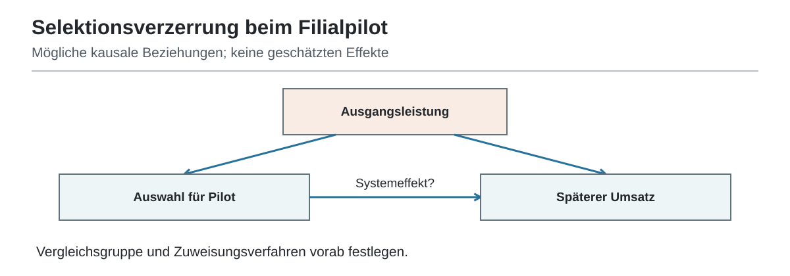

# M21-L1 – Empirische Forschung und Kausalinferenz {#L1}

**Kursbereich:** M21 – Wissenschaftliche Methoden

**Niveau:** Bachelor/Übergang/Master · Kern/Grundlagen

**Vorwissen:** [M20-L2](M20-L2.md)

**Lernziel:** Selektionsverzerrungen identifizieren und einen geeigneteren Untersuchungsplan entwerfen.

## Einstieg und Grundbegriffe {#S1}

Empirische Forschung formuliert beantwortbare Fragen, operationalisiert Konstrukte und wählt eine geeignete Datenerhebung. Reliabilität betrifft Messzuverlässigkeit; Validität betrifft die Tragfähigkeit der Interpretation. Randomisierte Experimente können unter geeigneten Bedingungen Gruppen vergleichbar machen. Beobachtungsstudien benötigen besondere Aufmerksamkeit für Selektion, Störvariablen und zeitliche Zusammenhänge.

## Begriffszusammenhang {#S2}

*Abbildung: Leistungsfähige Filialen werden bevorzugt für den Pilot ausgewählt. Ausgangsleistung kann sowohl Auswahl als auch späteren Umsatz beeinflussen; die beobachtete Differenz ist kein isolierter Systemeffekt.*

## Beispiel und Anwendung {#S3}

Eine Firma führt ein neues System zuerst in besonders leistungsfähigen Filialen ein. Diese steigern ihren Umsatz stärker als andere. Die Differenz kann am System, an der Auswahl der Filialen oder an anderen Einflüssen liegen; ein reiner Gruppenvergleich identifiziert keine Ursache.

Die Ausgangsleistung ist eine mögliche Störvariable. Das Diagramm zeigt angenommene Beziehungen, keine nachgewiesene Kausalstruktur. Randomisierung kann die systematische Auswahl anhand beobachteter und unbeobachteter Merkmale im Erwartungswert reduzieren; zufällige Ungleichgewichte und Ausfälle bleiben zu prüfen.

Wird auf Filialebene randomisiert, ist die Filiale die Zuteilungseinheit. Einzelne Kunden derselben Filiale dürfen für die Unsicherheitsschätzung nicht ohne Begründung als unabhängig behandelt werden. Auch Ausfälle nach Zuteilung und Wechselwirkungen zwischen Filialen sind zu dokumentieren.

## Selbstkontrolle {#S4}

### Aufgabe

Wie könnte ein besserer Untersuchungsplan aussehen?

::: {.lc-solutions data-lc-section="S4"}
Wenn durchführbar, zufällige Zuweisung geeigneter Filialen zu Pilot und Kontrolle, vorher definierte Zielgröße und Beobachtungszeit, Berücksichtigung von Spillover und dokumentierte Auswertung.
:::

## Weiterführung {#S5}

[M21-L2](M21-L2.md)

## Quellen und Vertiefung {#S6}

- [Universität Mannheim – Master Wirtschaftsinformatik](https://www.wim.uni-mannheim.de/studium/im-studium/master-wirtschaftsinformatik/) · Studienstruktur; Forschungsseminare und Abschlussarbeit, curricularer Kontext · Zuletzt abgerufen: 2026-11-25
- [World Bank – Impact Evaluation in Practice, Second Edition](https://www.worldbank.org/en/programs/sief-trust-fund/publication/impact-evaluation-in-practice) · Übersicht der Kapitel zu Kausalinferenz, Randomisierung und Differenz der Differenzen; Kapitelvolltext nicht geprüft · Zuletzt abgerufen: 2026-11-25
