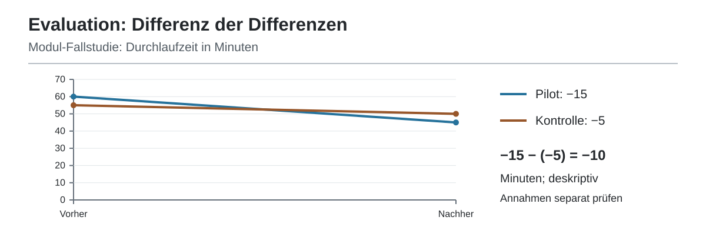

# M21-L2 – Design Science und reproduzierbare Forschung {#L2}

**Kursbereich:** M21 – Wissenschaftliche Methoden

**Niveau:** Bachelor/Übergang/Master · Kern/Grundlagen

**Vorwissen:** [M21-L1](M21-L1.md)

**Lernziel:** Artefaktevaluation von Implementierung unterscheiden und eine Differenz-von-Differenzen berechnen.

## Einstieg und Grundbegriffe {#S1}

Design Science untersucht Gestaltung und Evaluation von Artefakten zur Lösung relevanter Probleme. Ein Artefakt kann ein Modell, Verfahren oder Softwaresystem sein. Problembegründung, Designentscheidungen, Evaluation und Grenzen müssen nachvollziehbar sein. Reproduzierbarkeit verlangt dokumentierte Datenherkunft, Versionen, Verfahren und Parameter, soweit rechtliche und ethische Bedingungen dies erlauben.

## Begriffszusammenhang {#S2}

*Abbildung: Illustrative Differenz der Differenzen: Pilot 60 auf 45 Minuten, Kontrolle 55 auf 50 Minuten. Differenz der Veränderungen minus 10 Minuten.*

## Beispiel und Anwendung {#S3}

Ein Forscher entwickelt ein Werkzeug zur Erkennung von Bestellfehlern. Er definiert Fehlerarten, vergleicht das Werkzeug mit einer einfachen Regelbasis und dokumentiert sowohl erkannte als auch übersehene Fehler. Der Nutzen wird anhand eines unabhängigen Testbestands beurteilt.

### Vertiefung und Modellgrenzen

Difference-in-differences vergleicht die zeitliche Veränderung einer Interventionsgruppe mit einer Vergleichsgruppe. Kausale Interpretation erfordert unter anderem plausible parallele Trends ohne Intervention und keine differenziellen gleichzeitigen Schocks. Eine einzelne Vorperiode kann den Paralleltrend nicht empirisch zeigen.

Die Differenz der Differenzen ist zunächst eine Schätzung auf Grundlage der vier beobachteten Werte. Ein Gegenfaktum wird durch die angenommene Veränderung der Vergleichsgruppe approximiert; ohne ausreichende Identifikationsannahmen ist die Interpretation als Wirkung nicht gerechtfertigt.

Im Beispiel lautet das geschätzte Gegenfaktum für die Pilotgruppe 60−5=55 Minuten; der beobachtete Wert ist 45. Die Differenz von −10 Minuten hängt vom angenommenen unbehandelten Trend ab. Auch mehrere ähnliche Vortrends können parallele Trends nach der Intervention nicht beweisen.

## Selbstkontrolle {#S4}

### Aufgabe

Welche Ergebnisse sollten auch bei erfolgloser Evaluation erhalten bleiben?

### Modul-Fallstudie

Die Durchlaufzeit im Pilotbetrieb sinkt von 60 auf 45 Minuten; in der Kontrollgruppe von 55 auf 50. Berechne die Differenz der Differenzen. Diskutiere zwei Gefährdungen der kausalen Interpretation und ein geeignetes Robustheitsdesign.

::: {.lc-solutions data-lc-section="S4"}
Versuchsplan, Versionen, anonymisierbare Daten oder zulässige Ersatzdaten, Testprotokolle und negative Befunde. Eine nachträgliche Auswahl nur positiver Ergebnisse verzerrt Evidenz.

**Lösung der Fallstudie:** (45−60)−(50−55)=−10 Minuten. Das ist eine deskriptive Schätzung; bei plausibler Identifikation könnte sie einen Behandlungseffekt ausdrücken. Saisonale Nachfrage nur im Pilot, gleichzeitig geänderte Personalbesetzung oder andere Prozessänderungen gefährden die Interpretation. Mehrere Vorperioden, dokumentierte Interventionen, geeignete Vergleichsgruppen und Unsicherheitsintervalle einplanen.

:::

## Weiterführung {#S5}

[M21-L3](M21-L3.md)

## Quellen und Vertiefung {#S6}

- [Universität Mannheim – Master Wirtschaftsinformatik](https://www.wim.uni-mannheim.de/studium/im-studium/master-wirtschaftsinformatik/) · Studienstruktur; Forschungsseminare und Abschlussarbeit, curricularer Kontext · Zuletzt abgerufen: 2026-11-25
- [World Bank – Impact Evaluation in Practice, Second Edition](https://www.worldbank.org/en/programs/sief-trust-fund/publication/impact-evaluation-in-practice) · Übersicht der Kapitel zu Kausalinferenz, Randomisierung und Differenz der Differenzen; Kapitelvolltext nicht geprüft · Zuletzt abgerufen: 2026-11-25
- [Hevner et al. – Design Science in Information Systems Research (2004)](https://aisel.aisnet.org/misq/vol28/iss1/6/) · Abstract zum Design-Science-Paradigma; kein Volltextnachweis · Zuletzt abgerufen: 2026-11-25
