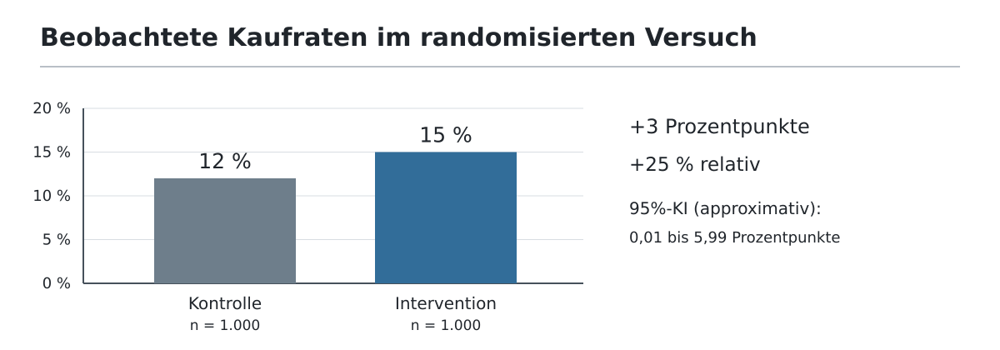

# M21-L3 – Randomisierte Experimente und Forschungsprotokolle {#L3}

**Kursbereich:** M21 – Wissenschaftliche Methoden

**Niveau:** Bachelor/Übergang/Master · Kern/Grundlagen

**Vorwissen:** [M21-L2](M21-L2.md)

**Lernziel:** Randomisierte Untersuchungen planen und Risiken selektiver Ergebnisberichterstattung erläutern.

## Einstieg und Grundbegriffe {#S1}

Ein randomisiertes Experiment weist Untersuchungseinheiten per Zufall einer Intervention oder Kontrolle zu. Dadurch werden Störfaktoren im Erwartungswert ausgeglichen, nicht zwingend in jeder konkreten Stichprobe. Bei digitalen Produkten muss die Randomisierungseinheit zur Wirkung passen: Wenn Nutzer mehrfach erscheinen, führt Randomisierung pro Seitenaufruf zu vermischten Erfahrungen. Ist die Intervention ein Teamprozess, können sich Beschäftigte gegenseitig beeinflussen; dann ist eine Cluster-Randomisierung zu erwägen. Das Forschungsprotokoll definiert vor der Auswertung Zielpopulation, Hypothese, primären Endpunkt, Beobachtungsfenster, Ausschlussregeln und Analyseverfahren. Dokumentiere Abweichungen und trenne explorative von bestätigenden Analysen. Schutz der Teilnehmenden, Datenschutz und mögliche Nachteile einer Variante gehören in die Planung. Fehlende Werte, Abbrüche und unterschiedliche Beobachtungsdauer können die Aussage verzerren.

## Begriffszusammenhang {#S2}

*Abbildung: Kaufraten 12 und 15 Prozent mit beobachteter Differenz von 3 Prozentpunkten. Eigenes Modellbeispiel.*

## Beispiel und Anwendung {#S3}

Je 1.000 Nutzer werden zufällig einer bisherigen oder einer neuen Suchoberfläche zugeteilt. Nach sieben Tagen haben 120 bzw. 150 Nutzer mindestens einen Kauf abgeschlossen. Die beobachteten Raten sind 12 % und 15 %, der absolute Unterschied beträgt 3 Prozentpunkte, der relative Anstieg 25 %. Unter einer vereinfachten unabhängigen Binomialapproximation beträgt der unverbundene Standardfehler der Differenz sqrt(0,12×0,88/1000+0,15×0,85/1000)≈0,01527; ein approximatives 95%-Intervall ist [0,0001; 0,0599]. Dieses knappe Ergebnis ist empfindlich gegenüber Modellannahmen, Zwischenanalysen und Datenqualität. Es ist keine Erfolgsgarantie für alle Nutzergruppen.

Das Intervall ist eine ungepoolte Wald-Näherung für die Differenz zweier Anteile, nicht die Wahrscheinlichkeit, dass der feste wahre Effekt in diesem konkreten Intervall liegt. Bei kleinen Stichproben oder Anteilen nahe 0 oder 1 sind andere Intervallverfahren vorzuziehen. Die Auswertung setzt unabhängige Zuteilungseinheiten und nachvollziehbaren Umgang mit Ausfällen voraus.

## Selbstkontrolle {#S4}

### Aufgabe

Ein Analyst betrachtet nachträglich 20 Zielgrößen und berichtet nur eine signifikante. Warum ist das problematisch? Entwirf drei Einträge eines Protokolls für den nächsten Versuch.

::: {.lc-solutions data-lc-section="S4"}
Selektives Berichten erhöht das Risiko falsch positiver Schlussfolgerungen. Beispielprotokoll: (1) primär: Kauf binnen sieben Tagen pro randomisiertem Nutzer; (2) feste Stichprobengröße, keine unplanmäßige Erfolgsentscheidung bei Zwischenanalysen; (3) Analyse nach ursprünglicher Zuteilung, Umgang mit fehlenden Ereignissen und Ausschlussregeln vorab dokumentieren. Sekundärgrößen transparent berichten und gegebenenfalls Mehrfachtests berücksichtigen.
:::

## Weiterführung {#S5}

[M21-L4](M21-L4.md)

## Quellen und Vertiefung {#S6}

- [OpenStax – Introductory Statistics 2e, 1.4 Experimental Design and Ethics](https://openstax.org/books/introductory-statistics-2e/pages/1-4-experimental-design-and-ethics) · Methodischer Fachbeleg; relevante Passage im Web eingesehen. Zuletzt abgerufen: 2026-11-25.
