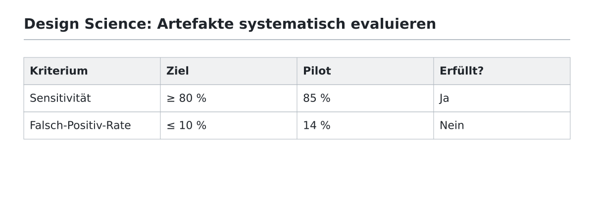

# M21-L4 – Design Science: Artefakte systematisch evaluieren {#L4}

**Kursbereich:** M21 – Wissenschaftliche Methoden

**Niveau:** Bachelor/Übergang/Master · Kern/Grundlagen

**Vorwissen:** [M21-L3](M21-L3.md)

**Lernziel:** Ein Artefakt anhand vorab definierter Akzeptanzkriterien evaluieren und verbleibende Grenzen beschreiben.

## Einstieg und Grundbegriffe {#S1}

Design Science Research erzeugt und untersucht Artefakte, um ein relevantes Problem zu lösen und übertragbares Gestaltungswissen zu gewinnen. Artefakte können Modelle, Methoden, Software oder Prototypen sein. Die Methodik von Peffers et al. verbindet Problemdefinition, Lösungsziele, Entwicklung, Demonstration, Evaluation und Kommunikation. Eine Demonstration zeigt, dass ein Artefakt in einem Fall eingesetzt werden kann; eine Evaluation prüft anhand vorher definierter Kriterien, wie gut es die Ziele erfüllt. Die verlinkte Quelle ist die Zusammenfassung des Forschungsartikels, nicht dessen vollständiger Text.

Gestaltungswissen sollte die Bedingungen benennen, unter denen eine Lösung funktioniert. Ein erfolgreiches Pilotprojekt ist keine allgemeine Bestätigung. Ein Evaluationsplan legt Vergleichsverfahren, Testdaten, Messgrößen, Auswertungsmethoden und Abbruchkriterien fest. Formative Evaluation unterstützt die Weiterentwicklung, summative Evaluation beurteilt den erreichten Stand. Ergebnisdaten dürfen nicht selektiv ausgeblendet werden; Fehlerfälle liefern Hinweise auf Grenzen des Artefakts.

## Begriffszusammenhang {#S2}

*Abbildung: Kriterienbasierte Evaluation eines Priorisierungsartefakts. Eigenes Modellbeispiel.*

## Beispiel und Anwendung {#S3}

Ein Prototyp priorisiert Supporttickets. In einer konstruierten Pilotstichprobe von 40 Fällen erkennt die Referenzmethode 28 dringende Fälle korrekt; der neue Prototyp erkennt 34 korrekt. Alle 40 Fälle sind tatsächlich dringend. Die Sensitivität beträgt 70 % beziehungsweise 85 %, ein Zuwachs um 15 Prozentpunkte. Die Evaluationsanforderung lautet mindestens 80 % Sensitivität und höchstens 10 % Falsch-Positiv-Rate in einer separaten Stichprobe nicht dringender Fälle. Aus der ersten Stichprobe lässt sich die zweite Kennzahl überhaupt nicht bestimmen.

Es folgt ein separater Test mit 50 tatsächlich nicht dringenden Tickets, von denen der Prototyp 7 fälschlich priorisiert. Die Rate beträgt 14 % und überschreitet das Ziel. Der Prototyp erfüllt die kombinierte Anforderung nicht, obwohl seine Sensitivität steigt. Ohne Angaben zu Auswahl, Zuordnung und Vergleichsbedingungen kann daraus auch keine belastbare Ursache-Wirkungs-Aussage abgeleitet werden.

Wenn dieselben 40 dringenden Fälle mit beiden Verfahren geprüft werden, sind die Beobachtungen gepaart. Aus den beiden Randhäufigkeiten allein lässt sich die Zahl der Fälle, die nur eines der Verfahren richtig erkennt, nicht eindeutig bestimmen. Für einen gepaarten Vergleich sind diese Fallzuordnungen erforderlich.

## Selbstkontrolle {#S4}

### Aufgabe

Nach Überarbeitung werden 32 von 40 dringenden Fällen korrekt und 4 von 50 nicht dringenden Fällen fälschlich priorisiert. Sind beide Ziele erreicht? Was bleibt offen?

::: {.lc-solutions data-lc-section="S4"}
32/40=80 % und 4/50=8 %. Beide deskriptiven Schwellen sind erreicht. Offen bleiben Stichprobenunsicherheit, unabhängige Prüfung, Repräsentativität und Verhalten in anderen Organisationen.
:::

## Weiterführung {#S5}

[M22-L1](M22-L1.md)

## Quellen und Vertiefung {#S6}

- [Peffers et al. – A Design Science Research Methodology for Information Systems Research (Abstract)](https://design-science-research.de/en/publication/peffers-2007/) · Methodischer Fachbeleg; relevante Passage im Web eingesehen. Zuletzt abgerufen: 2026-11-25.
