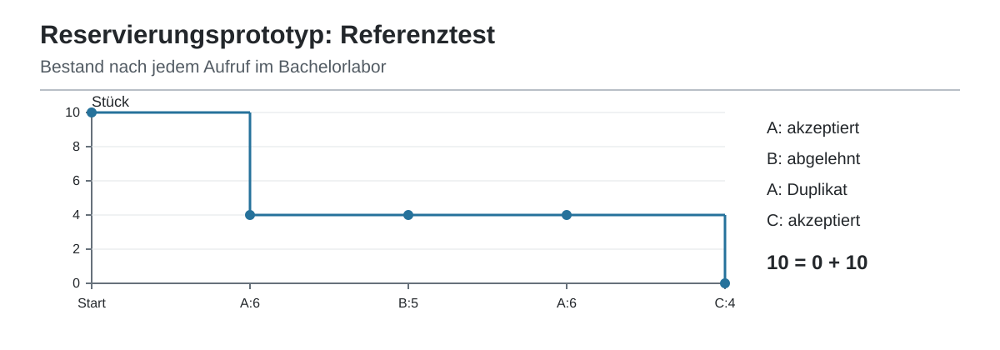

# M22-L1 – Bachelorprojekt: integrierter Geschäftsprozess {#L1}

**Kursbereich:** M22 – Projekt und Abschlussarbeit

**Niveau:** Bachelor/Übergang/Master · Praxis/Abschluss

**Vorwissen:** [M21-L2](M21-L2.md)

**Lernziel:** Einen Reservierungsprototyp mit atomarer Bestandsänderung, Wiederholschutz und Abnahmetests entwickeln.

## Einstieg und Grundbegriffe {#S1}

Ein Abschlussprojekt verbindet fachliche Analyse, Informationsmodellierung, Softwareentwurf und Evaluation. Der Umfang muss klar begrenzt werden. Ein überzeugender Prototyp demonstriert einen vollständigen Kernprozess, nicht eine Sammlung unverbundener Funktionen. Anforderungen, Datenmodell, Prozessmodell, Implementierung, Tests und Ergebnisse müssen aufeinander bezogen sein.

## Begriffszusammenhang {#S2}



*Abbildung: Anfangsbestand 10. Anfrage A:6 akzeptiert, B:5 abgelehnt, A:6 wiederholt, C:4 akzeptiert. Restbestand 0, reserviert 10.*

## Beispiel und Anwendung {#S3}

Entwickle ein kleines Bestell- und Reservierungssystem für synthetische Daten. Liefere ein Prozessmodell, ein relationales Schema, eine Reservierungsfunktion, Tests für knappen Bestand und eine Auswertung zur Auftragsdauer. Dokumentiere Annahmen und begrenze das Projekt auf einen Standort.

### Labor 1 – Transaktionaler Reservierungsprototyp

**Arbeitsauftrag:** Erstelle mit Python 3 und SQLite einen vollständig reproduzierbaren Minimalprototyp. Der Standort führt zehn Stück eines Artikels. Anfragen enthalten eine eindeutige Anfragenummer und eine positive ganzzahlige Menge. Bei erfolgreicher Buchung wird der Bestand vermindert und ein Reservierungsdatensatz geschrieben. Eine Wiederholung einer erfolgreichen Anfrage mit gleicher Menge darf den Bestand nicht erneut vermindern. Eine Wiederholung mit abweichender Menge ist ein Konflikt. Abgelehnte Anfragen werden in diesem Minimalmodell nicht dauerhaft gespeichert; eine spätere Wiederholung kann deshalb bei geändertem Bestand anders ausgehen.

Modelliere zuerst den Ablauf: Eingabe validieren → Transaktion beginnen → bestehende Anfrage prüfen → Bestand bedingt vermindern → Reservierung speichern → Commit. Bei einem Fehler werden beide Änderungen zurückgenommen. Die Tabellen bilden nur einen Artikel und positive Mengen ab; Auslieferung und Stornierung sind nicht implementiert. Der Bestand ist keine historische Lagerbewegungstabelle.

**Referenzimplementierung:** Parameterbindung trennt SQL-Anweisungen von Eingabewerten. `BEGIN IMMEDIATE` beansprucht die Schreibtransaktion vor der Abfrage; `UPDATE ... WHERE qty>=?` prüft und vermindert den Bestand innerhalb einer Anweisung. `rowcount` unterscheidet erfolgreiche und abgelehnte Anfragen. Das SQLite-Beispiel nutzt einen einzelnen Schreiber; in einer produktiven Umgebung sind Sperrzeitüberschreitungen, Wiederholungen, Zugriffskontrolle und andere Datenbanksemantiken separat zu behandeln.

```python
import sqlite3

db = sqlite3.connect(":memory:", isolation_level=None)
db.executescript("""
CREATE TABLE stock (id INTEGER PRIMARY KEY,
    qty INTEGER NOT NULL CHECK(qty>=0));
CREATE TABLE reservation (request_id TEXT PRIMARY KEY,
    qty INTEGER NOT NULL CHECK(qty>0));
INSERT INTO stock VALUES (1, 10);
""")

def reserve(db, request_id, qty):
    if type(qty) is not int or qty <= 0 or not isinstance(request_id, str) or not request_id:
        raise ValueError('Invalid request')
    db.execute('BEGIN IMMEDIATE')
    try:
        prior = db.execute('SELECT qty FROM reservation WHERE request_id=?', (request_id,)).fetchone()
        if prior is not None:
            if prior[0] != qty:
                raise ValueError('Conflicting request ID')
            db.execute('COMMIT')
            return 'duplicate'
        changed = db.execute('UPDATE stock SET qty=qty-? WHERE id=1 AND qty>=?', (qty, qty)).rowcount
        if changed != 1:
            db.execute('ROLLBACK')
            return 'rejected'
        db.execute('INSERT INTO reservation VALUES (?, ?)', (request_id, qty))
        db.execute('COMMIT')
        return 'accepted'
    except BaseException:
        if db.in_transaction:
            db.execute('ROLLBACK')
        raise

print(reserve(db, "A", 6))
print(reserve(db, "B", 5))
print(reserve(db, "A", 6))
print(reserve(db, "C", 4))
print(db.execute("SELECT qty FROM stock").fetchone()[0])
print(db.execute("SELECT SUM(qty) FROM reservation").fetchone()[0])
```

**Erwartete Ausgabe:** `accepted`, `rejected`, `duplicate`, `accepted`, `0`, `10` (jeweils eine Zeile). Die Erhaltungsbedingung lautet: Anfangsbestand = Restbestand + Summe erfolgreicher Reservierungen. Die Gleichung gilt hier, weil keine Wareneingänge, Stornierungen oder Auslieferungen existieren.

**Abnahmeprotokoll:** Prüfe positive Menge, ausreichenden Bestand, Wiederholung, Konflikt, vollständige Ausschöpfung und Rollback nach einem künstlich provozierten INSERT-Fehler. Für einen Nebenläufigkeitstest verwende eine temporäre Datei statt `:memory:` und zwei getrennte Verbindungen; zwei Anfragen zu je sieben Stück dürfen aus zehn Stück nur eine erfolgreiche Reservierung erzeugen. Reihenfolge des Gewinners ist nicht festgelegt. Ein solcher Test prüft SQLite in dieser Konfiguration, nicht PostgreSQL oder beliebige verteilte Systeme.

**Abgabe:** Datenmodell, Ablaufmodell, lauffähiges Skript, dokumentierter Testlauf und eine kurze Einschränkungsanalyse. Verknüpfe die Anforderungen mit [M7-L2](M7-L2.md), [M8-L3](M8-L3.md) und [M17-L3](M17-L3.md).

Die Grafik dokumentiert den erwarteten Verlauf des Referenztests, nicht eine Messung unter Produktionslast. In diesem Modell bleibt der Bestand nach Ablehnung oder Wiederholung unverändert. Abnahmetests müssen auch prüfen, dass die Reservierungssumme dem abgezogenen Bestand entspricht.

Die Funktion setzt eine Verbindung ohne bereits aktive Transaktion voraus. SQLite verwendet hier flexible Typisierung; der deklarierte INTEGER-Typ und CHECK allein sind kein vollständiger Schutz gegen direkte Schreibzugriffe mit anderen Datentypen. Der Prototyp schützt den definierten Funktionspfad. Ein produktives Schema benötigt zusätzliche Typ- und Zugriffssicherung.

## Selbstkontrolle {#S4}

### Aufgabe

Entwirf drei nachvollziehbare Abnahmekriterien für den Prototyp.

### Laboraufgabe

Starte mit zehn Stück. Anfrage X reserviert drei, Y reserviert sieben; X wird mit drei erneut gesendet, Z fordert eins. Bestimme die vier Statuswerte und den Restbestand. Welche zwei Nachweise wären zusätzlich nötig, bevor eine Aussage über Produktionsreife zulässig ist?

::: {.lc-solutions data-lc-section="S4"}
Beispiel: Kein negativer Bestand unter definierten Konkurrenzzugriffen; jede gültige Reservierung hat eine eindeutige ID; die Auswertung reproduziert die vorgegebenen Dauerwerte korrekt. Kriterien müssen durch Tests belegt werden.

**Laborlösung:** `accepted`, `accepted`, `duplicate`, `rejected`; Restbestand 0, Reservierungssumme 10. Zusätzlich beispielsweise reproduzierbare Tests konkurrierender Verbindungen einschließlich Sperrfehlern und ein überprüftes Authentifizierungs-/Berechtigungskonzept. Ein einzelner Testlauf beweist keine Produktionsreife.
:::

## Weiterführung {#S5}

[M22-L2](M22-L2.md)

## Quellen und Vertiefung {#S6}

- [Universität Mannheim – Master Wirtschaftsinformatik](https://www.wim.uni-mannheim.de/studium/im-studium/master-wirtschaftsinformatik/) · Studienstruktur; Forschungsseminare und Abschlussarbeit, curricularer Kontext · Zuletzt abgerufen: 2026-11-25
- [PostgreSQL Documentation – Transaction Isolation](https://www.postgresql.org/docs/current/transaction-iso.html) · Isolationsstufen, Konflikte und Abbrüche; das Beispiel ist eigenständig · Zuletzt abgerufen: 2026-11-25

- [Python – sqlite3](https://docs.python.org/3/library/sqlite3.html) · Methodenbeleg zum Labor; Webansicht 2026-11-25.
- [SQLite – Transaction](https://www.sqlite.org/lang_transaction.html) · Methodenbeleg zum Labor; Webansicht 2026-11-25.
- [SQLite – UPDATE](https://www.sqlite.org/lang_update.html) · Methodenbeleg zum Labor; Webansicht 2026-11-25.
