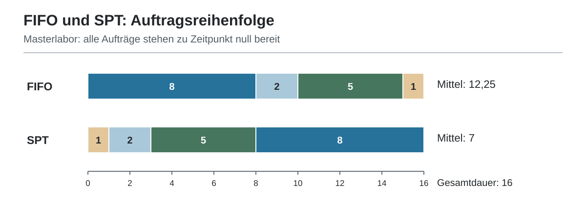

# M22-L2 – Masterprojekt und wissenschaftliche Abschlussarbeit {#L2}

**Kursbereich:** M22 – Projekt und Abschlussarbeit

**Niveau:** Bachelor/Übergang/Master · Praxis/Abschluss

**Vorwissen:** [M22-L1](M22-L1.md)

**Lernziel:** FIFO und SPT in einem reproduzierbaren Modell vergleichen und Grenzen der Übertragbarkeit diskutieren.

## Einstieg und Grundbegriffe {#S1}

Eine wissenschaftliche Abschlussarbeit benötigt eine relevante Fragestellung, nachvollziehbare Forschungslücke, passende Methode, begründete Analyse und eine Diskussion der Grenzen. Ein Masterprojekt sollte über die bloße Implementierung hinaus Erkenntnisse oder belastbares Gestaltungswissen liefern. Evidenz muss zur Forschungsfrage passen; negative Ergebnisse sind ebenso zu dokumentieren wie positive.

## Begriffszusammenhang {#S2}



*Abbildung: FIFO mit Dauern 8,2,5,1 ergibt Fertigstellungszeiten 8,10,15,16 und Mittel 12,25. SPT mit 1,2,5,8 ergibt 1,3,8,16 und Mittel 7. Gesamtdauer jeweils 16.*

## Beispiel und Anwendung {#S3}

Untersuche, ob eine neue Priorisierungsregel die Durchlaufzeit eines Bestellprozesses reduziert, ohne die Fehlerrate zu erhöhen. Vergleiche Ausgangsregel und Alternative in einer kalibrierten Simulation oder einem zulässigen kontrollierten Pilot. Definiere Kennzahlen, Unsicherheiten und Ausschlusskriterien vor der Analyse.

### Vertiefung und Modellgrenzen

Ein wissenschaftliches Projekt benötigt einen prüfbaren Zusammenhang zwischen Fragestellung, Methode, Artefakt, Daten und Evaluation. Akzeptanzkriterien müssen vor der Auswertung definiert werden. Ein erfolgreicher Demonstrator allein belegt keine verallgemeinerbare Verbesserung.

### Labor 2 – Vergleich von Priorisierungsregeln

**Forschungsfrage:** Verringert kürzeste Bearbeitungszeit zuerst (SPT) gegenüber Eingangsreihenfolge (FIFO) die mittlere Fertigstellungszeit in einem vereinfachten Auftragsprozess? Ein Arbeitsplatz verarbeitet alle Aufträge ohne Unterbrechung. Alle Aufträge stehen zum Zeitpunkt null bereit; Bearbeitungszeiten sind bekannt und deterministisch. Diese Annahmen müssen im Bericht ausdrücklich stehen.

Die Fertigstellungszeit eines Auftrags ist die Summe seiner eigenen und aller vorherigen Bearbeitungszeiten. Weil alle Ankunftszeiten null sind, entspricht sie hier der Durchlaufzeit. Die maximale Fertigstellungszeit ist zugleich die Gesamtdauer des Plans. Reihenfolgen können die mittlere Durchlaufzeit ändern, ohne den Arbeitsaufwand zu verändern. SPT sortiert die Aufträge aufsteigend nach Dauer; FIFO verwendet die vorgegebene Reihenfolge. Gleich lange Aufträge behalten in Python ihre Eingangsreihenfolge.

```python
from statistics import mean

def compare(jobs):
    # All jobs available at time zero. IDs in input order; ties stable.
    def score(order):
        elapsed = 0
        completions = []
        for duration in order:
            elapsed += duration
            completions.append(elapsed)
        return {'mean': mean(completions), 'maximum': max(completions), 'makespan': elapsed}
    return score(jobs), score(sorted(jobs))

for durations in ([8, 2, 5, 1], [6, 6, 6], [1, 2, 8]):
    print(durations, compare(durations))
```

| Szenario | FIFO-Mittel | SPT-Mittel | Gesamtdauer |
|---|---:|---:|---:|
| 8, 2, 5, 1 | 12,25 | 7,00 | 16 |
| 6, 6, 6 | 12 | 12 | 18 |
| 1, 2, 8 | 5 | 5 | 11 |

Im ersten Fall lauten die Fertigstellungszeiten 8, 10, 15, 16 beziehungsweise 1, 3, 8, 16. Der Unterschied beträgt 5,25 Zeiteinheiten. Die relative Verringerung ist 5,25/12,25 ≈ 42,86 %. Die anderen Szenarien zeigen, dass eine Verbesserung nicht zwingend eintritt. Das Modell enthält keine Fehlerkosten und keine später eintreffenden Aufträge. Es liefert daher keinen Nachweis, dass SPT in einer realen Organisation sicherer oder generell geeigneter ist.

**Abgabe:** Dokumentiere Modellgrenzen, Eingangsdaten, Baseline, Intervention und Auswertung. Erweitere das Experiment danach um ein explizites Modell für Ankunftszeiten und prüfe, ob lange Aufträge bei laufendem Zugang benachteiligt werden. Definiere vorab eine weitere Zielgröße, etwa den Anteil der Aufträge mit überschrittener zugesagter Frist. Verknüpfe die Auswertung mit [M12-L2](M12-L2.md), [M18-L2](M18-L2.md) und [M21-L3](M21-L3.md).

Die Balken visualisieren Bearbeitungszeiten, nicht individuelle Wartezeiten. Die mittlere Fertigstellungszeit wird aus den kumulierten Endzeitpunkten berechnet. Bei späteren Ankünften, unbekannten Dauern oder unterschiedlichen Prioritäten gelten die dargestellten Annahmen nicht mehr.

Für zwei benachbarte Aufträge mit Dauern a>b verringert ihr Tausch die Summe ihrer Fertigstellungszeiten um a−b; alle späteren Endzeiten bleiben gleich. Wiederholtes Vertauschen solcher Inversionen ergibt die SPT-Reihenfolge. Dies begründet die Optimalität im beschriebenen Modell. Der Beispielcode erwartet eine nichtleere Liste positiver Bearbeitungsdauern.

## Selbstkontrolle {#S4}

### Aufgabe

Welche Einschränkung hat eine positive Wirkung in einer Simulation für eine Aussage über reale Unternehmen?

### Modul-Fallstudie

Plane eine Untersuchung zur Verbesserung des Reservierungsprozesses. Nutze ausschließlich synthetische Aufträge mit dokumentierter Generierung. Formuliere Forschungsfrage, Baseline, Vergleich, mindestens zwei Zielgrößen, Tests und einen Abgabeumfang für ein reproduzierbares Paket.

### Laboraufgabe

Vergleiche FIFO und SPT für die Bearbeitungszeiten 9, 1, 4. Berechne beide Mittelwerte, die relative Verbesserung gegenüber FIFO und die Gesamtdauer. Erkläre, weshalb der Unterschied keine beobachtete Wirkung in einem Unternehmen ist.

::: {.lc-solutions data-lc-section="S4"}
Die Wirkung gilt zunächst für Modell, Daten und Annahmen. Externe Validität erfordert Prüfung in geeigneten realen Kontexten; Verallgemeinerung ist nicht automatisch gerechtfertigt.

**Lösung der Fallstudie:** Beispiel: Verringert eine atomare Reservierung bei gleichem Lastprofil Fehlbuchungen gegenüber einer nichtatomaren Referenz? Baseline und Intervention auf denselben definierten Eingaben vergleichen, Nebenläufigkeit und Fehlerszenarien wiederholt testen, Fehlbuchungsrate und Latenz quantifizieren. Versioniertes Schema, Quellcode, Seeds/Generator, Testdaten, Versuchskonfiguration, Rohresultate, Auswertung und Grenzen liefern. Keine Aussage über reale Unternehmen ohne externe Validierung.


**Laborlösung:** FIFO: (9+10+14)/3=11. SPT: (1+5+14)/3=20/3≈6,67. Relative Verringerung (11−20/3)/11=13/33≈39,39 %. Gesamtdauer jeweils 14. Die Zahlen sind deterministische Resultate eines synthetischen Modells, keine betrieblichen Beobachtungen.
:::

## Weiterführung {#S5}

[M22-L3](M22-L3.md)

## Quellen und Vertiefung {#S6}

- [Universität Mannheim – Master Wirtschaftsinformatik](https://www.wim.uni-mannheim.de/studium/im-studium/master-wirtschaftsinformatik/) · Studienstruktur; Forschungsseminare und Abschlussarbeit, curricularer Kontext · Zuletzt abgerufen: 2026-11-25
- [Universität Bonn – Scheduling, Single machine models](https://www.or.uni-bonn.de/lectures/ss10/scheduling_data/sched10_2.pdf) · SPT-Optimalität für die Summe ungewichteter Fertigstellungszeiten; Folie 4, Beweis nur angekündigt · Zuletzt abgerufen: 2026-11-25
