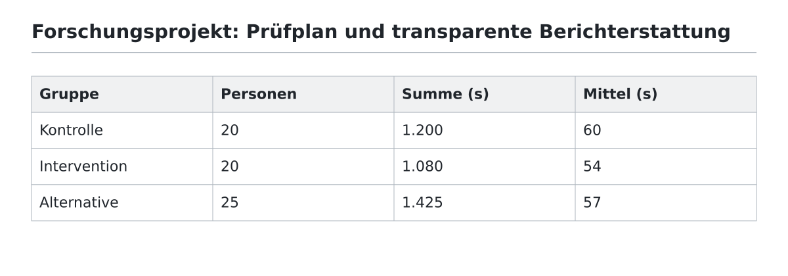

# M22-L3 – Forschungsprojekt: Prüfplan und transparente Berichterstattung {#L3}

**Kursbereich:** M22 – Projekt und Abschlussarbeit

**Niveau:** Bachelor/Übergang/Master · Praxis/Abschluss

**Vorwissen:** [M22-L2](M22-L2.md)

**Lernziel:** Ein Forschungsprotokoll erstellen, Ergebnisunterschiede berechnen und Unsicherheit transparent berichten.

## Einstieg und Grundbegriffe {#S1}

Eine Abschlussarbeit muss Forschungsfrage, Theoriebezug, Methode und empirische Aussage aufeinander abstimmen. Ein vorab dokumentierter Analyseplan reduziert die Gefahr, nach Kenntnis der Ergebnisse die ursprünglich geplante Hauptanalyse unbemerkt auszutauschen. Registered Reports gehen über eine bloße Präregistrierung hinaus: Die Methode wird vor Kenntnis der Ergebnisse begutachtet und ein geeignetes Protokoll kann eine bedingte Publikationszusage erhalten. Eine selbst erstellte Abschlussarbeit ist dadurch noch kein Registered Report.

Ein Prüfplan definiert primären Endpunkt, Vergleichsgruppen, Stichprobenstrategie, Ausschlussregeln, Umgang mit fehlenden Werten und Auswertung. Explorative Fragen dürfen weiterhin untersucht werden, müssen aber klar von vorab festgelegten Tests getrennt bleiben. Für eine reproduzierbare IT-Auswertung gehören auch Datenwörterbuch, Softwareversionen, Eingabedateien, Zufallsstartwerte und eine Ausführungsanleitung zum Nachweis. Personenbezogene Rohdaten dürfen nicht allein im Interesse der Reproduzierbarkeit veröffentlicht werden; gegebenenfalls sind synthetische Beispieldaten oder kontrollierter Zugriff vorzusehen.

## Begriffszusammenhang {#S2}

*Abbildung: Primärer Endpunkt: mittlere Bearbeitungszeit im Gruppenvergleich. Eigenes Modellbeispiel.*

## Beispiel und Anwendung {#S3}

Eine Masterarbeit untersucht eine neue Bedienoberfläche. Primär soll die durchschnittliche Bearbeitungszeit pro zugeteilter Testperson verglichen werden. Der Plan spezifiziert identische Aufgaben, randomisierte Gruppenzuweisung und einen zweiseitigen Test. Nach Datenerhebung ergeben sich in der Kontrollgruppe bei 20 Personen insgesamt 1.200 Sekunden, in der Interventionsgruppe bei 20 Personen 1.080 Sekunden. Die Mittelwerte sind 60 und 54 Sekunden; die Differenz beträgt −6 Sekunden, relativ −10 %. Ohne Streuungsdaten kann kein Standardfehler der Differenz berechnet werden.

Eine später betrachtete Untergruppe zeigt eine größere Differenz. Diese Beobachtung wird als explorativ gekennzeichnet, nicht als nachträglicher primärer Endpunkt. Der Abschlussbericht enthält auch die Ergebnisse der ursprünglichen Analyse und dokumentiert Ausfälle und Protokollabweichungen. Eine neue Studie kann die Untergruppenhypothese gezielt prüfen.

### Labor 3 – Reproduzierbarer Projektbericht und Bewertung

Die beiden vorangehenden Labore bilden einen gemeinsamen Modellfall: Reservierungen verhindern Überbuchung; die Reihenfolge der anschließenden Auftragsbearbeitung beeinflusst Durchlaufzeiten. Die Verbindung ist konzeptionell, kein bereits integriertes Produktionssystem. Definiere für die Abschlussarbeit die Systemgrenze und unterscheide Funktionsnachweise von Wirksamkeitsnachweisen.

**Prüfmatrix:** Lege für jeden Anspruch eine identifizierbare Anforderung, eine Prüfmethode, eine Sollgröße und einen Befund an. Ein Beispiel ist R1: keine negative Restmenge; Test T1: zwei konkurrierende Anfragen zu sieben Stück aus zehn; Soll: genau eine erfolgreich und Rest drei. R2: kürzere mittlere Durchlaufzeit im Szenario 8,2,5,1; T2: identische Daten in beiden Regeln; Soll: Mittelwert der SPT-Regel 7,00 statt 12,25. R3: reproduzierbare Ergebnisse; T3: saubere Neuinstallation mit dokumentierter Python-/SQLite-Version und identischer Eingabe; Soll: gleiche deterministische Werte. Ein nicht ausgeführter Test ist offen, nicht bestanden.

**Bewertungsraster für Selbststudium (100 Punkte, keine Hochschulnote):** Problem und Anforderungen 15, Daten- und Prozessmodell 20, Implementierung 20, Qualität der Tests 20, Auswertung und Grenzen 15, Reproduzierbarkeit und Dokumentation 10. Für jede Kategorie werden null, die Hälfte oder alle Punkte vergeben: kein prüfbarer Nachweis, teilweise erfüllte Kriterien oder vollständiger nachvollziehbarer Nachweis. Ein nicht bestandener Bestandsintegritätstest bleibt ein kritischer Mangel unabhängig von der Punktsumme. Für einen Masteranspruch sind eine begründete Forschungslücke, systematisch gewählte Vergleichsmethode und belastbare Gültigkeitsdiskussion zusätzlich erforderlich.

**Reproduktionspaket:** Schreibe eine README mit Umgebung, Ausführung und erwarteter Ausgabe; lege synthetische Eingaben, Skripte, Testprotokolle, Auswertung und bekannte Einschränkungen ab. Halte Fehler und negative Befunde fest. Notiere, welche Aussagen nur Modellresultate sind und welche empirischen Daten zur Überprüfung fehlen. Bei menschlichen Versuchspersonen oder Betriebsdaten wären gesonderte Einwilligungs-, Rechts- und Datenschutzfragen zu klären; dieses Labor verwendet keine solchen Daten.

Bei der Bewertung sind Punkteraster und Freigabekriterien getrennt: Der Schwellenwert für Bestandsintegrität ist eine harte Anforderung. Ein reproduziertes Ergebnis kann trotzdem methodisch ungeeignet sein; Reproduzierbarkeit ist nicht gleich Validität. Ein Vergleich der Gruppenmittel erfordert außerdem dokumentierte Beobachtungseinheiten und den Umgang mit fehlenden Werten.

## Selbstkontrolle {#S4}

### Aufgabe

Eine Intervention mit 25 Personen hat insgesamt 1.425 Sekunden bei gleicher Kontrollgruppe. Berechne die Differenz und die relative Änderung. Darf daraus allein statistische Signifikanz abgeleitet werden?

### Laboraufgabe

Bewerte einen hypothetischen Bericht: Anforderungen vollständig, Modelle teilweise, Implementierung vollständig, Tests teilweise, Auswertung vollständig, Reproduktion ohne prüfbaren Nachweis. Ein Test meldet negativen Bestand. Berechne die Punkte und formuliere den Freigabebefund.

::: {.lc-solutions data-lc-section="S4"}
1.425/25=57 Sekunden; Differenz −3 Sekunden; relativ −5 %. Nein, es fehlen mindestens Streuungsdaten und Angaben zur tatsächlichen Auswertung und zu den Modellannahmen.

**Laborlösung:** 15+10+20+10+15+0=70 Punkte. Keine Freigabe des Reservierungsprototyps: Der Integritätsmangel ist kritisch, auch bei 70 Punkten. Der fehlende Reproduktionsnachweis bleibt eine zusätzliche offene Aufgabe.
:::

## Weiterführung {#S5}

[Studienweg](pages/studienweg.md)

## Quellen und Vertiefung {#S6}

- [Center for Open Science – Registered Reports](https://www.cos.io/initiatives/registered-reports) · Methodischer Fachbeleg; relevante Passage im Web eingesehen. Zuletzt abgerufen: 2026-11-25.
